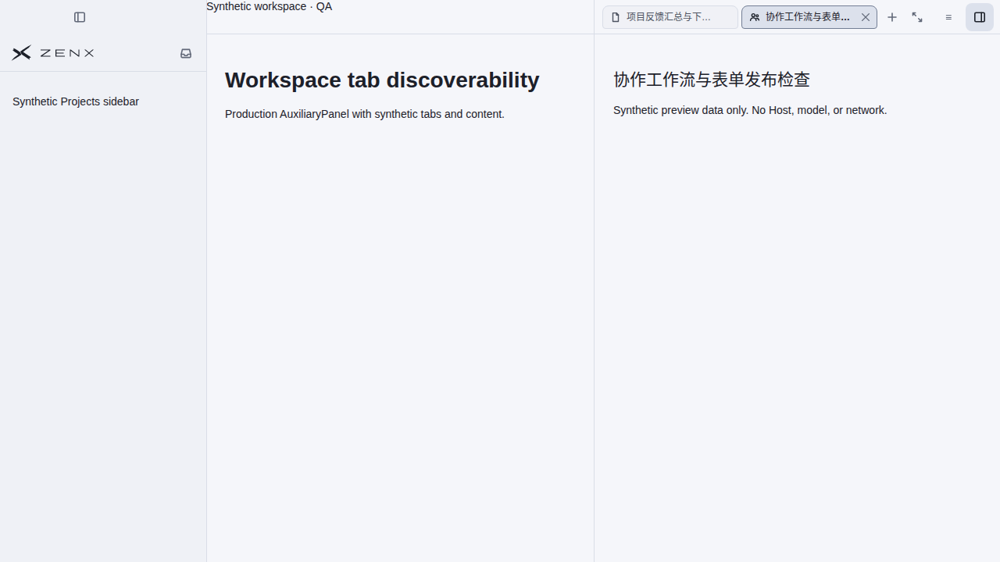
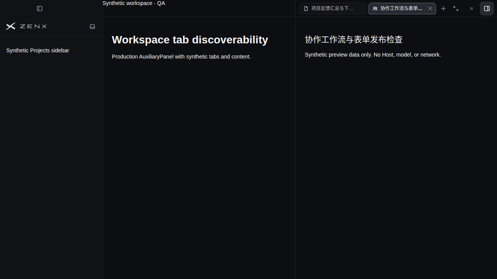

# Workspace tab discoverability

Real Chromium renderer captures from [run 42021766604](https://github.com/albert-zen/zen/actions/runs/42021766604), PR head `59c6c8c1a3e56115ad5c34d5936a678904aba1a0`, merge-ref `36d9d7c308046244caeb605f64f0c718918f5973`.

These use the production AuxiliaryPanel and stylesheet, synthetic Chinese tab titles/content, and a synthetic information-control layout placeholder. No real Host, profile, model or external network is involved. They verify renderer/platform CSS, not native OS windows. All four two-tab layout cases completed their assertions; the later many-tab navigation was interrupted by a capture-script body-read timing error, subsequently fixed without changing product code.

The revised design removes overflow buttons entirely. Tab widths still shrink as more tabs open, then retain the existing clipped, horizontally scrollable rail. The two embedded normal-width screenshots remain representative because neither displayed overflow controls. New capture runs verify the revised narrow/many-tab behavior without additional indicators.
