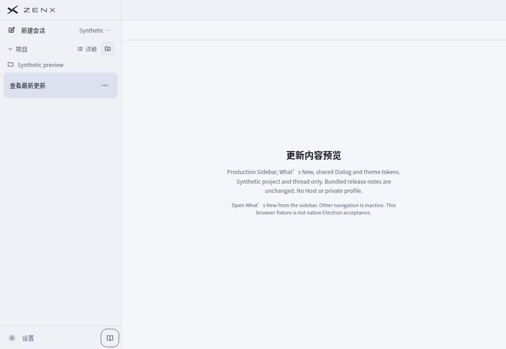
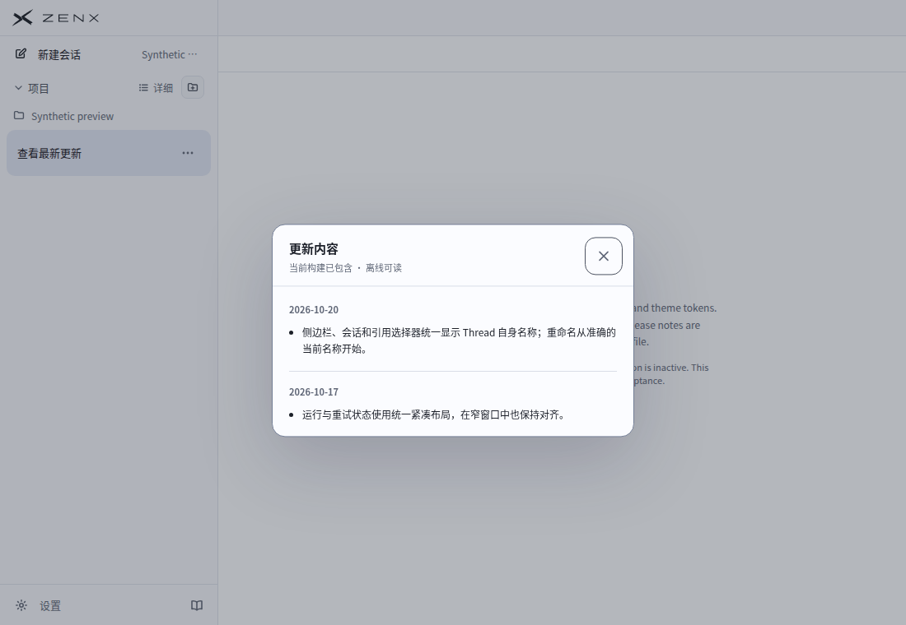
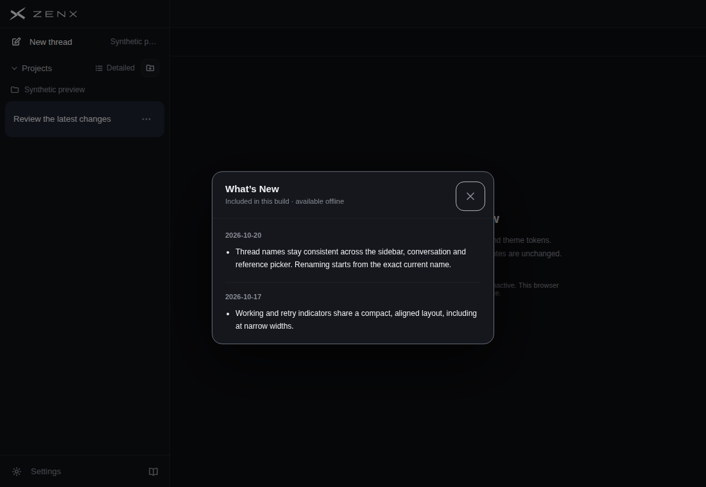
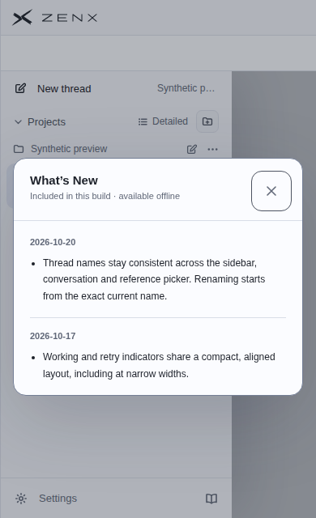
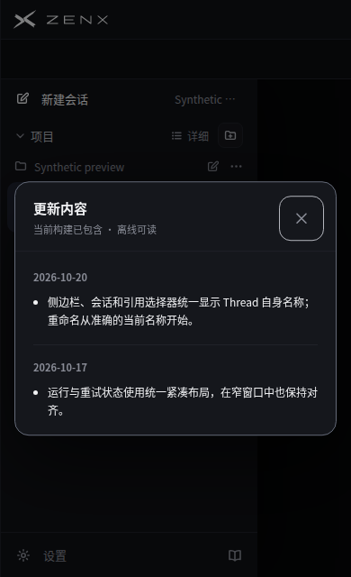
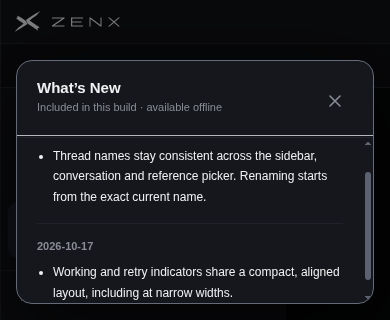

# What's New footer acceptance

Captured by [CI run 39454698708](https://github.com/albert-zen/zen/actions/runs/39454698708) for PR 455 at head `021ae804726cbd4472330f4ef0566ebe20eb228a`. GitHub checked out the PR merge commit `2cd179b2861268505d4bbcffb0ec9bd9bf6cbcd9`; all ten recorded production/preview source hashes were independently verified against the PR head. This evidence-only update does not change those sources.

## Result

- One footer row, unchanged 50px height. Settings and the 34px notes icon are sibling buttons; the icon sits at the right, with no service-status dot or standalone notes row.
- Localized tooltip and accessible name: What's New / 更新内容.
- Five browser cases passed: desktop EN dark, narrow EN light, short EN dark, desktop ZH light, and narrow ZH dark.
- Keyboard opening, forward/backward focus containment, Escape, outside click, close button, focus restoration, repeated opening, and closed-after-reload passed. Short-height content scrolls without moving the close control out of view.
- No renderer exceptions or external requests. Chinese captures have verified CJK font support. The browser sandbox remained enabled.
- All eight CI jobs passed, including the ZenX aggregate and Core/CLI/IMZen checks.

## Evidence boundaries

These are actual production Sidebar, What's New, shared Dialog, release notes, translations, branding and theme/styles rendered in Chrome. One Project, one idle Thread, ready service status and the main content scaffold are synthetic. There is no live Host, private profile, account, credential or real user content.

The scaffold holds Sidebar open, so this is not an end-to-end App or native Electron acceptance. App-wide Escape integration is covered by its source contract test, not by these browser screenshots. Browser keyboard/pointer emulation is not physical OS input.

`source.json` records exact source hashes. `measurements.json` contains all executed assertions and geometry. `head-verification.json` records the independent head comparison. The full artifact, including the self-contained offline `whats-new.html`, remains available from the linked CI run.

## Reviewed screenshots

### Chinese footer, no extra row

### Chinese dialog, light desktop

### English dialog, dark desktop

### Narrow English, light

### Narrow Chinese, dark

### Short viewport after keyboard scrolling

