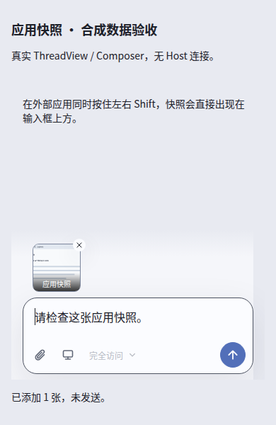
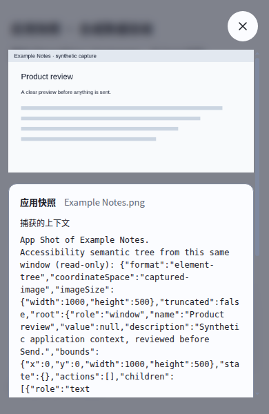

# App Shot Composer evidence

These are real production ThreadView, Composer, AttachmentImage and Dialog components
rendered by Chromium at a 390 × 600 viewport. Every application identity, image,
context and API response in this fixture is synthetic. No user data is present.
They do not test OS capture, physical keys, native permissions or model delivery.

- [Source run 42208100249](https://github.com/albert-zen/zen/actions/runs/42208100249)
- [Renderer artifact 13498166083](https://github.com/albert-zen/zen/actions/runs/42208100249/artifacts/13498166083)
- Verified artifact ZIP SHA256: `758c370dd32265ca468afd23e2583f1d8cbe1ff919bd28b0a7036941ebb3ca8c`
- PR source head: `634980ae607e4e029a0e5b5c4e12b235a407c6a6`
- Actual checked-out test merge: `93b0c845a2b1311bec22b48462b187640bcebf2f`
- Actual test tree: `65ed28f769c843c3f196d5cf5f9037a9ec6dbdbd`
- The test merge also includes main `fe1c1bcca93f83129490228fdde8891389bbd815`.
  Its four additional browser implementation/test files do not change App Shot's
  capture, Composer, UI fixture or native acceptance inputs. It is not an identical
  full tree to the PR head.
- Harness: `apps/zenx/scripts/capture-app-shot-preview.mjs`.
- Passed: 20 cases / 121 states, with no viewport overflow or pending finite motion.
  The isolated disposable Chromium fixture runs with its browser sandbox disabled;
  this is not a change to the shipped Electron application's sandbox policy.

## Direct draft attachment

Successful synthetic shortcut delivery adds one local draft image, without opening
an App Shot review dialog and without sending. The normal Composer remains visible.

Original artifact filename: `composer-darwin-light-390-pixels-direct-draft.png`.
PNG SHA256: `9a9537b52654ca5bfece9b279a30ab305d9495bf6720f449cffe227d7cf28529`.

## Details only after clicking

Clicking an attachment opens its stored App Shot context. This screenshot shows a
separate semantic-context case, not the pixels-only attachment in the first image.
Long exact context remains scrollable. Closing the dialog does not send the draft.

Original artifact filename: `composer-darwin-light-390-semantic-details.png`.
PNG SHA256: `7b71bf2032ac82351080a59fe8cde073657d076cb0d0d7a51ed8881d08ba2225`.

## Separate owned macOS evidence

[Owned native artifact 13497431767](https://github.com/albert-zen/zen/actions/runs/42208100249/artifacts/13497431767)
contains independently verified selected-window, accessibility and foreground
captures of a directly owned 640 × 320 nonce fixture. All three checks and cleanup
passed. It changed no OS permissions and requested one nonce-bound activation of
that fixture itself. This establishes that production capture path for the owned
fixture, not physical both-Shift delivery, arbitrary applications, Windows DPI or
Linux compositor acceptance. No native screenshot is reproduced as renderer proof.
