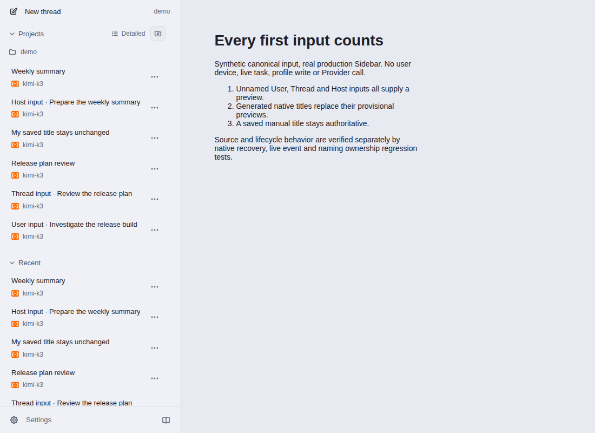
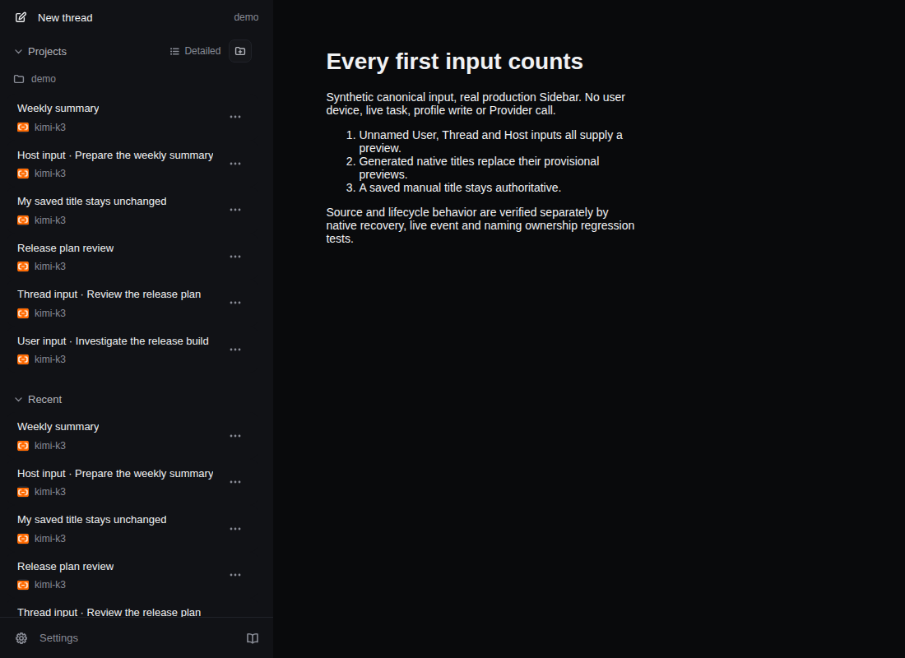

# Canonical first-input Sidebar visual evidence

These are unmodified screenshots from [hosted run 41423228521](https://github.com/albert-zen/zen/actions/runs/41423228521), artifact `13131006538`.

## Scope

Actual production Sidebar components with wholly synthetic canonical User, Thread and Host input. Generated/manual names are seeded presentation states, not a title-model call. This is component visual verification, **not complete-App first-input E2E acceptance**. No private journal, Trace, user profile or user device was used. Real manager, native protocol and naming-ownership regressions are documented separately in [PR #623](https://github.com/albert-zen/zen/pull/623).

The Project section visibly contains all six synthetic states: three unnamed input previews, two generated names and one saved manual name. Recent intentionally repeats the same underlying Threads; lower Recent rows are in a scrollable area and this image does not prove visibility of every Recent row.

## Source identity

- Product PR head: `fb2354260f8aeeeb0f786299278b56213818b9ab`
- Captured GitHub test-merge commit: `ec48a6e825a4d8cf9b5c70870e7c98a43be63416`
- Both have tree: `d802f9bd5ecebbc5541b714805d476af44d1d9f9`
- All eight source-file hashes in the downloaded capture manifest matched the reviewed source.
- Artifact ZIP SHA-256: `35b7446543d6721c945abba7f07aff8bdd5d71712f44a41224762b3f3fbd61cf`
- Capture passed; the owned browser exited and its temporary profile was cleaned up.

## Light

Computed appearance/color-scheme: `light`; canvas: `#e8eaf1`.
PNG SHA-256: `05cb36b825e87c11d79a086ad9b85f1c9905fddd63b3ea0b31d3b37049f8ebf8`.

## Dark

Computed appearance/color-scheme: `dark`; canvas: `#090a0c`.
PNG SHA-256: `5c13b665d74f9b4391e58fb89e0eb84656299192afef174b412da3abbb940088`.

