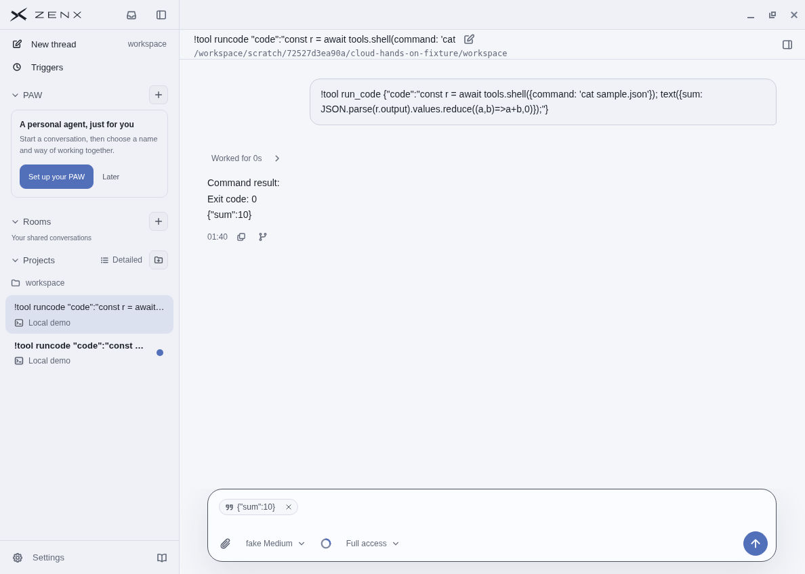
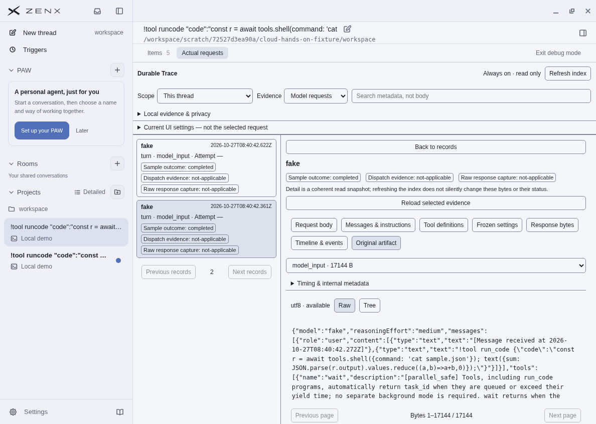

# Fresh-Thread native provenance acceptance

All content shown here is synthetic. The app ran on the assistant-owned cloud
Linux/Xfce desktop, not the user's computer, through ordinary Electron input.
These are actual production-compiled Electron windows backed by the real local
Host, run_code Worker, and nested shell—not renderer stubs or a browser preview.
The local Fake provider made no upstream/paid API requests.

## Captured version

- PR #547 source: `a81adfd86ed41c10be8a5a6b9a7b298037ad527a`.
- Exact source tree: `161c244e3aba6e337de97e0b487445ed6c3e32ed`.
- Build: `npm run build --workspace @zen/zenx`, including first-party plugins.
- Main bundle SHA256: `f1aeb8d36998e970c22c488cfbe29136d54a3e6dc9dc1133a3276a0cddc56185`.
- Renderer bundle SHA256: `698c397c9137db9ef704bd0b73b06b88e9f95abe103cc179bebc1e7591b212f7`.
- Ordinary synthetic profile, workspace and security settings were retained.
  No sandbox bypass, hidden renderer/IPC mutation, or remote-debug injection.

## Actual operation results

1. Created a fresh Thread and submitted the synthetic run_code command that read
   `sample.json` through nested `tools.shell` and returned `{"sum":10}`.
2. Selected the first completed assistant reply: Copy/Quote appeared. Alt+Enter
   inserted the compact exact quote token. No send, turn expansion, or body jump.
3. The quote plus long draft grew beyond the normal composer height. Ctrl+A and
   Backspace restored normal composer height; no turn was sent by this editing.
4. Debug opened on the same fresh Thread. Items showed five exact semantic Items,
   including tool input, tool result and assistant output. Actual requests showed
   two `model_input` records. The selected Original artifact contained 17,144
   bytes, including the real user content and received timestamp.
5. HTTP request-body capture stayed honestly unavailable/not applicable: this
   local Fake model had no HTTP transport. Model input is not claimed as HTTP.

## Screenshot integrity

| File              | SHA256                                                             |
| ----------------- | ------------------------------------------------------------------ |
| `pr547-quote.jpg` | `864f702176778c9771a92b4754e2741cdf787fcdb98205a292998970ecdc04b4` |
| `pr547-debug.jpg` | `4d907ae5989d52a5c6dcbdce86def2e5a6741cd0e22d9e33e49a437fb2dbfeb4` |

The screenshots were inspected before publication and contain only this synthetic
fixture. No raw journals, Trace artifacts, credentials, user profile, or user-PC
data are published. The screenshot of the Debug pane is a synthetic UI capture,
not an exported log bundle.

## Automated coverage and integration boundary

Full-App tests cover initial native bootstrap, failed bootstrap retry on the same
Thread, overlap across compatibility completion, stale epoch, covered watermark,
stream-only and cross-thread rejection. A separate actual source Host test runs
run_code/nested shell and the production Quote/Fork/Debug projection before and
after compaction and Host restart. Those tests are not substitutes for the native
GUI observations above.

After capture, accepted provider-storage PR #546 (`c628b976`) was merged cleanly
into this branch. No conflict resolution or Quote/Fork/Debug code change was
needed; both independent architecture statements were preserved. The screenshots
identify their exact pre-integration source rather than claiming a new capture.
Final integrated-head CI is required before merge.

Linux Quit was not validated: the prior owned synthetic app was closed through
its launching terminal with Ctrl+C because no Quit menu was available. This is
not presented as normal Quit acceptance. Native pointer targeting and the
separate spool-file link investigation are outside this fix.
