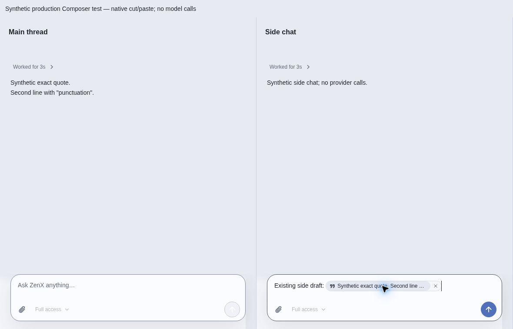
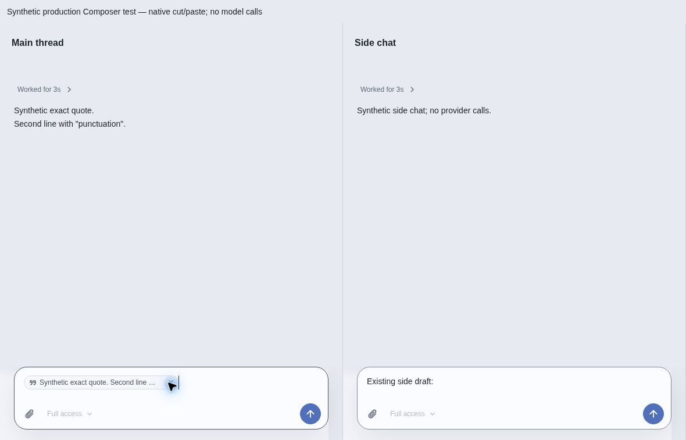
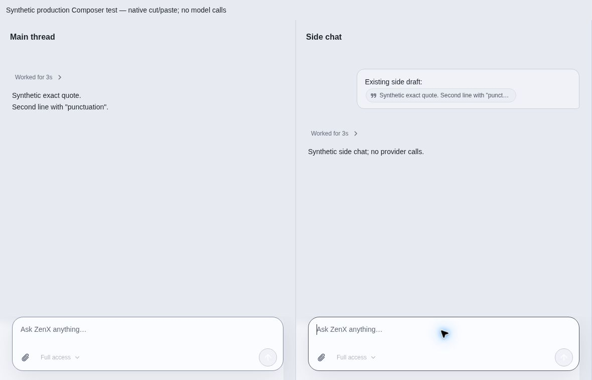
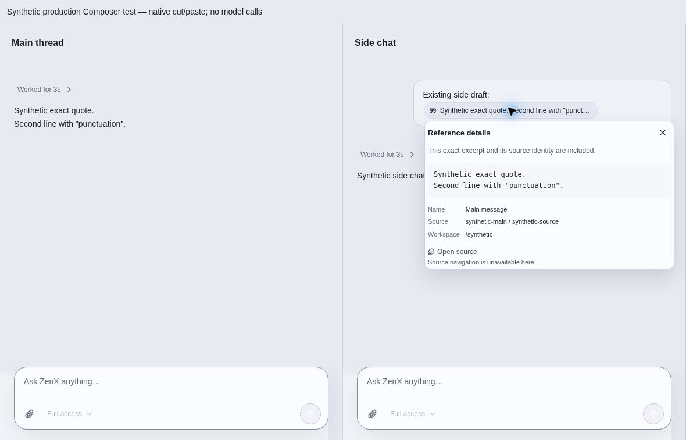

# Quote clipboard regression — synthetic acceptance

All names, messages and identities in these captures are synthetic. No user screenshot,
conversation, Trace or personal configuration is included. Production `ThreadView` and
`InlineComposerEditor` run in two independent fixture panes. Explicit Send only appends a
synthetic native event; no provider calls occur in this browser fixture.

Build with `node apps/zenx/scripts/build-quote-preview.mjs /tmp/quote-preview` and serve
`quote-frame.html?clipboard&lang=en` over loopback HTTP. Source production checkpoint:
`5170decff3c5ef349b7e08f36af5cd312f9e26a0`; fixture: `test/fixtures/quote-clipboard-visual.tsx`.
Captured inline HTML SHA256: `10dc647452e3bc7ac0f4cbd75bccf997638719e75931222026b4d56efee6bea9`.

Native cloud Chromium acceptance, 2026-10-30:

1. Main composer: select capsule using Ctrl+A, Ctrl+X. Main draft clears.
2. Side composer: place caret after existing draft, Ctrl+V. Existing prose remains,
   capsule appears and focus/caret stays in destination. No message sent.
3. Shift+Left selects the atomic capsule, Ctrl+X; paste back into main. Both directions
   preserve capsule presentation. Side's unrelated prose remains.
4. Repeat main-to-side and explicitly press Enter. Sent bubble shows the capsule,
   not UUID transport text; expanded detail shows exact real line breaks and identity.

The minimal clipboard fixture does not install App-owned source navigation, so its
expanded view truthfully says source navigation is unavailable. This is not a source-
navigation acceptance claim. The real DOM source-action test verifies exact cross-thread
`{kind: "thread", id: sourceThreadId, itemId}` routing and current-owner guards; the main
App integration/combined side-chat fixture must verify destination navigation separately.
Model tests compare actual Chat Completions and Responses adapter request bytes, exact
selected excerpts, compact `sN` provenance, restart and fork isolation without paid calls.
