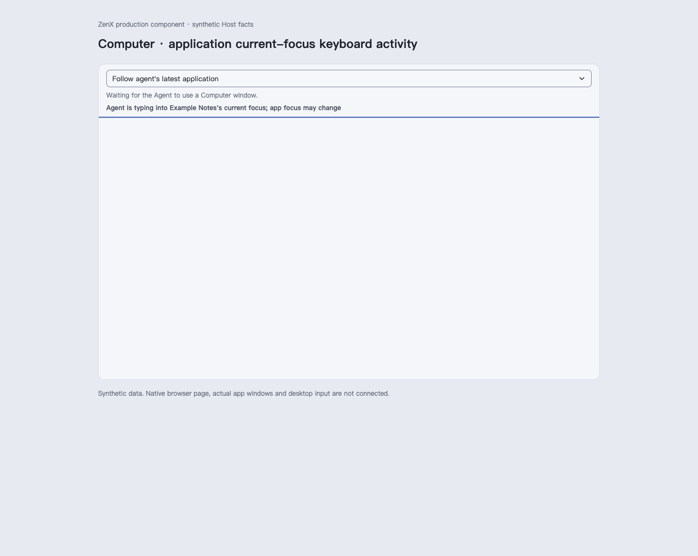
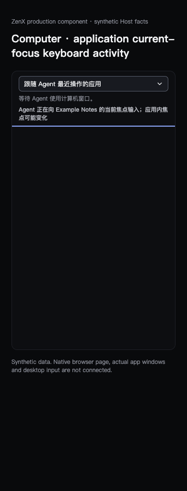
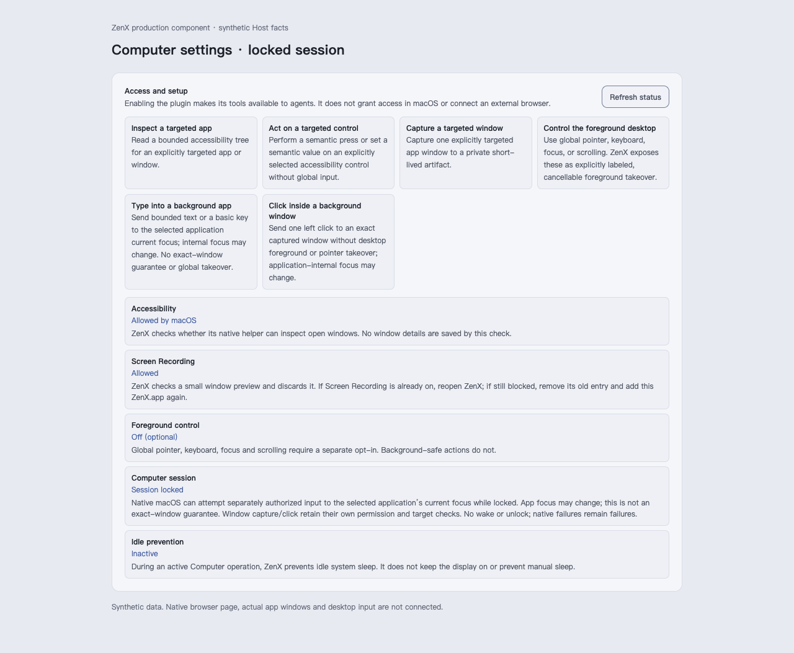
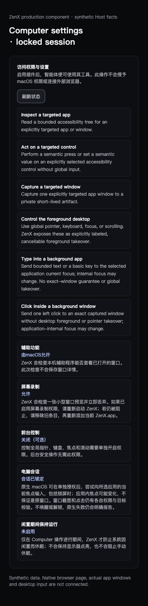

# Application-current-focus keyboard UI

Real production ComputerThreadPanel and PluginAccessReview, rendered at source `3c0f53effba5935f7836e9d2d248997c28ca5f0c`. SOURCE.json records the bundled source hashes and eight desktop/narrow, light/dark English/Chinese captures. All were visually checked; the permission review is fully visible and the app activity has no window image or action pointer.

Host data is synthetic: an Example Notes application activity and a locked native macOS readiness snapshot with existing permissions. No native window, input, real profile or OS permission is connected to this renderer fixture. These images verify the displayed scope and independent app permission, not actual keyboard effect or locked execution.

The app keyboard activity names the application current focus and allows internal focus changes. It does not claim the original window or control. The source after independent R2 differs only in fixture CSS that lets this permission preview grow to its full height; production behavior is unchanged.

