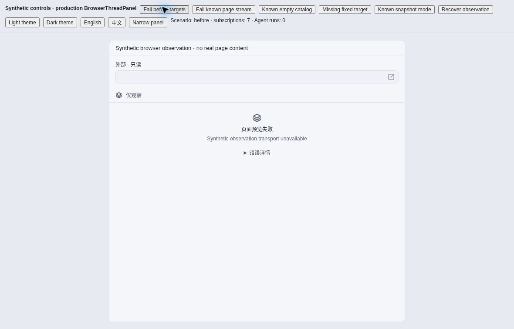
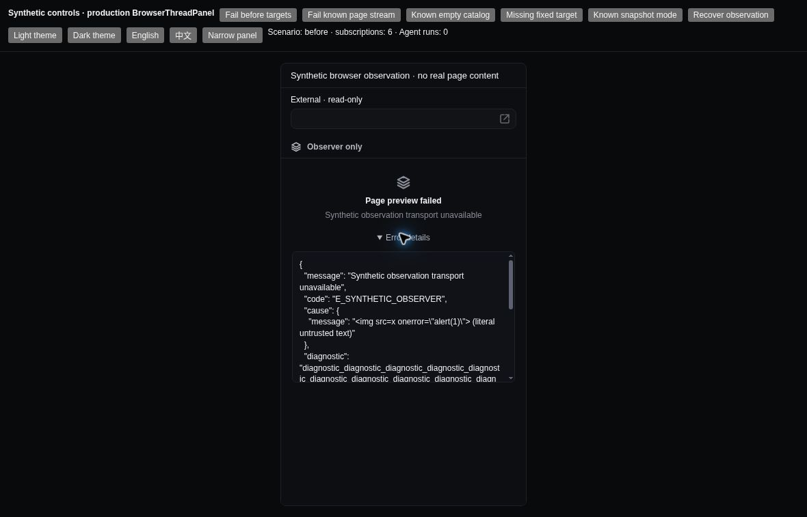
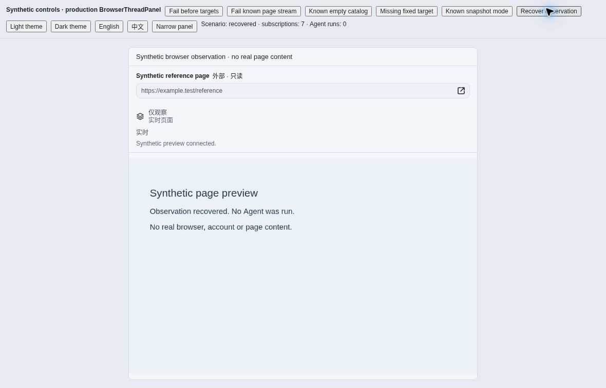

# Browser observation — synthetic acceptance

Accepted source: `f0d08ed4edd8995071585bfc4dd4daeafa36aeb7` · 2026-10-29.

These screenshots show the production `BrowserThreadPanel`, styles and translations in the repository's synthetic browser fixture. Target metadata, errors and canvas frames are synthetic. The fixture does not connect to a browser, Host, account, provider or model. Its in-flow wrapper keeps the visible test controls above the production pane; it is not the full Electron workspace.

## Screenshots

All three images were inspected and copied without modification. Each is 1180 × 757 pixels; the narrow screenshot contains a 360 CSS-pixel panel within that viewport.

### Failure before target metadata · light / Chinese

One failure heading and the actual error reason appear, with collapsed details. There is no false empty-page message, inferred snapshot mode or privacy boilerplate.



### Original error details · dark / English / narrow panel

The original structured error and nested cause remain literal text, including the synthetic HTML-shaped payload. The disclosure scrolls locally. Browser inspection recorded `clientWidth === scrollWidth === 314` for the details body.



### Recovered frame · light / Chinese

An explicit fixture control emits a fresh status/frame; the previous failure disappears and known target metadata returns. This is synthetic event delivery, not an automatic retry or recovery mechanism.



## Observed interactions

Acceptance used the fixture's visible controls, not hidden state changes:

- Failure before targets remains distinct from a confirmed empty catalog and a missing fixed target.
- A known-page stream failure retains its title and URL and removes the old frame.
- Expanding error details and explicitly emitting recovery do not increase the subscription counter; complete details remain escaped. The fixture has no model-dispatch API.
- Known snapshot mode alone shows the temporary-artifact note. Unknown mode does not imply snapshots.
- Light/dark themes, English/Chinese labels and the narrow panel remain usable; expanded narrow details stay within their container.

## Separate source and backend checks

The browser fixture does **not** exercise the native connection. Separate synthetic backend tests use an actual `BrowserBackendRegistry`-produced 120-character connected target through catalog and fixed live IPC. They verify cross-Thread and stale-generation rejection, bounded opaque IDs without parsing/normalization, and unchanged external-open authority.

The existing full `localErrorDetail` helper is unchanged from accepted base `df003fc5`; caught error evidence crosses only local observation IPC, retaining existing authentication-header handling and visible diagnostic limits. The auxiliary Follow Agent policy is unchanged. Disclosure or failure does not introduce automatic retry, tool replay or model dispatch.

The following focused command was verified at the accepted source with repository dependencies available: **30 tests passed**. Run from the repository root:

```sh
node --import tsx --test \
  apps/zenx/test/browser-live-observation-ipc.test.ts \
  apps/zenx/test/browser-observation-error.test.ts \
  apps/zenx/test/browser-observation-failure-ui.test.ts \
  apps/zenx/test/browser-presentation.test.ts \
  apps/zenx/test/i18n.test.ts \
  apps/zenx/test/browser-observation-fixture-layout.test.mjs
```

The visual entry point is [`browser-observation-failure-visual.html`](../../../test/fixtures/browser-observation-failure-visual.html); its adjacent TSX imports the production component and provides the labeled controls above.

## Provenance and limits

- [`source.json`](source.json) is the unchanged build manifest: the exact source commit, 47 source-file SHA-256 values and three compiled artifact hashes. All hashes were checked against that commit and the rendered artifacts. Compiled bundles are deliberately not included here.
- [`SHA256SUMS`](SHA256SUMS) covers this README, the original manifest and the three images. From this directory, run `sha256sum -c SHA256SUMS` to verify the archive.
- This is source-bound synthetic browser acceptance, not native Electron/Chrome/Edge, installed-extension, OS-input or real-account acceptance. It does not prove the cause of any private installed-user incident.
- No private incident screenshot, personal configuration, credentials, real page content or diagnostic logs are included. Focused checks do not claim a complete CI pass.
