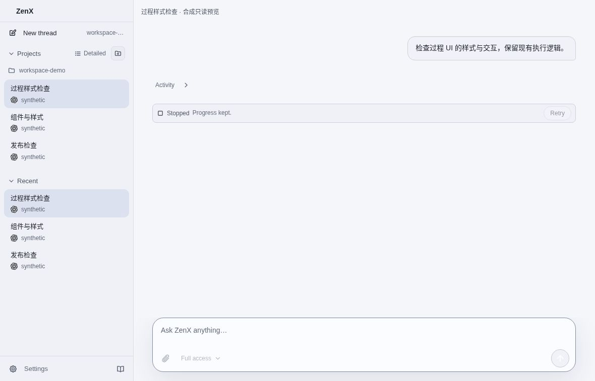
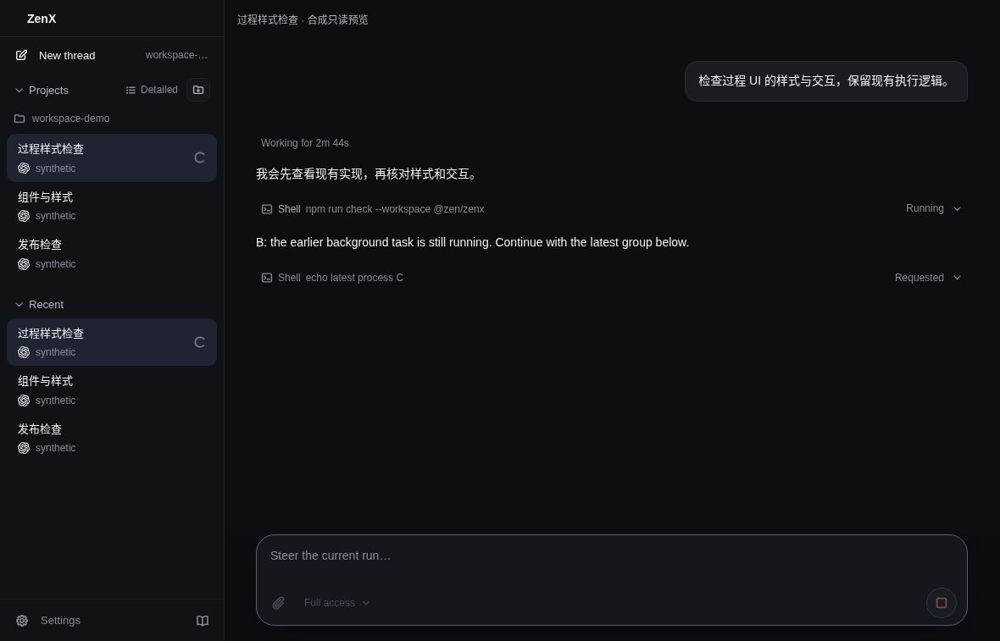
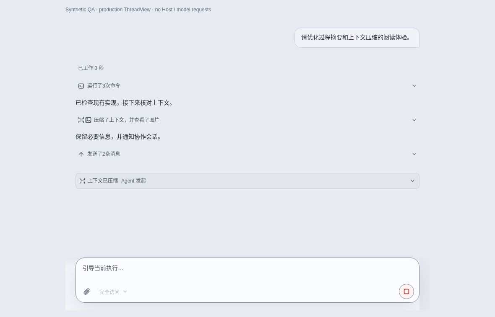
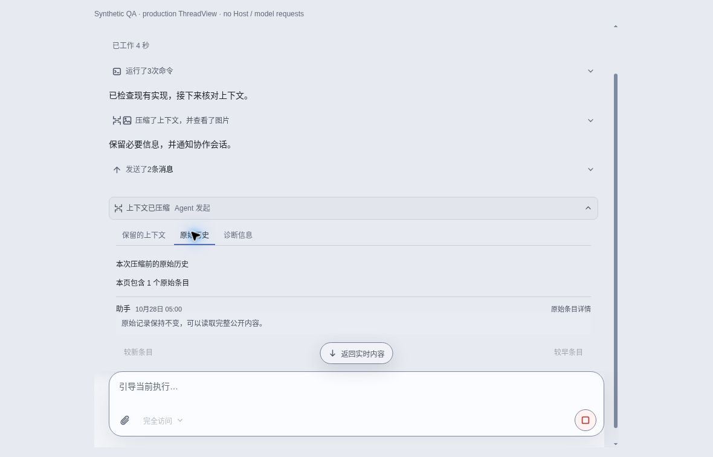
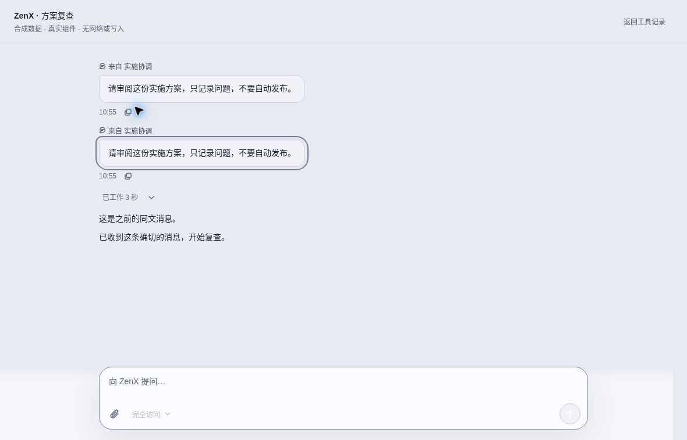
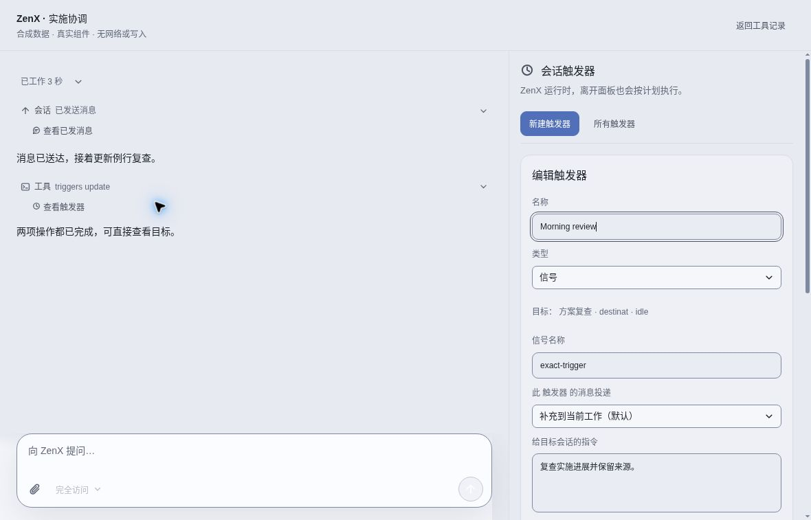
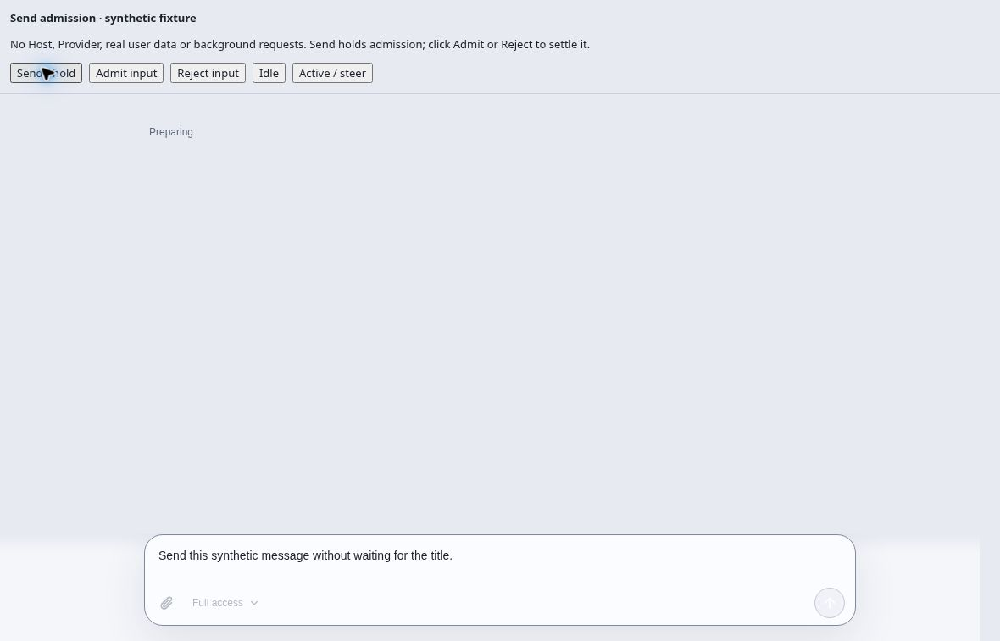
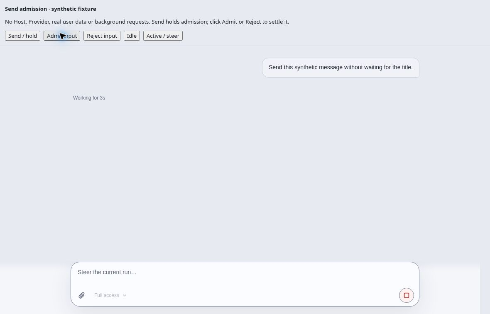

# Chat interaction acceptance

Source: `898de81093a2c3ecd899a6ebd004c79c603b8eb7`. SOURCE.json binds source, compiled fixtures and screenshot hashes. These eight captures show actual production components with synthetic inputs in cloud Chromium. They are not native user-machine acceptance. No original user screenshots, credentials, real conversation, private Trace or logs are included.

Verified by actual browser input: interrupted history expand/collapse; only latest requested process owns sweep while older running labels remain truthful; semantic Chinese summaries; one compaction disclosure with peer views and original-history reads; exact focus on the correct one of two identical messages; exact trigger prompt; preparing-before-admission and bubble/elapsed/draft transition after admission. Failed admission retained draft in the same production-component fixture. Existing App and Host integration tests cover the real boundary separately.

## Visible outcomes

## Checks and limits

277 affected UI tests and 103 Core tests passed, together with Core/ZenX builds and Node/web typechecks. The final debugger fixture correction passed the specialized production-reader command 54/54. Independent final follow-up review passed 20 focused tests and found no remaining blocker. Bounded assertions, the prototype-key action lookup issue, complete synthetic trigger metadata, and interrupted-history disclosure expectations were corrected rather than skipped.

The source send branch full sweep was not all-green locally: 4577 passed, 15 failed, 49 skipped. Five npm cache prerequisite failures subsequently passed; two empty-turn duration fixtures were corrected and their suite passed; the exact-version Electron prerequisite was restored and smoke tests passed. Seven environment failures remained (three private UDS policy tests, four unavailable Linux node-pty binary tests). Hosted full CI is a separate required gate.

Synthetic 200ms title hold: dispatch 223/216/260ms before versus 2/1/14ms after for idle/steer/new-thread. Long-history exact append receipts remove two redundant Trace scans and semantic rereads without new retained state. These are controlled dispatch/IO measurements, not physical frame latency guarantees.

## Aggregate runner follow-up

CI40741597061 attempts 1 and 2 on unchanged head5e73d7aa lost their runner during the aggregate, with no TAP assertion failures emitted. Seven other jobs and all specialized workflows passed. A separate controlled local run reproduced heap exhaustion in the old execution-process-style test: its returned-wait expectation contradicted the newly accepted latest-process sweep rule, and direct DOM assertion diagnostics attempted to inspect the React Fiber graph. Bounded diagnostics exposed that exact mismatch.

The test-only follow-up aligns ongoing/terminal Turn expectations, bounds all 13 DOM comparisons in that file, and extends the existing regression guard. Production, concurrency, deadlines, reporters, test discovery and dependencies are unchanged. The corrected file plus adjacent suites passed 73/73 under a 512 MiB diagnostic heap guard; root independently passed 16 exact-file/guard tests. Local Node24 reproduction does not establish the hosted shutdown sender; fresh hosted Node22 CI remains required.
