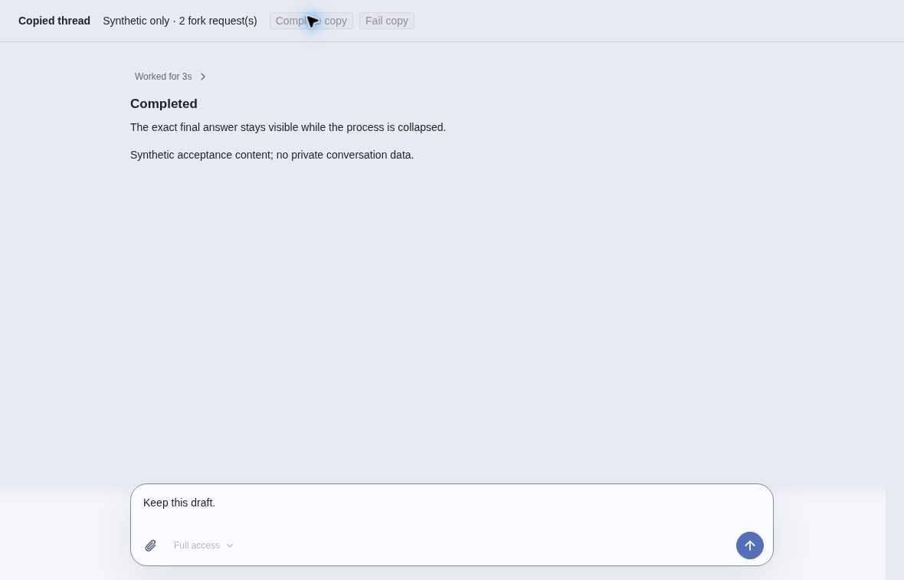
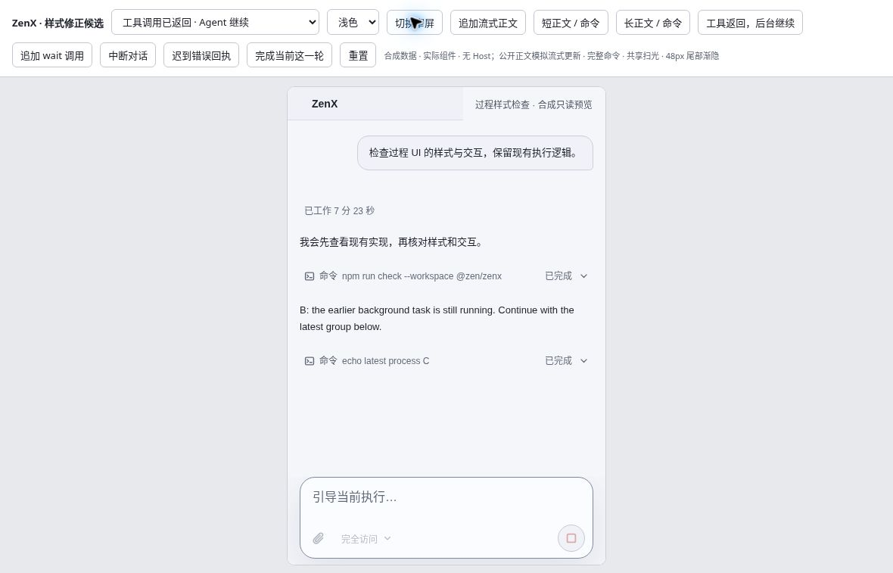
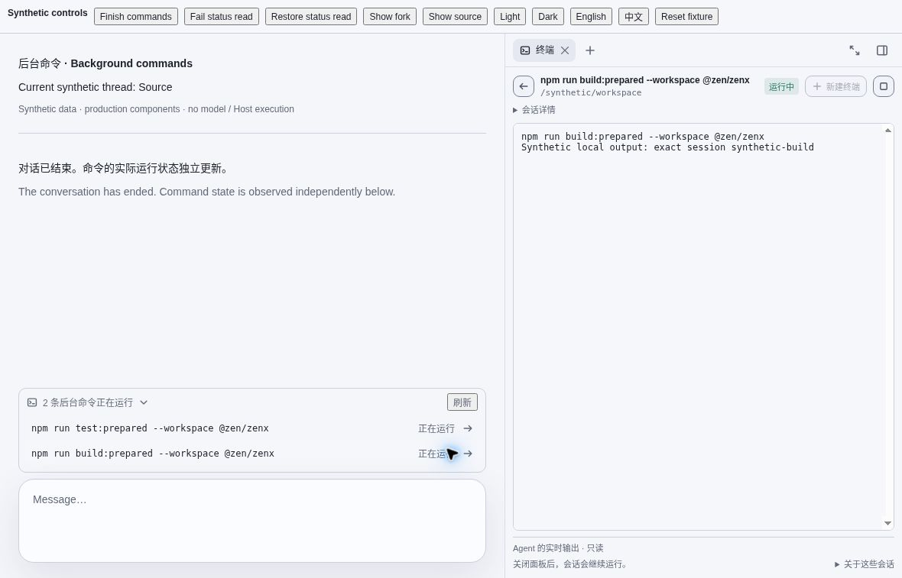
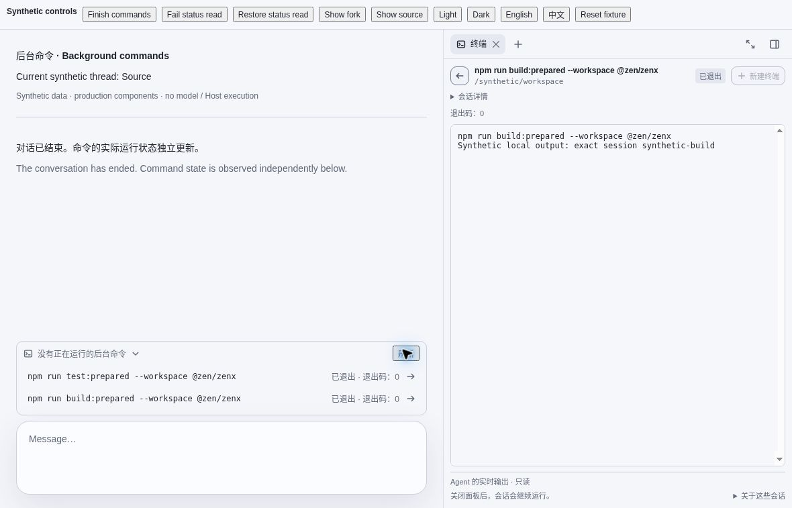
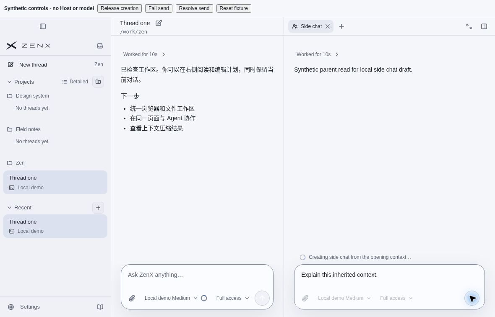
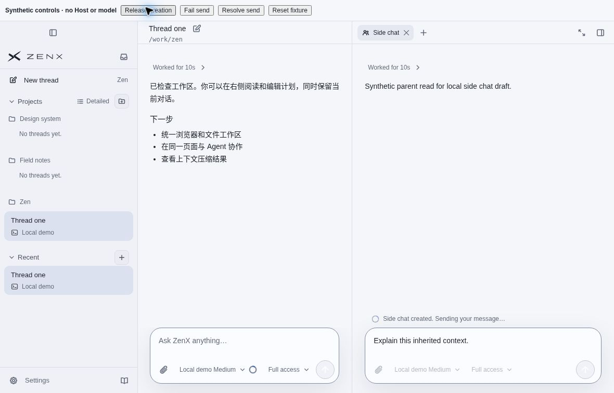
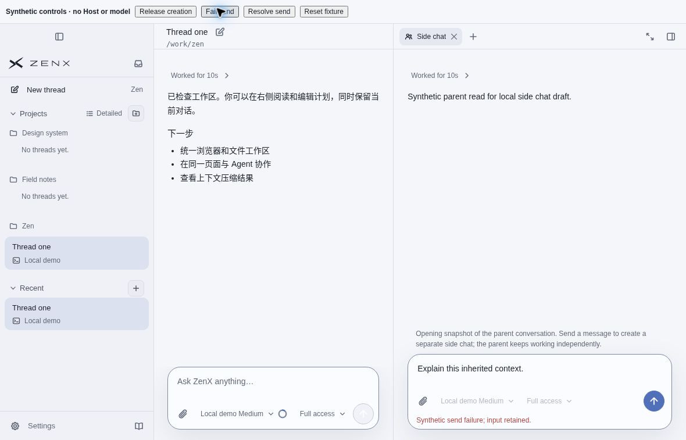

# Chat runtime UI acceptance — 2026-10-29

Seven cloud-browser CUA captures of production components with **synthetic data and bridges only**. The reviewer used visible controls; no real Host, user profile, private conversation, or model was involved in these browser flows. All frames are 1180 × 757; the tool-status frame contains a 420px-wide embedded viewport.

## Source and capture provenance

Documentation base: `fca0efffd4359de54a717b7f625a024a3244a9cb`. Captures retain their own build versions, **not** this later documentation HEAD.

| Captured surface                       | Build commit                               | Provenance                                                                                               |
| -------------------------------------- | ------------------------------------------ | -------------------------------------------------------------------------------------------------------- |
| Fork feedback                          | `b2f06194c8f752c63c51cd83af01db45681ed838` | Root-recorded `build-fork-feedback-preview.mjs` invocation, 05:20 UTC. Builder emits no source manifest. |
| Tool-call presentation                 | `377f641e811fe60aeb464e20ed830422e20078a4` | Root-recorded `build-process-style-preview.mjs` invocation, 05:15 UTC. Builder emits no source manifest. |
| Current background commands / Terminal | `6b657ece281538efc00b03182d85c51afddff92a` | [Original clean-build manifest](background-source-manifest.json).                                        |
| Side-chat creation / delivery          | `cb3bd13c17e4029587faa4d5a861126215ed1418` | [Original clean-build manifest](sidechat-source-manifest.json).                                          |

[acceptance-manifest.json](acceptance-manifest.json) records every image SHA-256, source group, exact generated-artifact hash, and source provenance. Both builder manifests' source hashes were checked against their recorded Git commits, and artifact hashes against the handed-off HTML. Fork/process records contain hashes of review-relevant source inputs at the recorded commits; those are not complete dependency manifests or reproducible-build claims.

The supplied filenames ended in `.png`, but their bytes are JPEG/JFIF. These `.jpg` copies preserve the original bytes and hashes; no image was converted, cropped, or edited. No other screenshots, Board images, or private reports are included.

Later changes include fixture controls/composer/title-bridge repairs and `fca0efff`'s Chinese background-count plural-key repair. The latter keeps the visible Chinese sentence unchanged. These older frames are not presented as a fresh full-application visual run of every later revision.

## CUA acceptance sequence

The root reviewer recorded these actual browser interactions. The images below are selected checkpoints, not a continuous recording:

- **Fork:** pending → explicit failure → successful copy; the final answer remains outside the collapsed process, and the composer draft survives.
- **Tool calls:** returning a call marks that invocation completed even while its synthetic process continues; a new wait is pending independently. Interrupt collapses the process. A late error receipt ends the invocation and retains inspectable raw error detail. Narrow labels remain visible.
- **Background commands:** expand the exact count → select the build command → open its exact Terminal session. Source and fork ownership stay separate. A failed status read clears the count and exposes the error; Refresh restores observations. Process exit updates the count to zero and Terminal to exited/code 0 without another conversation turn.
- **Side chat:** inherited read-only context → Creating → Sending → explicit send failure with the input retained → resend and promotion of the confirmed child. Visible fixture buttons release/fail only synthetic promises; they do not execute a model or Host action.

### Fork: copied result and preserved draft



### Tool calls: completed invocation in a narrow view

The English process-lifetime sentence is authored synthetic transcript content, not a current-state observation supplied by the product.



### Background commands: exact target and observed exit





### Side chat: separate stages and retained failure input







## Separate backend evidence and limits

At documentation base `fca0efff`, this focused run passed **25/25**:

```sh
node --import tsx --test \
  apps/zenx/test/background-shell-state.test.ts \
  apps/zenx/test/shell-panel-poll-cost.test.ts \
  test/thread-fork.test.ts
```

These tests exercise real local native Shell/task and fork paths with deterministic synthetic providers—not the screenshot bridge. They cover a completed call/Turn whose command remains alive, source-only process ownership after a real fork, completion observed without another model sample, exact-item final-message copying, and stale/missing/cross-owner observations and navigation retirement.

The poll-cost fixture uses 12,000 historical messages and 40 warmed list/read cycles (80 observations). All instrumented history/journal/projection/configuration counters were zero; this run measured 3.014 ms for the observation loop. This is a bounded-path regression check, **not** a general application-performance benchmark or a production latency guarantee.

These browser captures do not establish native macOS/Electron behavior, real remote/PTY acceptance, or full-application performance. Native and broader regression results must be reported separately; the images alone cannot prove backend ownership or execution semantics.
