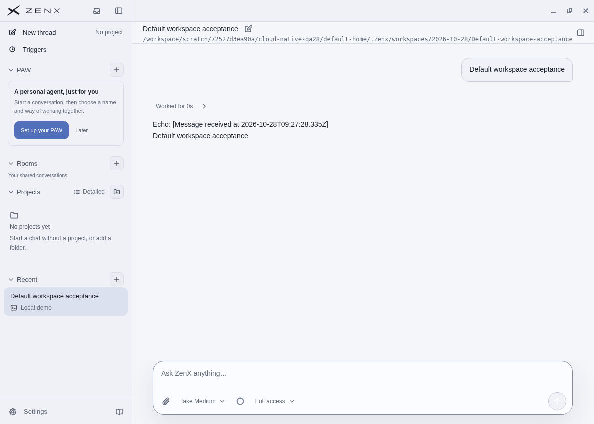
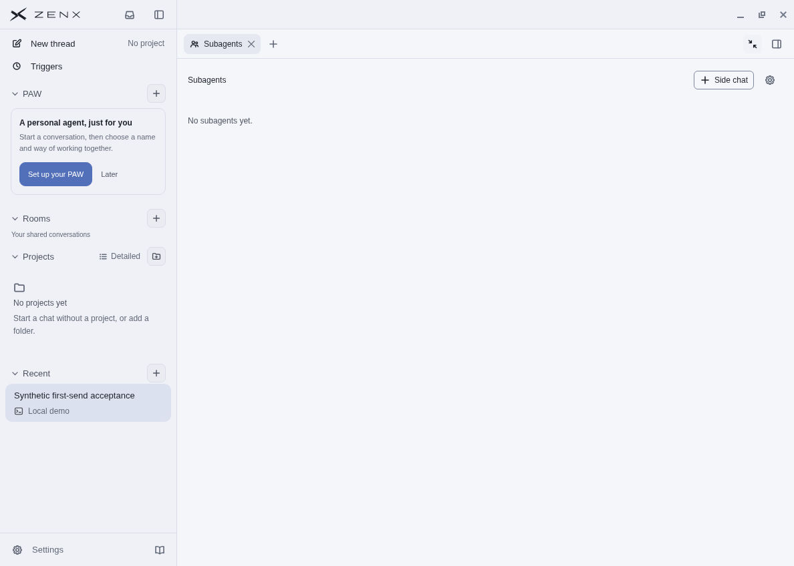
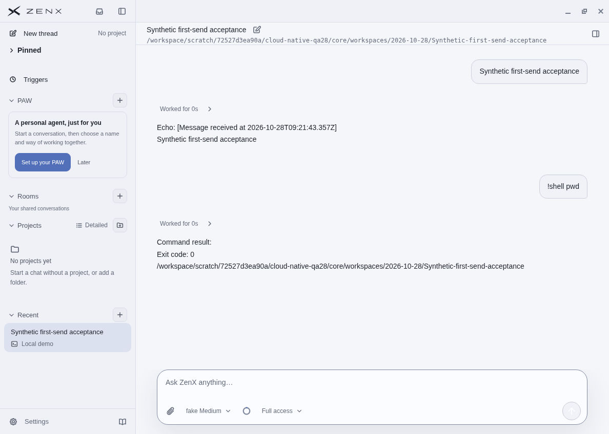
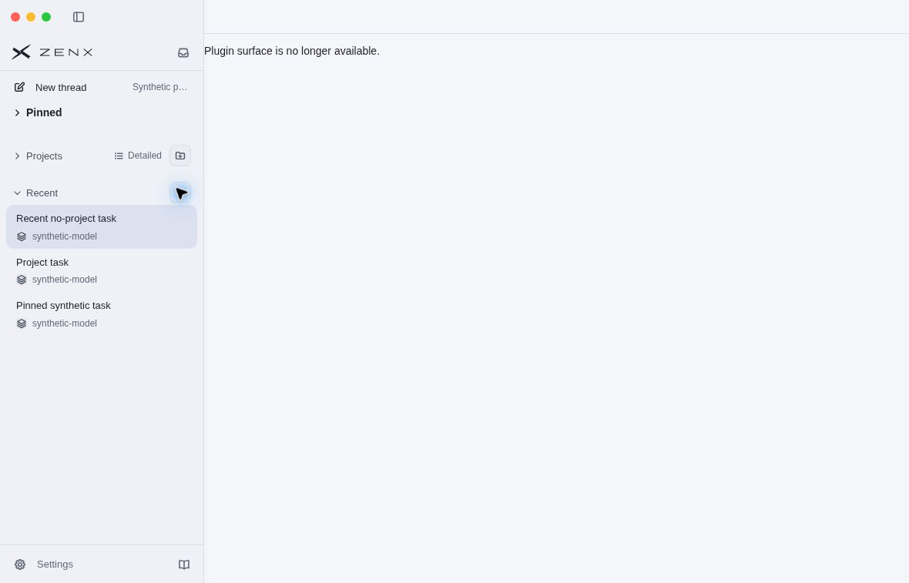
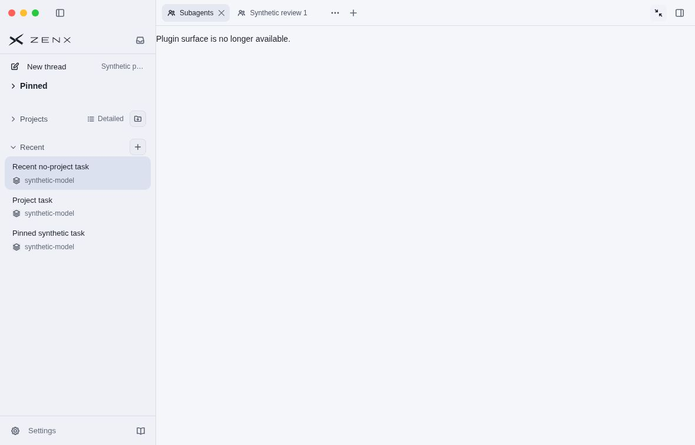
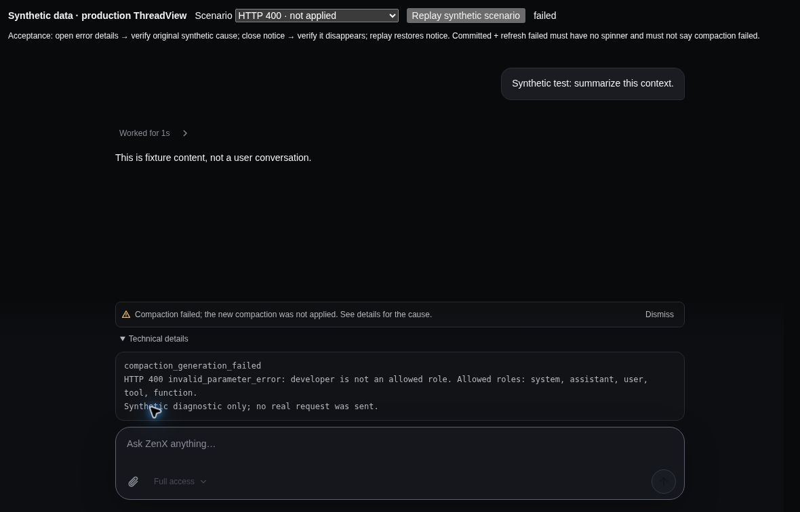
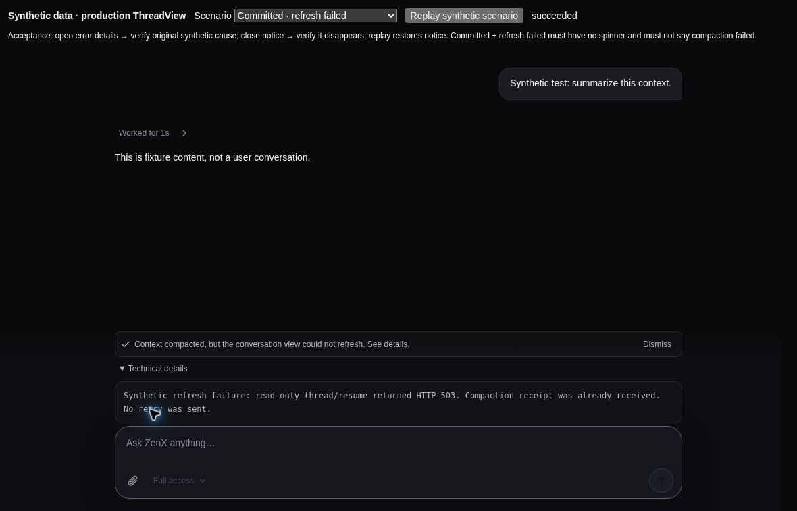
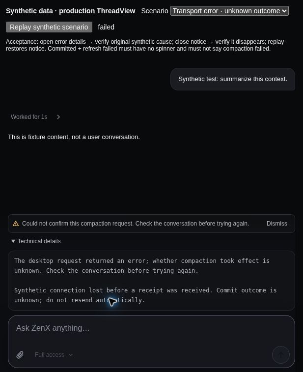
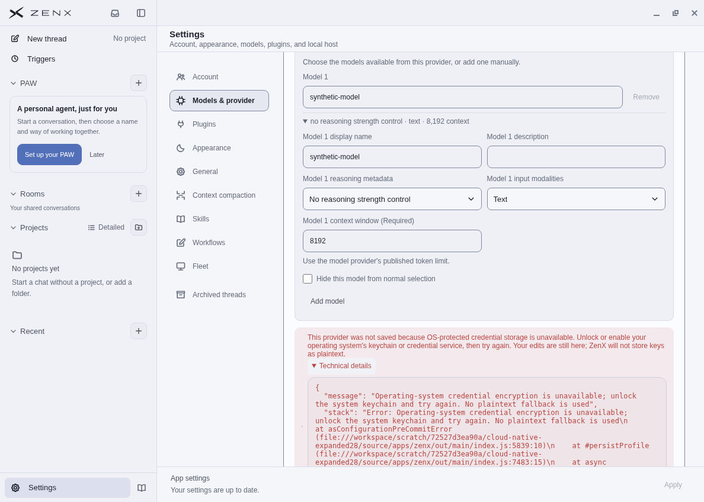
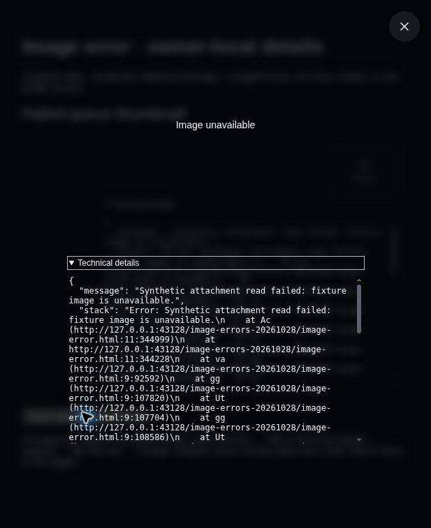

# Client reliability acceptance checkpoints

All images contain synthetic conversations and assistant-owned cloud paths only.
No owner screenshots, keys, real conversations, Trace files or profiles are included.

## Ordinary application, not a replacement renderer

The normal production Electron application at `29b4fbb43d7876c8c95f8a8ad887405ef3a0733b`
(tree `d604a628eded5da6aeede7c414cc0180438b6b64`) was built with all 15 first-party
packages and official Electron 43.2.0. The real Host/Worker used the existing
deterministic FakeModel in independent temporary profiles. SOURCE.json binds the
compiled payload and screenshots. This is Linux native acceptance, not a macOS
native run or installation on the owner's computer.

Manually verified with native pointer/keyboard:

- Recent + opens a projectless draft. No workspace directory exists before Send.
- First Send creates a dated, request-named folder and a completed conversation.
- A real `pwd` shell tool returns the new folder through the ordinary turn loop.
- Subagents opens, expands to fullscreen, and remains visible when the left
  sidebar collapses; reopening and closing preserve usable controls.
- Pinning from Recent creates the independent Pinned section. Collapsing Pinned
  leaves the Recent projection visible.
- A second fresh profile with no data-root override confirms the actual default
  `~/.zenx/workspaces/YYYY-MM-DD/request-name` location. Electron's effective HOME
  was checked before launch. Internal Core data remains separately under `.zen`.

## macOS-layout clipping regression, cloud browser

Actual production WindowTitleBar/Sidebar/AuxiliaryPanel components and the real
Subagents manifest contribution were rendered in Chromium with synthetic data.
Delayed width observation is deliberately injected by the fixture; this is not
a claim about the exact timing on the owner's computer.

Before (`294c03f3`), fullscreen transition while the reported panel width was
stale left a 1180px-wide high-z-index titlebar above the first SVG. At its centre,
`elementsFromPoint` returned the titlebar drag layer before the SVG. After
`b06f7f46`, the same delayed condition constrained the titlebar to the actual
264px sidebar grid column and the 14px SVG was the topmost hit. Left-collapsed
and 617px narrow layouts retained accessible tabs. This demonstrates and fixes
an occlusion path, without asserting it is the sole cause of the owner's image.

## Compaction diagnostic states, production components

Preview commit `83d8db2ef3d7eae8664e066fc589e740f3353671`, based on `57dcf3af`,
renders the actual ThreadView/requestContextCompaction using synthetic receipts
and failures. No model call is sent by this fixture. Browser interaction verified
details initially collapsed, expansion, dismissal and replay; known failure,
committed-but-refresh-failed and unknown transport outcomes stay distinct.
At 617px viewport, details wrap without page overflow. Later diagnostic changes
must be assessed separately; these captures do not certify all later local-log
or provider-save additions.

## Expanded local diagnostics

The ordinary production application was separately rebuilt at `c106d7a8`, with
all first-party plugins, in another isolated HOME/profile. A synthetic Provider
with a localhost endpoint and a non-credential dummy string exercised the actual
Save path. OS-protected credential storage was unavailable in the cloud desktop.
The UI correctly said the Provider was not saved, retained the editor, and kept
Technical details initially collapsed. Expanding it exposed the available
message and stack. No provider probe, paid model request or plaintext-key
fallback was used. This does not simulate a successful encrypted credential save.

The image fixture at `589be682` uses the actual AttachmentImage/ImagePreview
with synthetic read failures. In the cloud browser, thumbnail details expanded;
the preview initially hid details behind a disclosure. Tab reached the disclosure,
Enter expanded it, another Tab entered the scrollable text, and Escape closed
the preview and restored focus to its trigger. It rendered the message, stack and
nested cause as text. This fixture is not a complete native attachment pipeline.

## Remaining gates

These are source-bound checkpoints, not a blanket final acceptance statement.
Final integrated CI, later diagnostic UI changes, and their independent review
remain gates. Hosted native/provider tests and paid live endpoint checks have
separate evidence; these screenshots do not replace them.
