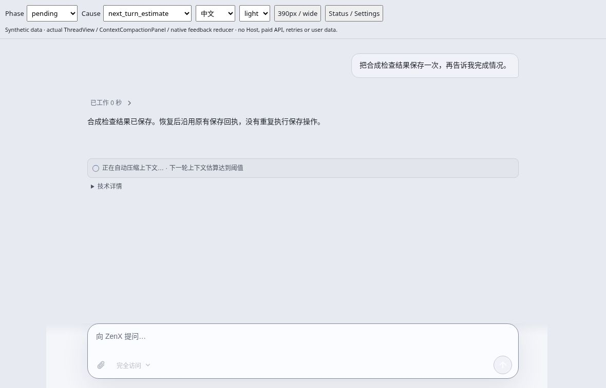
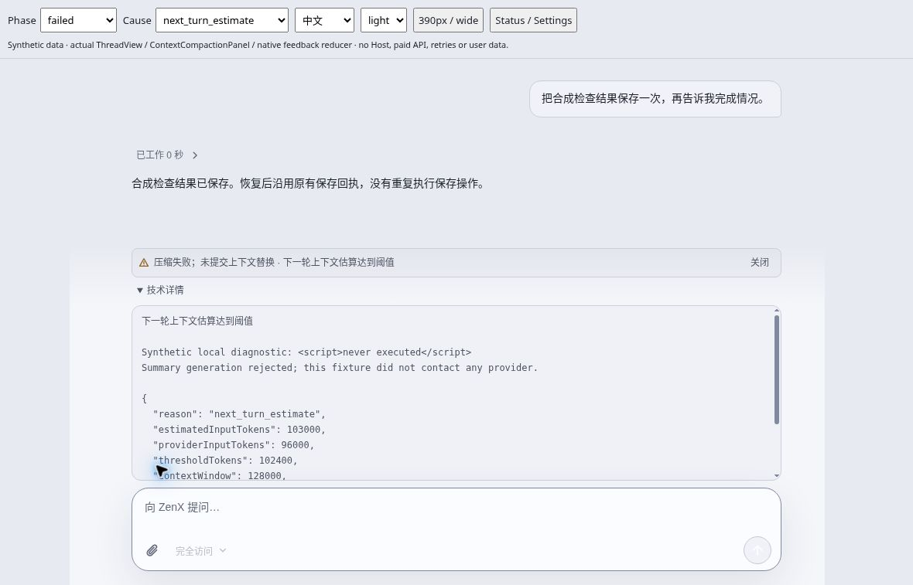
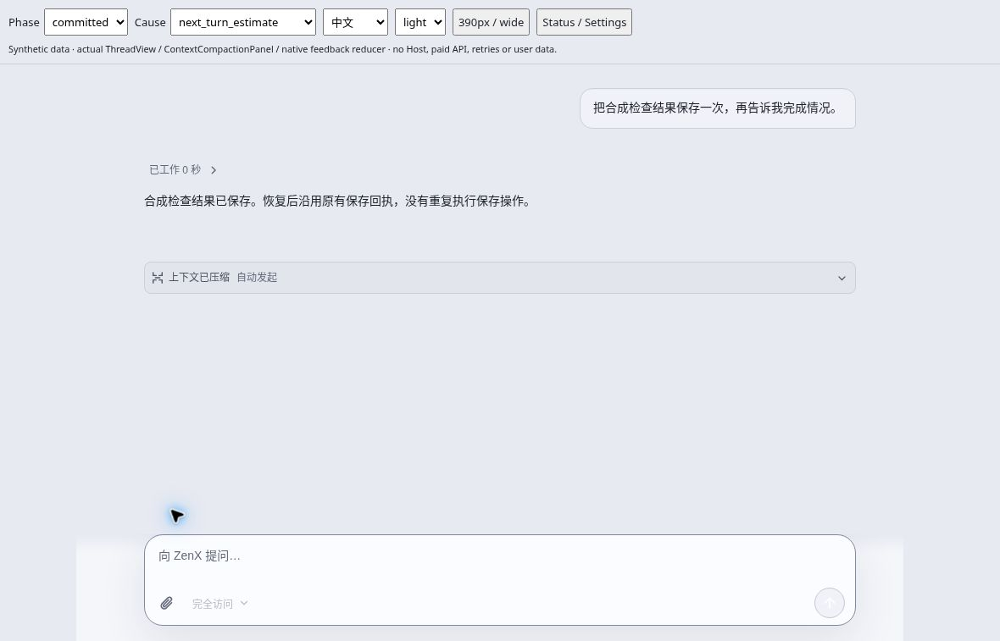
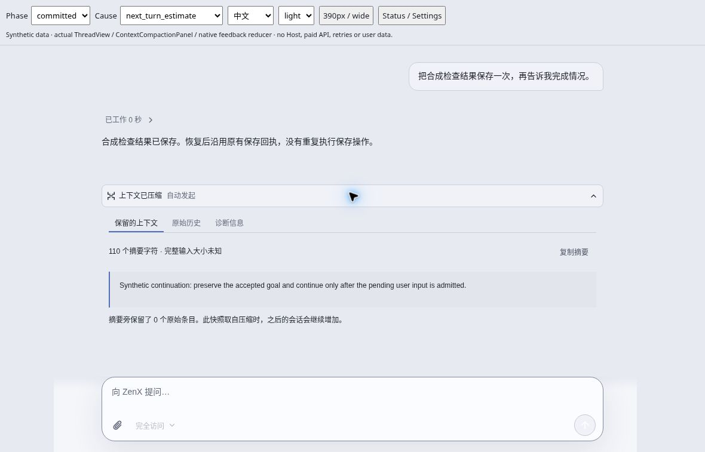

# Context compaction transparency — synthetic browser acceptance

Date: 2026-10-29. Scope: the production `ThreadView`,
`ContextCompactionPanel`, compaction event view and native-feedback reducer,
rendered with **synthetic** events and a synthetic committed selection.

## Source and capture provenance

- Root captured these four screenshots through the cloud CUA browser while operating the
  [offline review fixture](../../../test/fixtures/compaction-trigger-visual.tsx).
  This documentation pass independently inspected each supplied screenshot and copied
  it without editing. The supplied files had `.png` names but contain JPEG/JFIF
  bytes; the review uses `.jpg` extensions without conversion. Original capture
  filenames and unchanged checksums are retained in the screenshot manifest.
- The captured bundle was built from clean source
  `6b657ece281538efc00b03182d85c51afddff92a`. Its original [source manifest](source.json)
  records the component/fixture hashes and HTML SHA-256
  `1c18c2ecadb36eb186d0c1b27948671dd22bb7d8613f7867a634659544d3aecb`.
  The supplied HTML was checked against that hash.
- Documentation base: `5d4a11ef9d79da4cca6f50d656682460f77135d9`.
  The exact base SHA is also recorded in [screenshots.json](screenshots.json).
  The captured source is an ancestor of that base, and **all 11 source hashes in
  the original manifest match the base files**. No product code changed in this
  documentation commit.
- [screenshots.json](screenshots.json) records each screenshot's SHA-256 and dimensions,
  plus the copied source-manifest checksum. The screenshots are 1180 × 757.

## Observed interface

### Automatic compaction is named before admission

The pending row explicitly says “正在自动压缩上下文…” and gives the trigger:
“下一轮上下文估算达到阈值”. Technical details remain available. This is a
synthetic pending observation, not evidence that a real compaction ran.



### Failure is not presented as success

The failed row says no context replacement was committed. Expanded technical
information displays the synthetic local error and threshold evidence. The
literal `<script>never executed</script>` appears as readable text; Root also
confirmed it was not executed during the interaction. Escaping is independently
covered by the renderer tests linked below.



### A committed selection has one event row

The committed fixture produces one collapsed “上下文已压缩 · 自动发起” row,
not an additional duplicate transient success row.



Opening that row exposes peer views for retained context, original history and
diagnostics. The captured retained-context view shows the synthetic summary,
its character count, and the explicit unknown full-input size; it does not
invent token savings.



Root additionally inspected the fixture's Settings view and confirmed that the
copy distinguishes Host automatic compaction from the agentic tool switch and
explains the automatic timings. **That supplementary observation has no separate
screenshot in this four-image set.**

## Automated evidence and reproduction

The screenshots supplement, not replace, the following synthetic regressions:

- [Core compaction tests](../../../../../test/context-compaction.test.ts):
  trigger paths, durable commit ordering, failure/unknown outcomes, model notices,
  and rejection of non-advancing boundaries before summary generation.
- [Capability-reference tests](../../../../../test/builtin-model-handles.test.ts):
  optional `cN` references do not claim a compaction happened.
- [Native feedback](../../../test/compaction-feedback.test.ts) and
  [composer state](../../../test/composer-state.test.ts): operation/epoch fencing,
  canonical start-prefix reconciliation and stale-boundary rejection.
- [Manual command tests](../../../test/compact-command.test.ts): unchanged-draft
  authority, native/canonical observations, and delayed manual reply/refresh
  settlement preserving a newer automatic operation's pending/failed/unknown
  feedback.
- [Compaction view tests](../../../test/compaction-views.test.ts): single-event
  disclosure, peer-view navigation, visible pending cause and escaped errors.

The final bounded command/feedback/composer/view suite passed **49/49** on
`5144c1a9dc5fc0c4c0f3b02696650d5aabfcc774`, including independent review of the
late-refresh reproduction. This documentation-only pass verified artifacts,
source hashes and links; it did not rerun the application suites or claim a new
whole-application test result.

Rebuild the standalone fixture from the repository root:

```sh
node apps/zenx/scripts/build-compaction-trigger-preview.mjs /tmp/compaction-preview
```

The output includes `compaction-trigger.html` and a fresh `source.json`. Visible
controls select phase, cause, language, theme, width and Settings; record the
new source hash when capturing a different build.

## Acceptance limits

- No Host, provider API, paid model, real compaction, retry or user profile was
  used by this fixture. Its conversation, errors, metrics, events and committed
  record are synthetic.
- These are browser screenshots of real product components, **not native
  Electron/platform acceptance** or proof of backend execution. Only the Chinese,
  light-theme, wide-layout states shown above are captured here; other controls
  are not claimed as screenshot coverage.
- There is no private report image, private history, credential, real Trace or
  unrelated Board image in this review bundle. The previously reported model's
  prose is not execution evidence.
- Automatic policy/defaults were not changed. See the
  [source-backed trigger audit](../../../../../docs/compaction-trigger-visibility.md)
  and [UI contract](../../ui-ux.md#context-compaction-trigger-transparency) for the
  compiler/Host/Trace boundaries and remaining limits.
