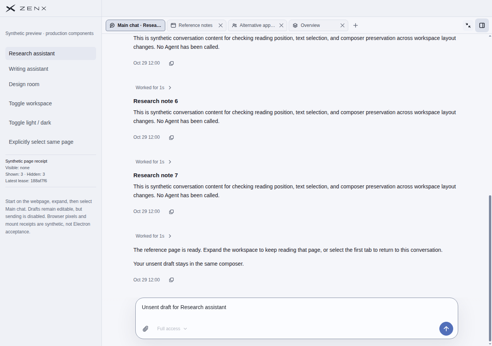
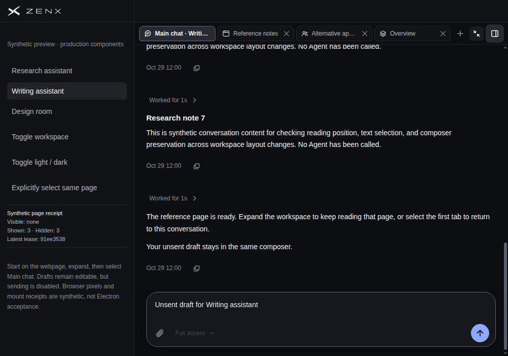

# Fullscreen primary-chat width restoration

Real Chromium production-component acceptance passed in [run 42171784416](https://github.com/albert-zen/zen/actions/runs/42171784416), for PR head `0644be0662c7b9c74daf36bd3b166168b3058ca3` and tested merge `113f89af4da5575b1618e121c56caec560280f9c`. `source.json` records the exact producer source hashes. The evidence-only commit does not change those sources.

All four scenes passed: 1280×900 and 1000×700, light/dark, two synthetic thread owners. Each scene covers three browser→primary returns, an Overview resource control, and return to split layout. The restored virtual scroller measured 1016px or 736px, equal to its containing block. Tests also verify row bounds, composer pointer reachability, draft/node preservation, and stable dimensions.

These are actual Chromium screenshots of production components with synthetic conversations, browser-page DOM and mount receipts. They do **not** establish native WebContentsView, Host, full App/header integration, OS-input, or packaged Electron acceptance. No user conversation or reference screenshot is included. [Full measurements and screenshots](https://github.com/albert-zen/zen/actions/runs/42171784416/artifacts/13481601519) are retained by Actions for 14 days.

## Wide light, third browser→chat return

## Narrow dark, third browser→chat return

