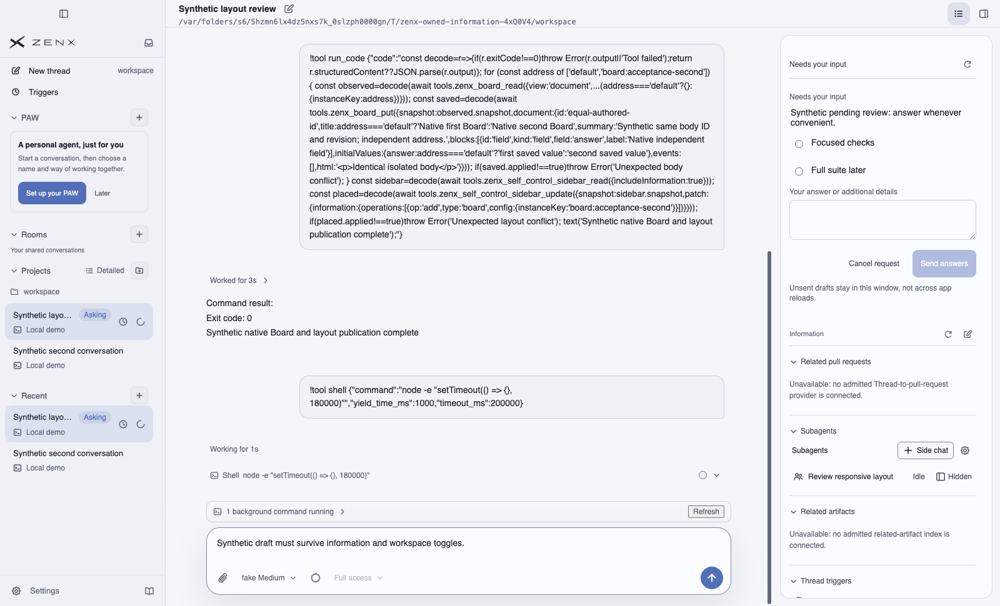
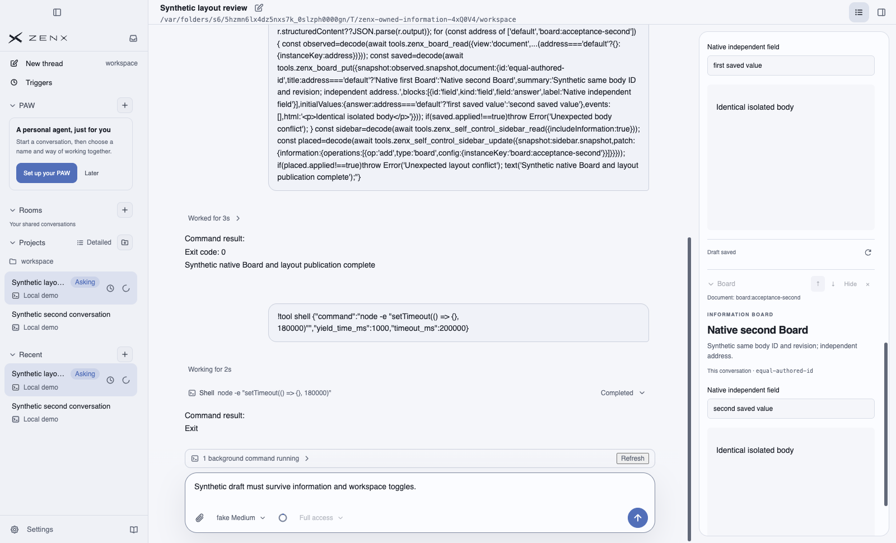
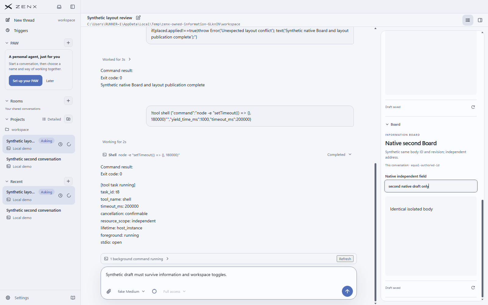
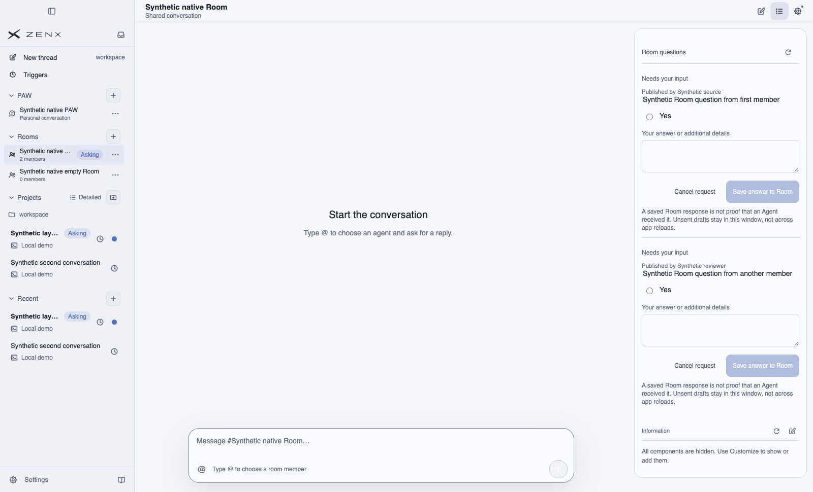
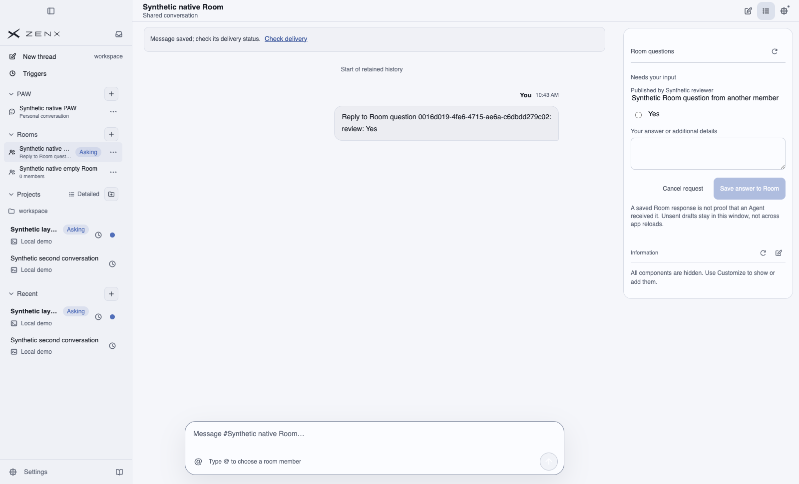
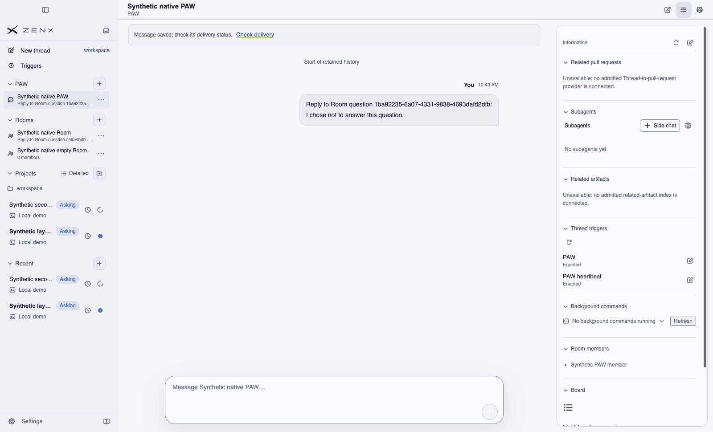
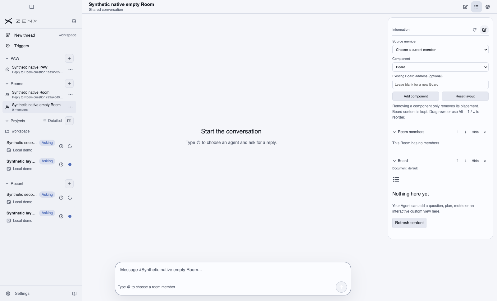
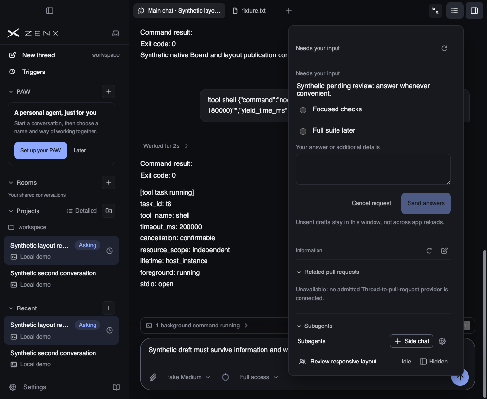

# Full production App information acceptance, 11b9

These are unmodified screenshots and synthetic receipts from the complete production Electron App on macOS and Windows, not a component scaffold or a T3 reference image.

## Exact source and run

- Product/source head: `11b9bd39064a80dfbb0a8ade01743d8a733385b7`.
- Product/source tree: `0058429ea3008df31b057215aa74d1c581f6e68b`.
- Actual CI checkout: `8cdbb17330c87adfdfe631fcbf9871766c2877dd`, the GitHub merge of main `a44591da91c5f1bb075b913b97796951a1ac1289` and that head. Its tree is exactly the product/source tree above.
- [Full App matrix run 41621321753](https://github.com/albert-zen/zen/actions/runs/41621321753): both jobs succeeded, with `ok: true`, 65 steps and 19 cases each.
- [macOS job 125867468689](https://github.com/albert-zen/zen/actions/runs/41621321753/job/125867468689), [original artifact 13222519730](https://github.com/albert-zen/zen/actions/runs/41621321753/artifacts/13222519730).
- [Windows job 125867468874](https://github.com/albert-zen/zen/actions/runs/41621321753/job/125867468874), [original artifact 13223693161](https://github.com/albert-zen/zen/actions/runs/41621321753/artifacts/13223693161).

Original ZIP SHA256, checked before extraction:

- macOS: `4d730d967eff1cf10512cb166e4b4683ed423d4cee6374e8107a4eff03232778`.
- Windows: `d913ab9b2d4c800fd7ed0f15dbbfbe41cddca0a57d7e27a9dbb91e7ed928cf0f`.

The source manifests retain hashes of built main/Host/preload/renderer files and 23 source files. All 23 source hashes were independently compared with the reviewed source, using the actual Windows checkout's CRLF bytes and macOS's LF bytes. Different platform CSS/font assets are not claimed byte-identical. Both synthetic Apps exited and their disposable profiles were cleaned up.

This evidence-only branch is a child of the source head. Adding these files does not change the accepted product source or require a self-referential screenshot rebuild.

## Synthetic and input boundaries

The run starts the complete production renderer, preload, main, child Host, actual local provider bridges, DomainThreadJournal and Room journal. It uses a disposable private profile, synthetic Threads/Rooms/questions and an offline fake model provider. Board publication, Room question publication and withdrawal use the real runtime tool routes. No user device, personal profile, real LLM or external service operation is represented.

Pointer actions use Electron native events with focus, hit-target, disabled-state guards and observed trusted click delivery. Board field replacement uses native Select All and insertText, with observed selection and exact persisted-value/sibling-isolation checks.

**The source-member and component select choices use the real DOM select input/change handlers, not OS-native popup automation.** Their exact resulting Host member/Trigger binding is asserted. `acceptance.json` records this boundary under `inputBoundaries` and `controlSelections`. The two native OS-menu input steps are not accepted by this run. The earlier native select failure remains in run 41618205498; no guard or permission was weakened to conceal it.

A source manifest's general “native input” description must be read together with these explicit per-input limits. The narrow overlay is allowed to overlap the conversation; the dock is separately checked to stay beside the chat/Composer. No page-level horizontal overflow occurs. The same Composer DOM identity and unsent draft survive presentation and workspace changes.

## Covered product cases

- A real default-on asynchronous Thread question remains after its publishing Turn finishes and its seed Host exits, including with every customizable widget hidden.
- Actual controls reorder/hide/reset/remove placements, without deleting independent Board bodies. Two Board addresses have equal authored IDs/revisions but isolated fields, native edits and saved values.
- Room questions are independent workspace resources. Two members publish two Room questions; private Thread questions are excluded. Removing an author retains the Room question. Answering one retains the other card and Room Asking. Cancelling the last clears Room Asking; explicit model snapshot withdrawal also clears it.
- PAW uses its actual Room and excludes its single member's private Thread questions. Cancelling its independent Room question clears its card/Room badge while private Thread Asking remains.
- Empty Rooms do not invent a member binding. Responsive checks include 920px dock and 919px overlay, repeated open/close, light/dark appearance and workspace/owner transitions.

The independent source/image reviewer checked 14 key original images across both platforms, the two receipts, ZIP digests and source hashes. This is the scope of this matrix, not acceptance of every harness, native OS select menus, real LLM behavior or universal filesystem crash durability. The complete CI aggregate is a separate gate.

## Selected original screenshots

### macOS: default full App and customization

### Windows: independent Board field

Only the second Board field is edited; the sibling's unchanged persisted value is checked through the actual Board command route.

### macOS: Room workspace questions remain outside hidden widgets

### macOS: independent PAW and empty Room

### macOS: dark narrow allocation

Related-PR and artifact provider messages are explicitly unavailable because the authoritative owner-to-PR association/status bridge and owner-associated artifact registry/read API are not implemented. They are not fake zero-count providers. T3's generic public marketing screenshot does not establish a matching information-panel reference or drag behavior, and is not used as this run's acceptance evidence.
