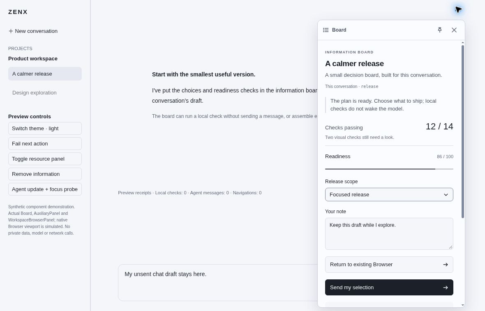
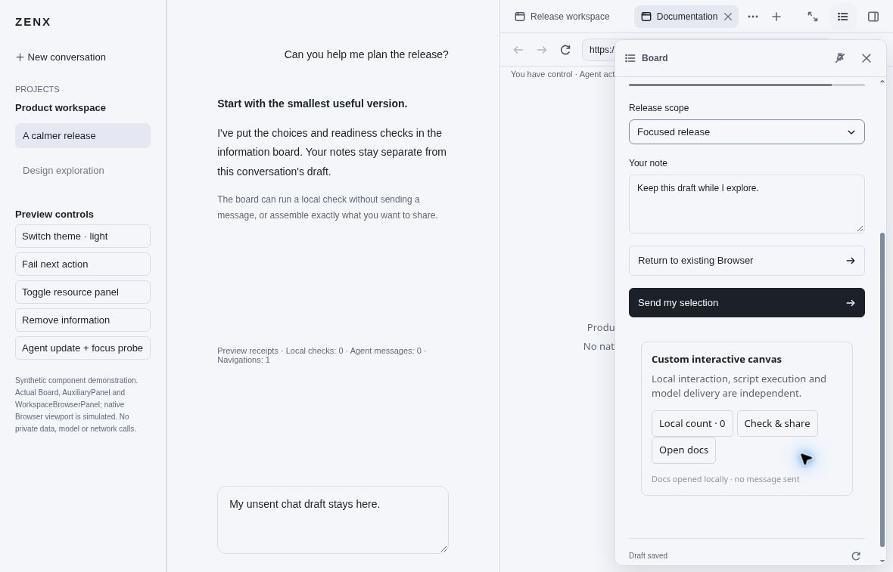
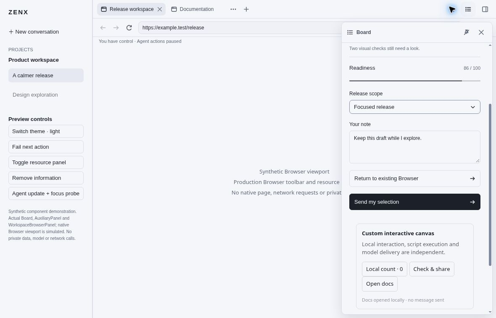
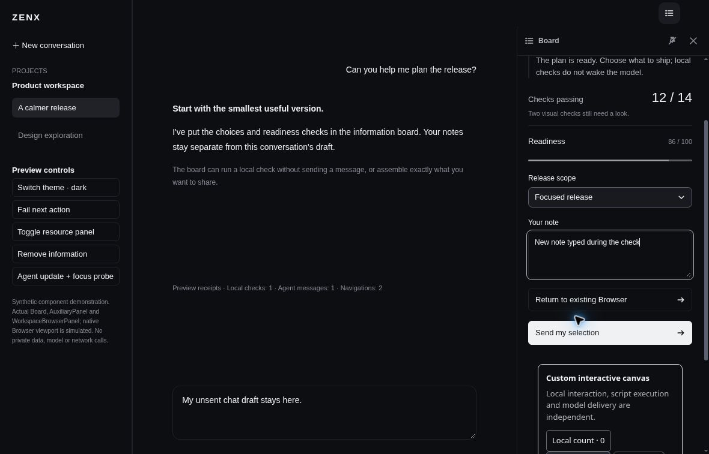
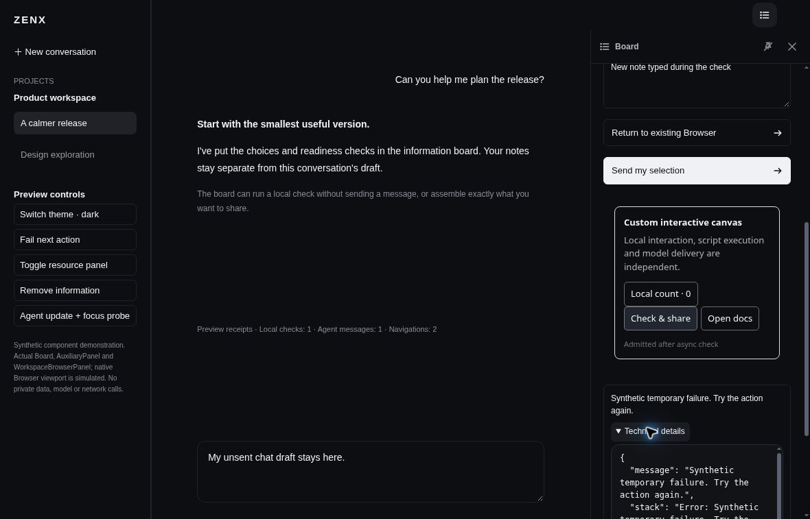
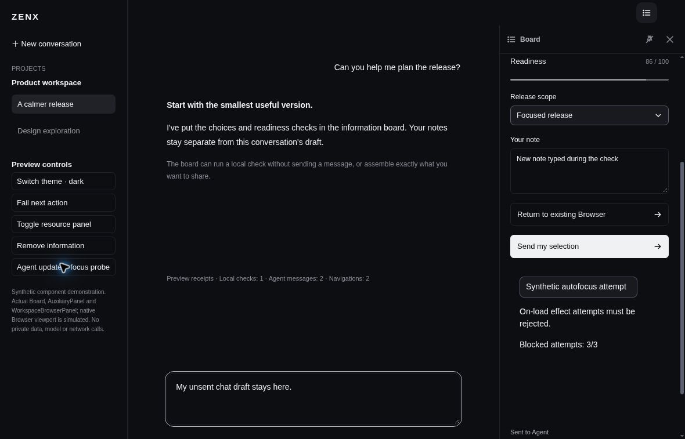
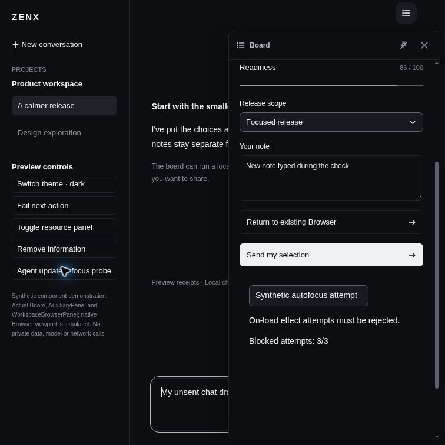
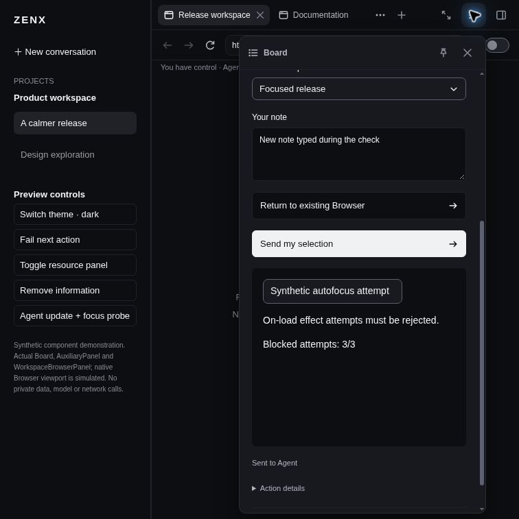

# Interactive Board — synthetic renderer acceptance, 2026-10-29

## Scope and source

These eight newly captured screenshots show the **production Board, information
popup/rail, AuxiliaryPanel and WorkspaceBrowserPanel components** in a cloud
browser. The outer conversation/sidebar, current-state ports, execution receipts
and message admissions are synthetic. The Browser viewport is explicitly a
placeholder; its surrounding resource tabs, address/control toolbar and
fullscreen controls are production components.

**No native Electron application, real webpage, user conversation, external API,
Provider/model request or native script execution is demonstrated.** The displayed
“Agent messages” counter counts simulated explicit admissions, not actual model
calls. Fixture branding and QA controls stay in the left sidebar rather than
covering the production resource header.

The preview was built from `76f8dcf51ee8af0d437cadf58d3d114d97d6e2ad`.
[Original builder metadata](source.json) records 14 source SHA-256 hashes.
[Manifest](manifest.json) records the image dimensions/hashes, generated bundle
hash and a later source-hash comparison. [SHA256SUMS](SHA256SUMS) covers the
published evidence files. The generated HTML bundle itself is not included.

Capture method: manual cloud-browser computer-use interactions against the local
synthetic preview. This was **not** the automated capture helper or a launched
native application; no subprocess lifecycle receipt exists for these captures.
All eight image files were visually inspected before these labels were written.
No lost/older checkpoint screenshots are included.

## Interaction observations

The following are the capture operator's observed interaction results; a single
still image does not independently establish focus, timing or lifecycle behavior.

- Opening the light popup and pinning it moved keyboard focus to **Unpin**.
- Custom **Open docs** called the production Board SDK navigation override and
  selected the exact synthetic `https://example.test/docs` resource. Navigation
  count became 1, with zero simulated Agent messages or local checks. The
  template **Return to existing Browser** then selected `fixture-existing`
  (`https://example.test/release`), making navigation count 2 without a message.
- Resource fullscreen **Restore** and **Close** remained reachable with Board
  present. Closing resource/Board presentation retained the drafts.
- In dark mode, **Check & share** awaited a 6.2-second synthetic local check and
  then explicitly admitted one simulated Agent message. A newer note typed
  during that wait remained visible; the separate Composer draft was unchanged.
- An induced failure exposed the actual synthetic error/stack as plain text in
  **Technical details**. Explicit retry cleared the error and increased the
  simulated Agent-message count to 2; no real Provider was contacted.
- Agent content replacement with an autofocus/on-load probe blocked **3/3**
  attempted effects. Navigation/message counts did not increase, and Composer
  retained focus.
- At an actual 756px viewport width, the floating 360px Board remained bounded.
  Closing it returned focus to the information entry.
- Removing information while Browser stayed open, then adding it again, did not
  auto-open Board. Explicit opening used the measured production header geometry
  and retained the newer saved note.

## Captures

### Light popup — templates and separate Composer draft

The 1180 × 757 capture shows the top-right popup, note/metric/progress/fields,
explicit message action, and the untouched Composer text.



### Custom URL navigation — real resource header

The production custom SDK opened the synthetic Documentation resource. The
visible receipt counter reads local checks 0, Agent messages 0, navigations 1;
custom content reports “Docs opened locally · no message sent.”



### Fullscreen resource — Board remains below the toolbar

The selected release resource uses the production fullscreen resource layout.
The synthetic viewport label is visible; Board does not occupy the resource
header's Restore, information or Close slots.



### Dark asynchronous action — newer note preserved

The newer note remains “New note typed during the check.” Counters show one
synthetic local check, one simulated Agent message and two navigations. The
Composer still contains its original unsent draft.



### Error disclosure — owner-readable plain text

An induced synthetic temporary failure is visible with expanded technical
details. The bounded details area is independently scrollable; the screenshot
shows only its currently visible portion, not the entire stack.



### On-load effects blocked — Composer keeps focus

The replacement custom document reports “Blocked attempts: 3/3.” The Composer
focus outline remains visible; the simulated message count is 2 after the earlier
explicit retry, with navigation count unchanged at 2.



### Narrow viewport — bounded floating Board

At 756 × 757, the floating Board stays within the viewport, with its header,
close control and independent content scroll area visible.



### Late contribution — explicit reopening with Browser already present

After removing and adding the contribution, this explicit reopening aligns
below the actual resource header and retains the newer note. The capture is
756 × 757; it does not claim native mobile or physical-touch acceptance.



## Reproduction and remaining boundaries

Build the synthetic preview from the referenced source using:

```sh
node apps/zenx/scripts/build-board-preview.mjs /tmp/zenx-board-preview
```

Serve only that generated directory on loopback for browser inspection. The
fixture exposes left-sidebar controls and `window.__boardFixture`; its source
contains the exact synthetic effect ports. Custom **Open docs** deliberately
fails if it escapes into generic application navigation, rather than pretending
that route succeeded.

This evidence does **not** claim a full CI pass, packaged/native compositor
acceptance, real Browser ownership/permissions integration, a real model response,
or completion of all Host/schema review. Those checks are separate from the
captured renderer. Host review fixes and schema/discovery follow-ups were still
in progress at capture. Before merge, compare the final renderer/fixture hashes
with `source.json` and rerun affected validation if they differ.
