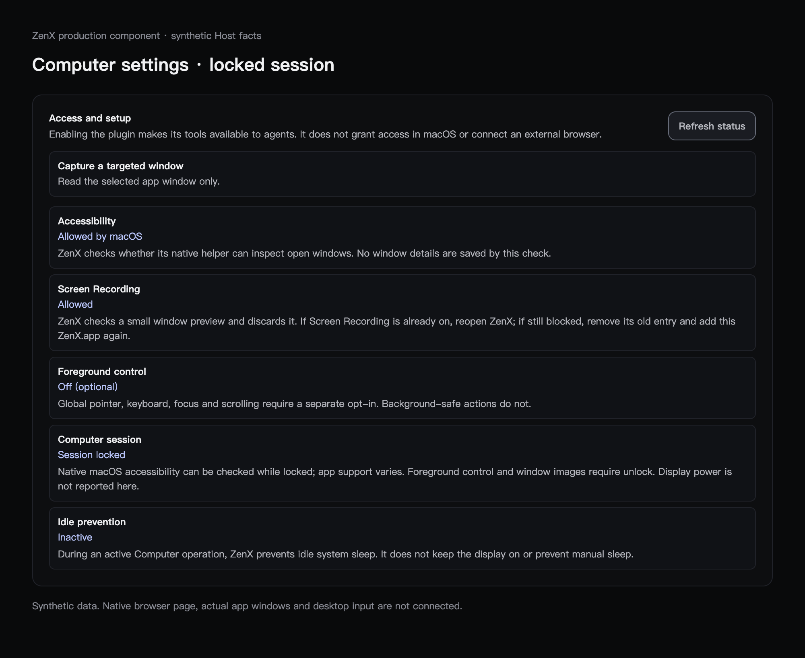

# macOS background and session-state acceptance

Production source checkpoint: `9faf2dd89e567cbf0a030627e31e341c62dfb72c` (base `97187f2a`). Independent production review R1 passed after three observed races were corrected: activity wrongly granting preview freshness, a late action result crossing lock/unlock, and readiness capture verification being relabeled as a newer session generation.

## UI evidence

The actual production PluginAccessReview component was rendered from clean `bb99d865756f39eb5f39255fb00fe81f87e8c1da` in a hidden isolated Electron renderer using **synthetic** macOS locked Host facts. This is layout/text evidence, not a photograph of a real locked screen or a native operation acceptance test. The component, translations, fixture and styles are unchanged in the final readiness-only `9faf2dd8` commit.

Relevant Git blobs: PluginAccessReview `614cd989fe55e20974ddf9a7cd2cf20b86da4e4e`, settings translations `118345d8e8ebda32d5b175cbd13ac49ecba9b869`, visual fixture `9b2656cbe4085eeb0adf2e70bf1ec78b12318564`. PNG SHA256: `022e60b821bd1708308cac93995c583281f610a9b0792770820389fca6d25914`.

## Actual macOS observations

On macOS 26.5.1 arm64, isolated synthetic Browser/Computer fixtures produced these distinct results:

| Operation/state                                                                                            | Observed result                                                                                                                                                                |
| ---------------------------------------------------------------------------------------------------------- | ------------------------------------------------------------------------------------------------------------------------------------------------------------------------------ |
| Background Browser CDP Chinese forms, select/checkbox/editable, stale refs, cancellation and tab isolation | Passed; no foreground focus or system pointer change                                                                                                                           |
| Background AppKit AX text writes and native NSButton press                                                 | Actual value/button-state readback passed; no foreground focus or pointer change                                                                                               |
| Background Electron DOM AXPress                                                                            | Native ACK returned, but DOM effect remained absent; recorded task failure                                                                                                     |
| Startup already locked                                                                                     | Native sampler reports locked, matching an independent CoreGraphics observation; previous Electron-only active inference was incorrect                                         |
| Locked capture and foreground input                                                                        | Rejected before dispatch                                                                                                                                                       |
| Browser CDP while the session is already locked                                                            | Actual owned DOM effects passed independently of native GUI visibility                                                                                                         |
| Fresh AppKit window created while locked                                                                   | Native AX could not find the target; no GUI success claim                                                                                                                      |
| Public CGEvent post-to-PID/window experiment while locked                                                  | Sender returned posted-unverified; fixture received zero mouse events and button count did not change. No foreground or pointer change. Experiment was not added to production |
| Display off while unlocked / real lock-to-unlock transition / model task quality                           | Not yet evaluated                                                                                                                                                              |

The deterministic baseline contains 12 checks: 11 pass and one Electron AXPress task failure. A transport ACK never counts as application success. AppKit, Electron, CDP and native GUI paths are separate capabilities. The source change permits a narrow fresh native accessibility attempt where the OS exposes it; it does not claim universal locked-session GUI availability or unlock the Mac.

## Automated validation

- 242 focused tests at `bb99`: 241 pass, one existing platform skip.
- Final readiness correction: 39 focused checks pass; independent review also ran 39 with zero skips/failures on `9faf`.
- Node/Web and Computer package typecheck, 7 same-version digest repair/startup checks, and 5 first-party packaging checks pass.
- Ordinary package upgrades compare exact trusted tarball digests, including changed content at the same version. Explicit uninstall and non-bundled overrides retain their existing behavior.

## User-authorized physical state window

A later coordinated run used integrated source `da6178e9782fd353bd777616706b9b6fccc8544d`. The user explicitly allowed brief display sleep and then authorized the operator to lock the Mac; the user unlocked manually. The operator used `pmset displaysleepnow`, one normal OS lock shortcut, and a short display-wake request. The evaluation controller itself performs no system-state changes or global input.

- At 19:05:40 (Asia/Shanghai), display sleep also locked the session under the Mac's current security policy. Old native AX references were retired, fresh locked AX could not find the owned window, and Browser CDP confirmed its counter increment.
- A second run observed lock with the display still awake, followed by automatic display sleep. CDP produced actual increments in both states; native AX remained unavailable.
- The final passive run observed display wake at 19:15:57.333, the real unlock event at 19:15:59.758 (unknown/revision 2), and native refresh to active/revision 3 at 19:16:00.693. Fresh native text value readback matched at 19:16:01.063; a native button count advanced to 1 at 19:16:01.581. Browser CDP also advanced its counter after unlock. No locked-era AX reference existed in this last run, so unlock-era stale-ref rejection is not claimed from that run.
- Across the three runs, eight independent CDP count increments were observed. Locked screenshots were refused by the OS-session admission guard. Foreground input was disabled throughout and refused by the permission guard, which is not separate proof of a lock-only foreground guard.
- All three runs finished within their deadlines. Independent post-exit checks confirmed temporary profiles absent, owned process groups/PIDs gone and loopback ports closed.

A separate display-off-but-unlocked sample was not obtained because this Mac's existing policy locks on display sleep; its security settings were not changed. Native locked-GUI availability and the Electron AXPress task failure remain unresolved. Daily app installation and real-user profile/history migration were not performed.
