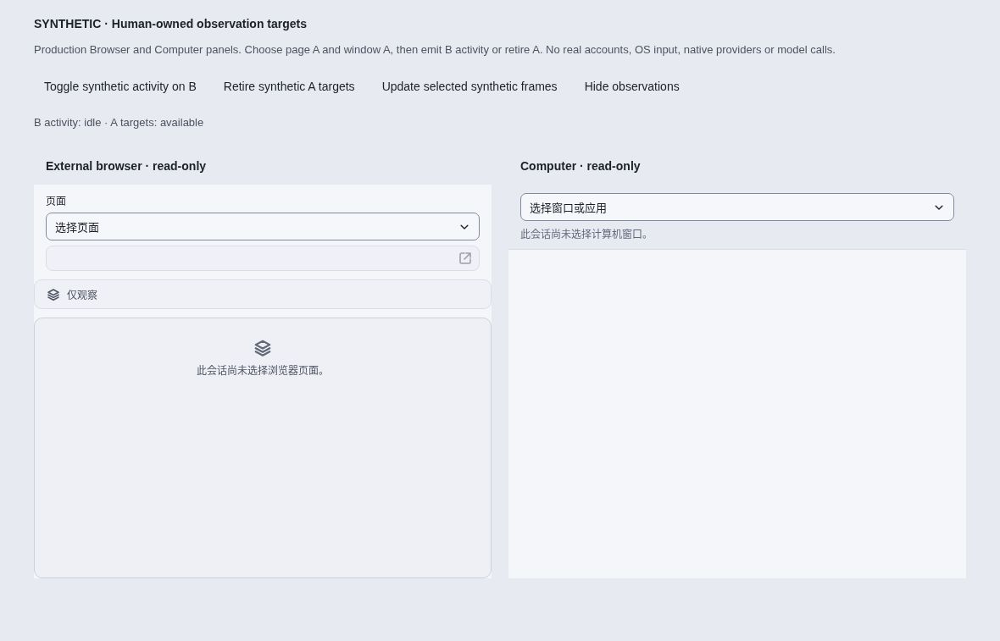
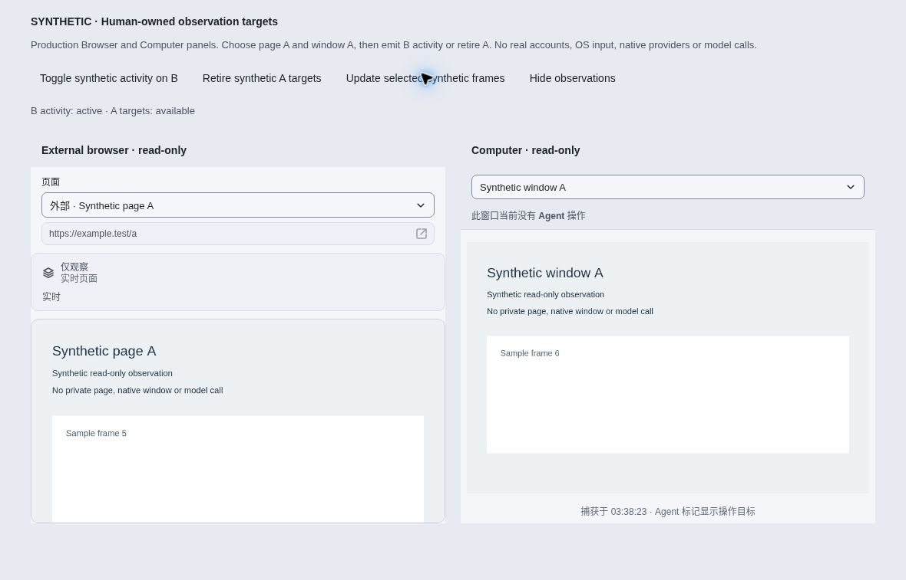
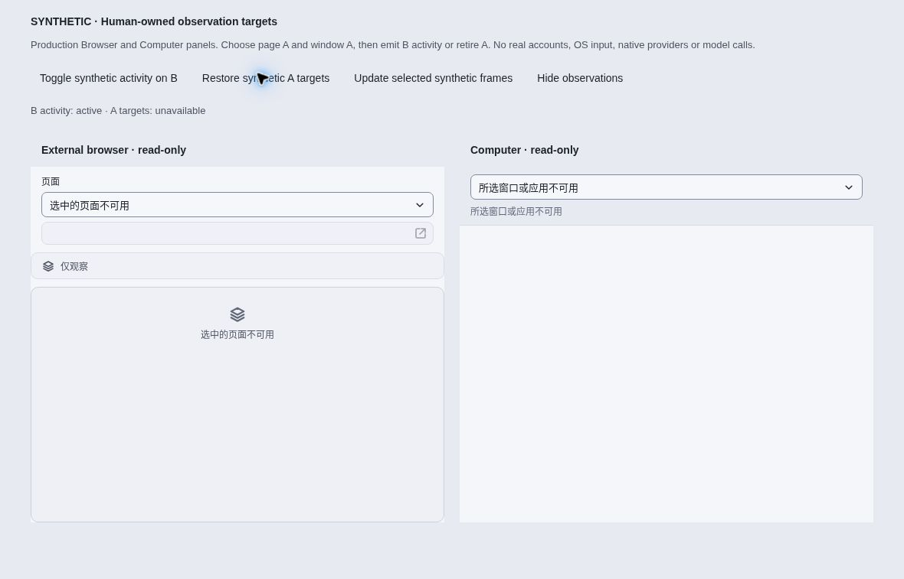
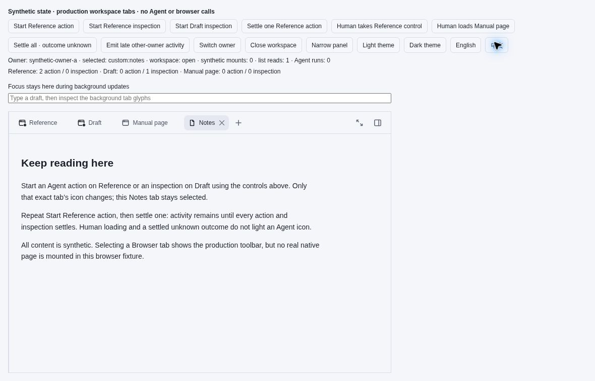
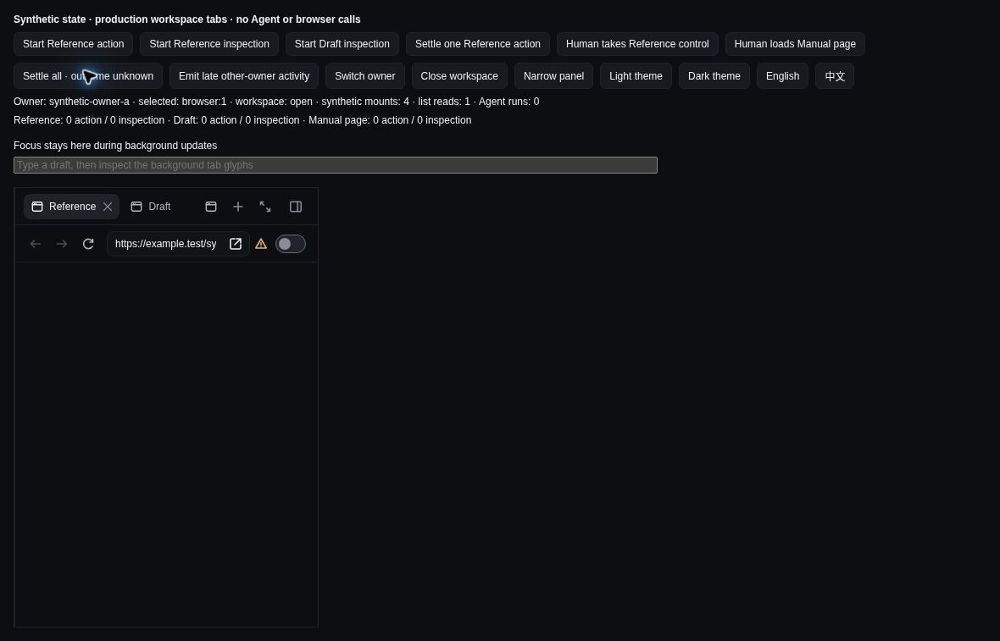

# Manual Browser presentation — synthetic acceptance

Accepted renderer source: `734137ff36e60cc4fee7b5587f7295ec35efd617`.
Public source: `066b1752749d294ebaa7bb42e3f2966c14c22c34`.
Both commits have the same tree, `12c832321f1983834ae9441e0821802659f9ff7d`.

Actual cloud-browser CUA screenshots were captured on 2026-10-29, approximately
10:37–10:39 UTC, and all five images were inspected. They show production
`AuxiliaryPanel`, `WorkspaceBrowserPanel`, `BrowserThreadPanel` and
`ComputerThreadPanel` components with **synthetic** catalogs, frames, activity
and native-mount counters. No private content, user machine, real account,
native provider/input or model API was used. These are browser fixtures, not
a native Electron acceptance run.

## Screenshots and observed interactions

All images are original, unmodified 1180 × 757 JPEGs. The fixture controls are
separate from production panels. The dark screenshot contains a narrow panel,
not a narrow browser viewport.

### No implicit target selection · light / Chinese

Both observers remain unselected despite available targets. The Browser
no-selection sentence is displayed once; no Follow Agent control is present.

### Explicit targets survive other-target activity

After choosing page A and window A, B activity and frame-update controls leave
both A identities selected. New synthetic A frames appear without switching.

### Retired targets remain unavailable

Retiring A clears its frames and shows unavailable without substituting B.
Browser feedback does not contradict the retained selection with a no-selection
explanation.

### Exact built-in tab glyphs only

Two Reference actions and one Draft inspection mark only their corresponding
tab glyphs. Notes remains selected; the fixture reports no native mounts or
Agent runs. One Reference settlement leaves its remaining action marked.

### Settlement preserves real control and uncertainty · dark / narrow panel

Human takeover keeps its safety details in the existing permission tooltip
and accessible description, without a separate text row or reserved blank
space. Final settlement clears activity marks but retains actual human control
and the unknown-outcome warning; it does not imply success or replay. The
production viewport element remained at `(18, 310, 357, 430)` CSS pixels across
Agent-allowed two actions, human-controlled one action and settled unknown
outcome in this real-browser fixture.

The operator also closed the workspace, emitted new Draft activity and a late
other-owner event, and verified that the workspace stayed closed. Intermediate
click outcomes are recorded in [`acceptance.json`](acceptance.json); the five
images are selected end-state captures, not screenshots of every transition.

## Validation and limits

- Final focused changed-test set: **187 passed**, across 24 files including `.mjs`.
  The packaged lifecycle regression separately passed with explicit target
  selection and no automatic substitution after provider replacement.
- Independent final geometry-stage review: **23 passed**, covering control,
  activity and errors. All five images, ten checksums, 74 + 18 source hashes
  and the public source-tree equivalence were also independently verified.
  The earlier manual/localized observer and strip review passed 25 tests at
  `0992b1ff`.
- Own SDK build, prepared first-party packages, brand check, final Node/web
  types, production main/preload/renderer build, changed-file formatting and
  whitespace checks passed. Core aggregate: **1,560 passed / 2 skipped**;
  SDK **25 passed** and IMZenX plugin **45 passed**. Those Core/plugin sources
  were unchanged by subsequent renderer-only feedback corrections.
- Initial **unfiltered** ZenX aggregate: **4,827 passed / 11 failed / 49 skipped**.
  Three failures were outdated synthetic owner/automatic-selection assumptions;
  their corrected regressions pass. The other eight were environment limits:
  three synthetic Unix-control tests could not bind `control.sock` (`EPERM`),
  four shell tests lacked native `node-pty`, and one `.mjs` file could not import
  the unavailable Electron installation. No denied socket action was retried
  after its cause was established; no tests were weakened to hide these limits.
- Pre-geometry `0992b1ff` explicitly environment-filtered aggregate: **4,831
  passed / 0 failed / 49 existing skips**. Seven named cases and one
  Electron-import file were excluded for the established environment limits;
  they are not included in those totals. The same filtered aggregate on final
  `734137ff` finished **4,830 passed / 1 failed / 49 existing skips**. The sole
  failure was an unchanged plugin-profile dev transaction timing out at its
  existing 10-second deadline before the Catalog commit fence. Its isolated
  rerun passed on the same source with the same timeout. That isolated pass
  does **not** change the failed aggregate verdict or establish its cause.
- The earlier hosted native job on `2371ef6b` caught a real **22px viewport
  displacement** when the conditional human-control row appeared. The repair
  removes that row, keeps all safety text in the existing permission control
  and preserves the native exact-geometry assertion, adding human-plus-inflight
  coverage. The final browser-fixture geometry is stable. The same hosted
  **Workspace background capture and targeted input step passed** on public
  `066b1752` ([job](https://github.com/albert-zen/zen/actions/runs/40858904418/job/123396944653));
  remaining hosted/platform checks were still running when that result was
  reported. This is not a claim that all CI checks passed.

This is **not a full unfiltered suite pass**. The browser screenshots do not
replace native Electron/WebContents, compositor, CDP/OS-input, login/profile
identity or platform-lifecycle validation. The separately identified hosted
step is native evidence for its own exercised scope; other platform checks
remain separate. No full CI or real-account acceptance is asserted here.

## Provenance

- [`activity-source.json`](activity-source.json) and
  [`observation-source.json`](observation-source.json) are unchanged build
  receipts for the exact accepted source: 74 and 18 repository-source hashes,
  respectively, plus compiled artifact hashes. Compiled bundles are not
  included. The two fixture entry points are
  [`workspace-browser-tab-activity-visual.tsx`](../../../test/fixtures/workspace-browser-tab-activity-visual.tsx)
  and [`manual-observation-visual.tsx`](../../../test/fixtures/manual-observation-visual.tsx).
- [`acceptance.json`](acceptance.json) binds the images, capture interval,
  observed interactions and synthetic limits to the accepted source and its
  public tree-equivalent commit. [`validation.json`](validation.json) records
  commands, result counts and explicit environment exclusions; it contains no
  private runtime logs or screenshots.
- [`SHA256SUMS`](SHA256SUMS) covers this README, the receipts and all five images.
  From this directory, run `sha256sum -c SHA256SUMS`.
