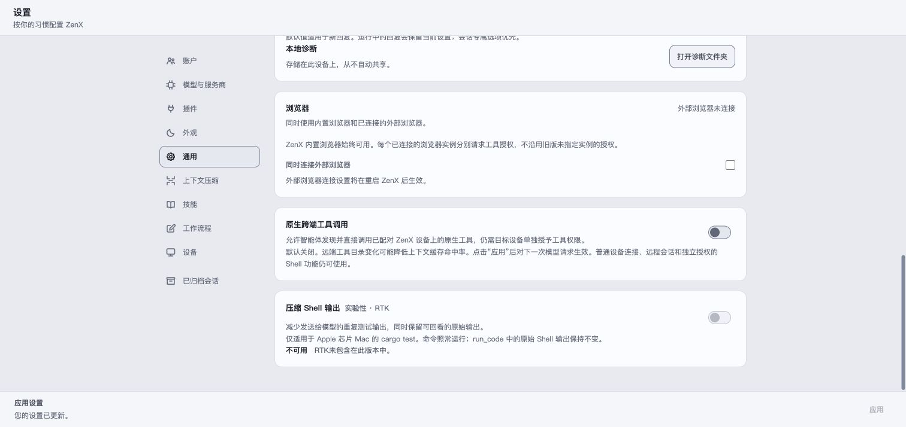
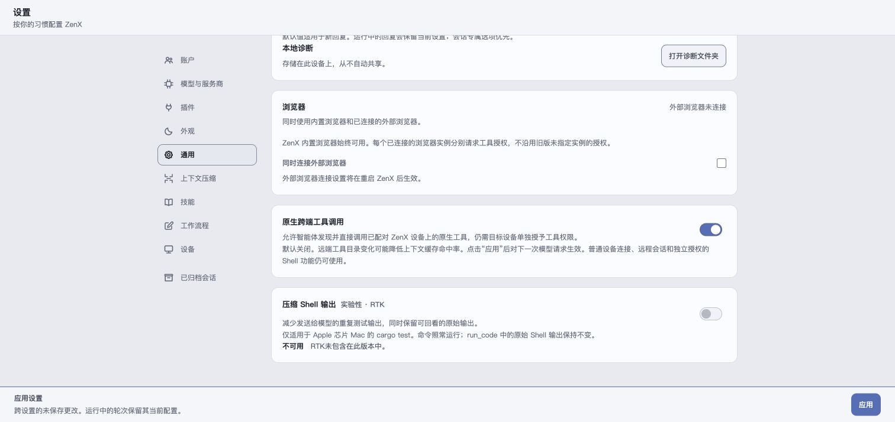

# Native cross-device tools settings

These are real Chrome screenshots of the production `SettingsView` and shared
styles, built with `scripts/build-settings-audit-preview.mjs`. The fixture uses
synthetic providers, `/synthetic/audit` and unavailable mutation ports. It does
not read a user profile or start a Host, make provider/SSH requests, or grant
access to a device. This is browser component evidence, not installed Electron
acceptance.

The first screenshot shows the default-off switch; the second shows an enabled
draft and the Apply button. Persistence and dispatch are separately tested
through the real settings service, profile store and capability boundary.

