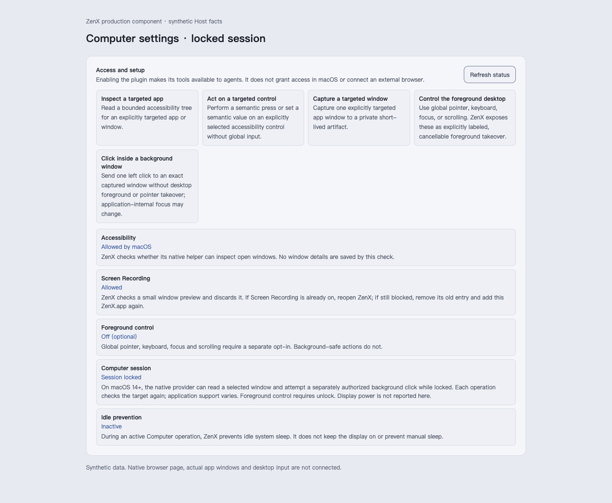
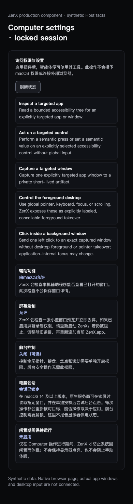

# Native window access explanation

These are real renders of the production `PluginAccessReview`, styles and English/Chinese resources with the selected native Computer 1.4.0 manifest. Source: `c506fd567f5d60b6f674cb4d26e622ff25bf1f9f`. [SOURCE.json](SOURCE.json) records 36 bundled source hashes and viewport geometry. All four images were visually inspected; the full access review fits each capture without horizontal overflow.

The Host facts are synthetic: macOS, locked session, existing Accessibility/Screen Recording permission, foreground control disabled, no generic preview verification. No native app, real profile, OS permission, window capture or desktop input is connected to this renderer fixture. Permission labels come from the actual selected manifest; the narrow layouts use the bundled Chinese interface resources. These screenshots establish the UI explanation only; actual native behavior is validated separately.

The explanation names macOS 14+ for scoped native locked-window reads and separately authorized background clicks. Application support varies, app-internal focus can change, and foreground control still requires unlock. Generic preview readiness does not certify a particular native window. The image and input receipts do not assert application effect.

| Appearance | Width / language | Capture                                        |
| ---------- | ---------------- | ---------------------------------------------- |
| Light      | 1280 / English   | [Desktop](native-window-access-light-1280.png) |
| Dark       | 1280 / English   | [Desktop](native-window-access-dark-1280.png)  |
| Light      | 390 / Chinese    | [Narrow](native-window-access-light-390.png)   |
| Dark       | 390 / Chinese    | [Narrow](native-window-access-dark-390.png)    |

