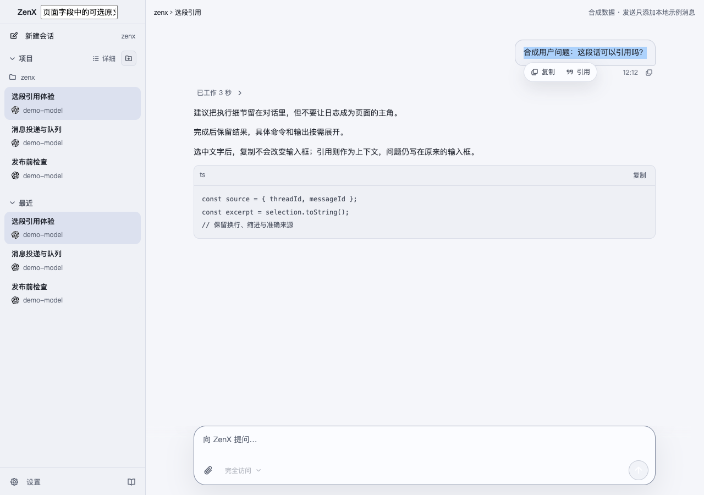
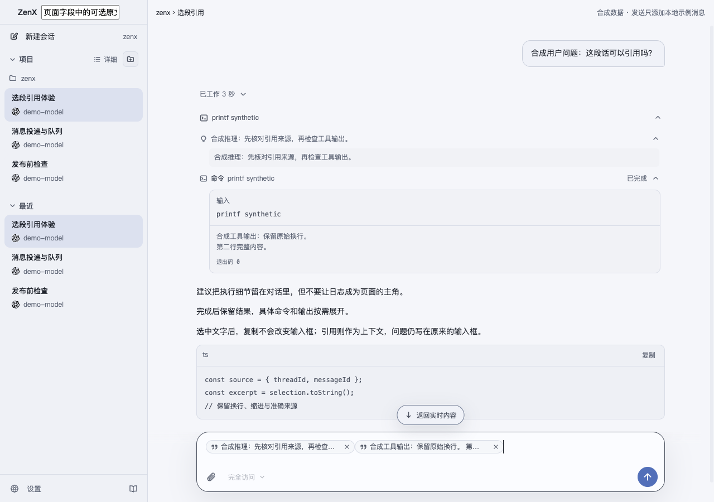
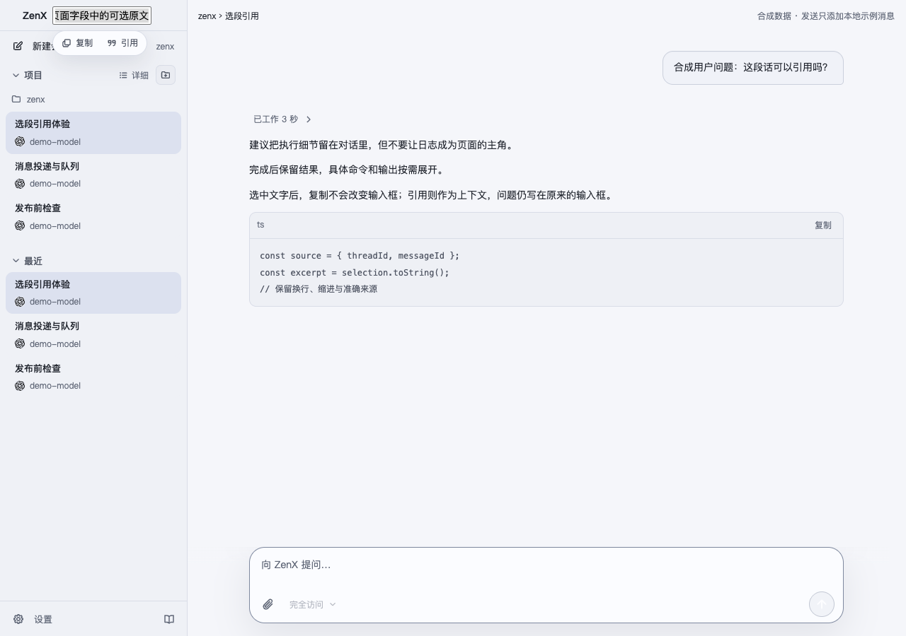

# Page text quotes — 2026-11-02

Implementation: `50c5501a51069650bab509d87e64c9a46ef09106`. All screenshots and source data are synthetic; the standalone fixture renders production components in real Chrome. This is not installed-app or production-provider acceptance.

The model receives a compact header such as `[Selected message; zenx_threads_read ref=s3]`, exact selected text and its closing delimiter. There is no missing-time or permission prose. Text without a canonical source uses `[Selected text]`; multi-message and tool selections retain each exact source ref. Source refs continue through the existing reader and permission checks.

## Verified

- 97 focused quote/reference/clipboard/serialization/provider/Host tests passed.
- 118 Core compaction/reference regression tests passed.
- ZenX typecheck, production build, formatting and diff checks passed.
- Eight real-browser scenes passed: user, public reasoning, tool output, interface text, input field, cross-message selection, explicit send, and narrow layout. Quoting preserves exact text and does not send. Native field scrolling no longer dismisses its quote menu.
- Native Host reads returned exact user/reasoning/tool-call/tool-result Items, including long result continuation. Two real provider adapters constructed the expected input at injected no-network boundaries.
- Two independent review rounds found no unresolved implementation blocker.

## Broader check limits

The full ZenX suite ran 5,117 tests: 5,077 passed, 18 failed, 22 skipped. Failures include macOS realpath/login-PATH differences and unrelated integration failures/timeouts. The source-Find and Fleet-shell failures were separately reproduced on unchanged main `6aa0a505`; the other failures are not all independently classified. The full Core command first hit a Python dependency download timeout, then stalled after failures in the unrelated IM plugin when reusing the local environment; the task-owned run was stopped. No full-suite green result is claimed. Full logs remain in the local task artifacts.

## Real browser captures

The manifest records the exact implementation and bundle/screenshot hashes. `page-quote-verification.json` records the selected excerpts and source identities; `browser-lifecycle.json` records successful capture and cleanup.
