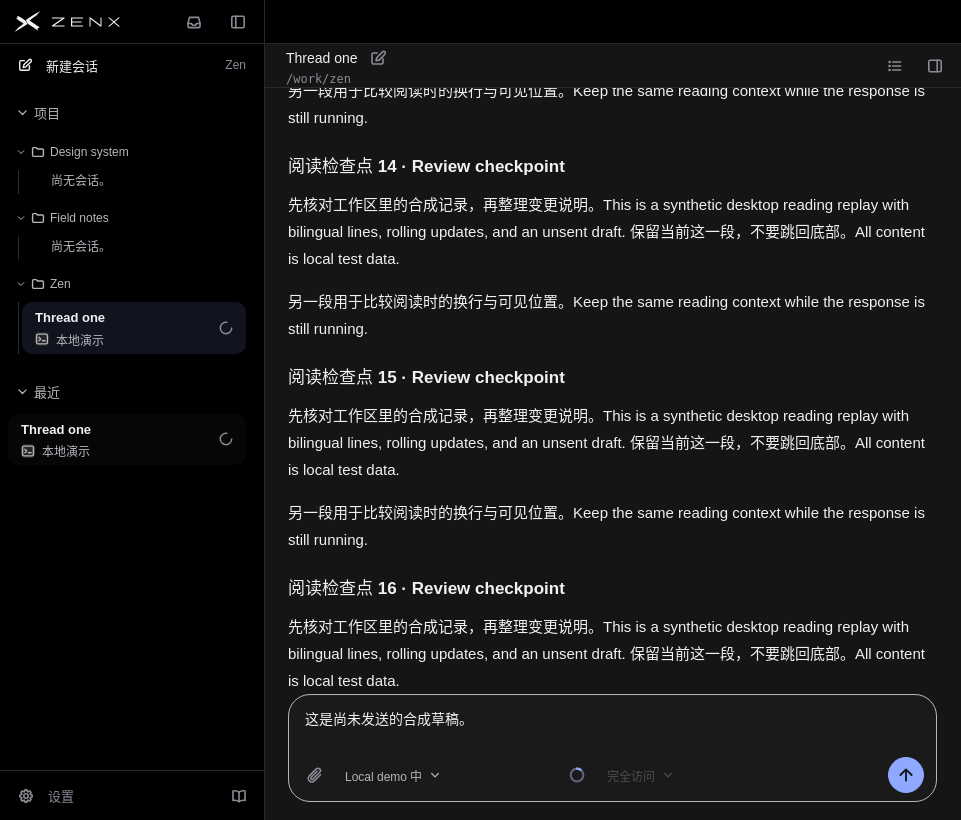
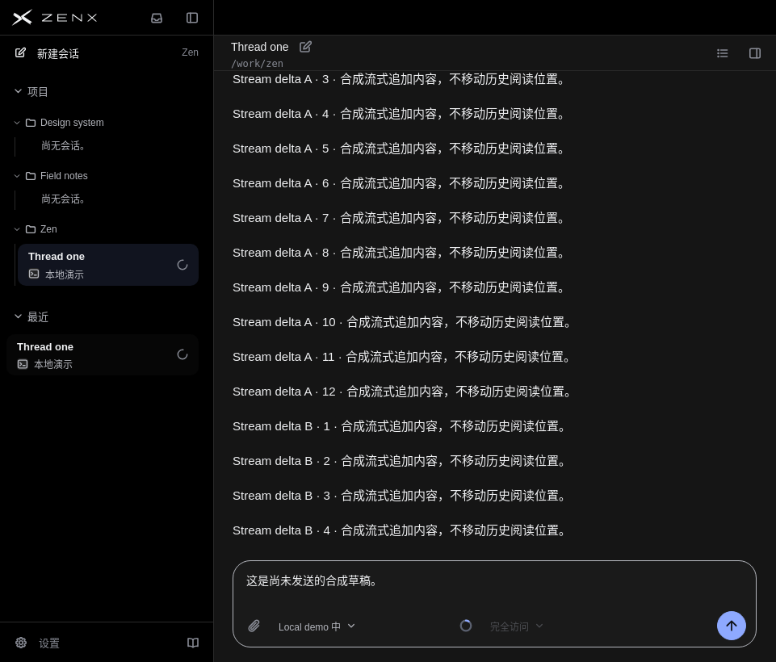

# 「回到最新」在缩放和流式回复期间

这是合成数据的完整 ZenX App renderer，不是模型或真实会话。云 Linux Chromium 131，Graphite 深色、简体中文、DPR 1。不连真实 Host；用夹具通过 App 原有通知入口提供同一条回复的合成增量（`item_delta`）。未在 macOS / Windows 原生窗口复验此缩放链路。

同一数据、相同实操：在 961 × 820 从底部用鼠标向上滚 160px，窗口收窄到 960 再恢复 961，然后增加 12 段流式文本。改前产品基线为 `3163e537043d8d13d0a193a8210307227724fab1`，改后只改变 `ThreadView.tsx` 的虚拟内容稳定通知处理。同位的未裁剪原图：

两版恢复宽度和收到增量后滚动偏移均为 2789px；距离最新分别为 821px（无按钮）和 869px（有按钮，含自身48px留白）。候选只刷新按钮显示，不主动拉回底部。分两次验证，鼠标点击和从输入框 Shift+Tab 后按 Enter 都回到底部；后一段增量仍锁在底部。各态保持未发草稿。20 个定向测试通过。它不修窄窗换行带来的段落位置变化，也不改变箭头的大小、样式或位置。

参考：[T3 #5566](https://github.com/pingdotgg/t3code/pull/5566) 作者公开描述从实时回复上翻后暂停跟随、显式回底后才恢复。是相同的交互原则，不是同一个窗口宽度触发，不是本轮本地运行或视觉评分，不把局部功能验证当整套 UI 得分。
