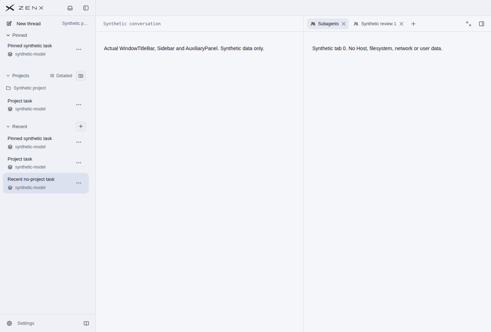

# Project / Recent / Pinned visual review

Source: synthetic merge `143506de12ebd540da6c1cd481726b021b263af2`, tree `879b436d11cd7cf5c2be42fd6d161a48b160ab5b`, identical to candidate `2ca2adc438f911a499bdaee3ae0b3878885e588a`.

[Visual-only run 41423633402](https://github.com/albert-zen/zen/actions/runs/41423633402) rendered the unchanged `titlebar-safe-area.html` from original CI artifact `13130870327` ([source run 41421950151](https://github.com/albert-zen/zen/actions/runs/41421950151)). Its existing navigation query renders the real production Sidebar, WindowTitleBar and CSS with synthetic rows. Pinned, Projects and Recent appear together; Recent remains selected. This is a 1360 × 920 Linux Chrome screenshot, not native Electron acceptance. No Host or user data is present, and this single image is not proof of dynamic ordering; actual Sidebar interaction regressions cover that behavior.

- Original artifact ZIP SHA-256: `cd8e3f8b30c4d7de87e0592c0b6eb61408a534301e3f3b347fe8f4eb00f6f604`.
- Original HTML SHA-256 before and after rendering: `14d43c153a30da89d220e553f7087baa80103163a2cd467046d6f5444cea59e1`.
- Original PNG SHA-256: `12d12d06403b87d25f316d0cbf76bc52a17eb8d153b6069e5c62393a603e6539`.
- Query: `navigation=1&platform=linux&sidebar=open&theme=light&count=short&lang=en`.

The PNG is published unchanged after pixel review. Its visual source predates the independent #621 tool-result-identity integration; no later native or visual rerun is claimed.
