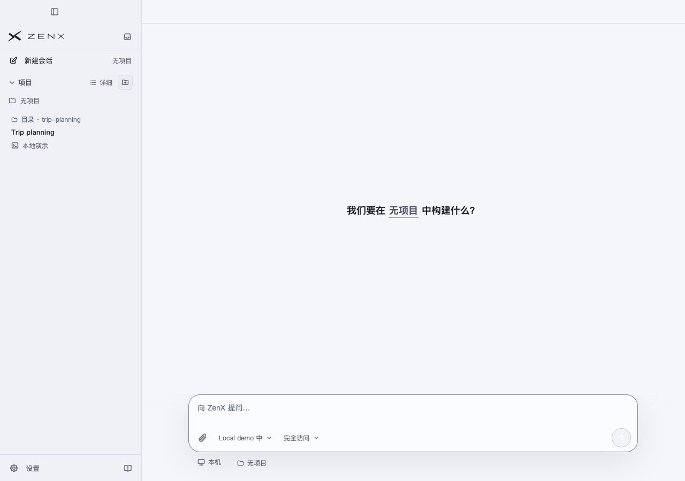
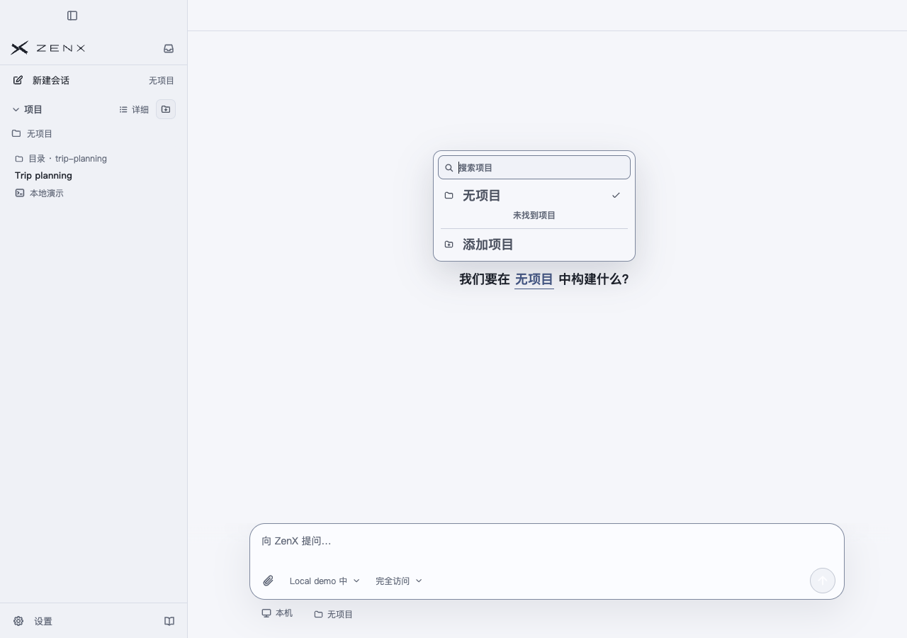
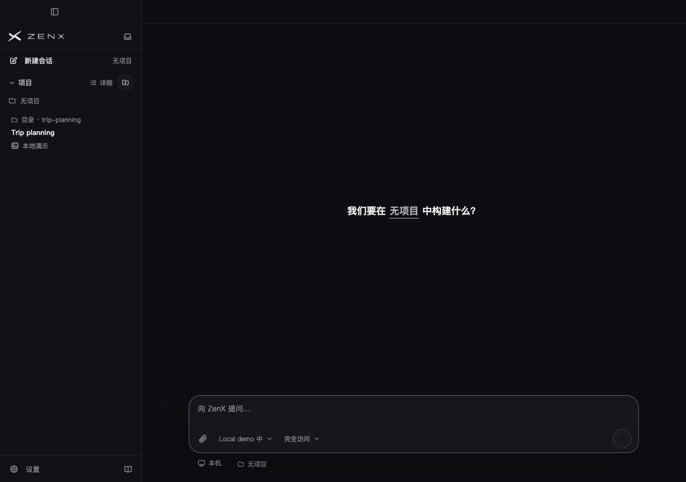
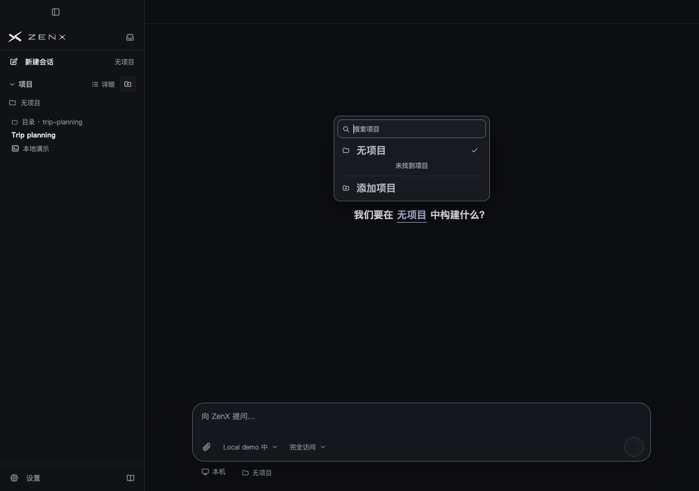
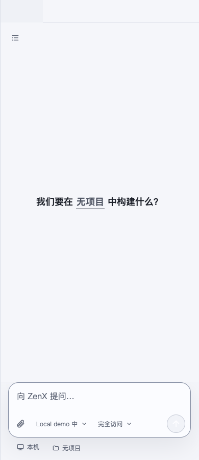
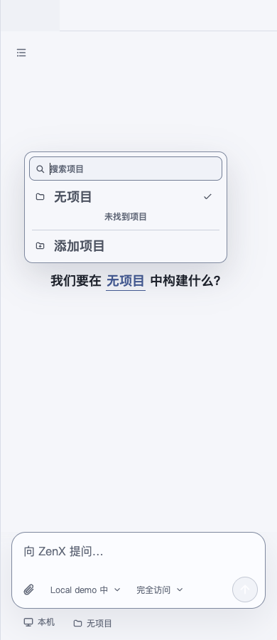
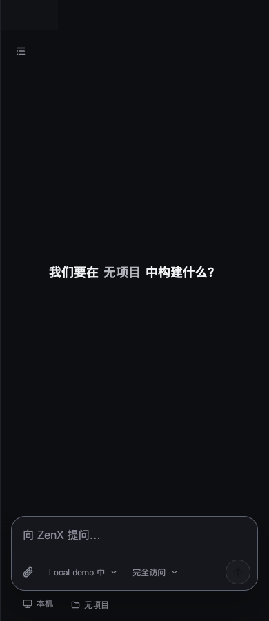
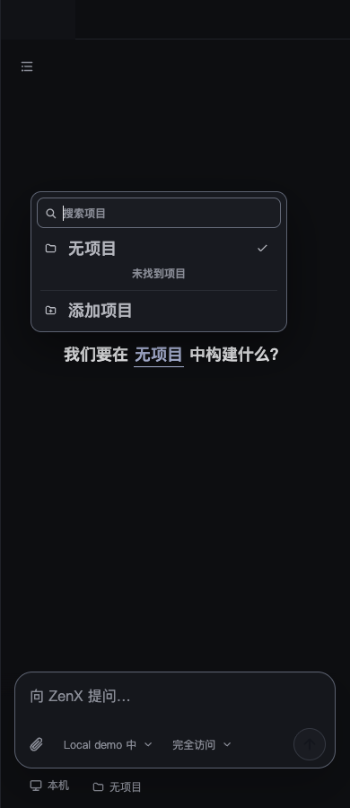

# Projectless chat acceptance

Production source and fixture commit: `cb26d875504e33682e93c6b489ae39eeb3468421`.
All screenshots render the actual App, Sidebar, Project selector and production styles. Host/Thread facts are synthetic; no actual user profile, model, directory allocation or desktop input occurred. The fixture intentionally has no configured Projects and one existing projectless chat, covering reload discovery rather than only a mixed sidebar. Headless Chrome CDP pointer input opened the real selector; light/dark and 1280/390px cases passed. `source.json` records source hashes; `PROJECTLESS-CAPTURE.json` records the frozen source and interaction receipts. This evidence commit changes only acceptance documentation.

## Desktop

## Narrow viewport

## Other validation

- Allocator/profile/projection/settings: 124 tests, 119 pass and 5 existing platform skips; new projectless cases all pass.
- App/Sidebar/projectless self-control: 123 tests pass, including projectless-only reload rendering and rejection before remote Fleet dispatch.
- Self-control/model facade/Fleet regressions: 29 tests pass with actual synthetic Host wire tracer.
- Core build, ZenX Node/Web typecheck and production build pass.
- Independent review R1 fixes are included in the captured source; R2 must complete before merge.

Allocation uses exclusive persistent folders under the local Host's Documents/ZenX/date/name. It records exact product membership before native Thread creation; no Git initialization or automatic cleanup occurs. Configured Project authorization and remote Fleet scope are retained. Real-user app upgrade, historical data migration and actual filesystem usage by a paid model are outside this renderer fixture.
