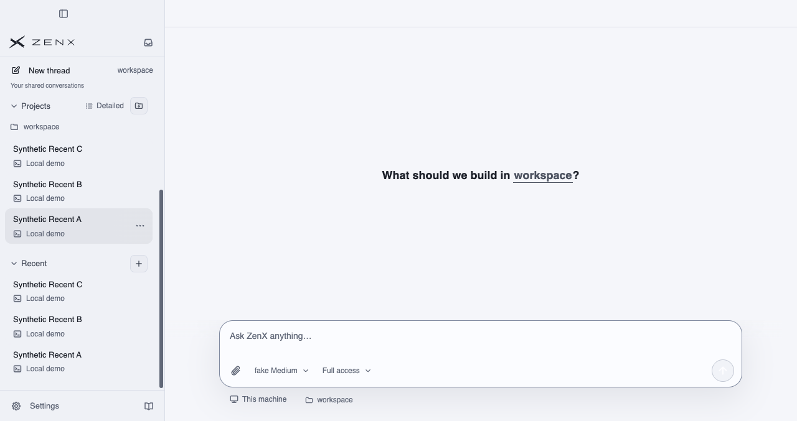
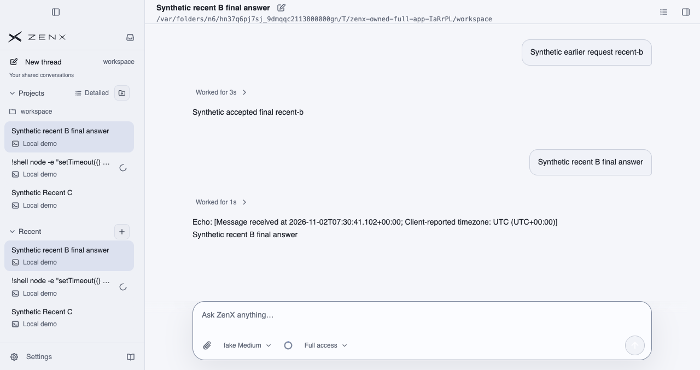
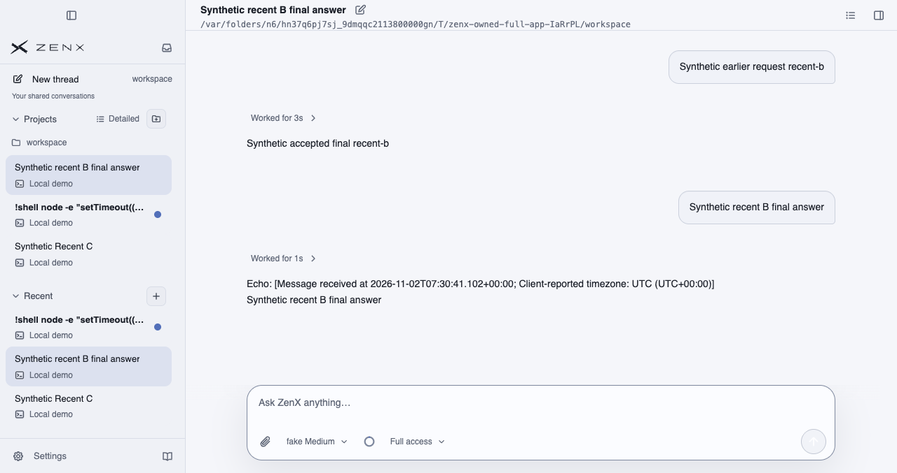

# Recent ordering — native full-App evidence

Product source: `e5c3fe9bf91ce0385bf730cd364b3035a82fa461`.

- [Native run 41406567098](https://github.com/albert-zen/zen/actions/runs/41406567098): successful actual Electron App on disposable macOS CI, not a mock UI.
- [Independent bounded report](https://github.com/albert-zen/zen/blob/8a10de9d2f79e67cd2a00e9d7417653874530d3b/docs/performance/native-recent-order-20261102.md).
- Three synthetic DomainThreadJournal histories, fake local provider, two native sends, actual local tool, private profile/home/workspace, no model network or user-device operations.
- Order checkpoints: C/B/A despite A's newer non-message instruction; A/C/B on user arrival; B/A/C with A running; A/B/C after A's accepted final, B still selected; A/B/C after reload.
- Exact client/message/Turn/ItemList IDs verified through a read-only storage reopen, complete Trace and zero compaction.
- The background stability interval had 12 observations but no guaranteed intermediate canonical event after B. It is not isolated post-B tool-result suppression proof; the Core runtime/reducer tests cover type-specific suppression.
- The fourth full-page reload capture leaves Recent below the fold. Reload order is established by actual-App DOM assertions, not a misleading screenshot claim. Only the first three clearly visible captures are published here.

## Original unmodified PNGs

### recent-01-cold-original-message-order.png

SHA-256: `0f4524e686190e4f9a37fa7a7744f7146fb6d290bd33d5ee40c2fd8c739ad2f5`; 62295 bytes.

### recent-02-background-tool-does-not-reorder.png

SHA-256: `625a620027ba55110b89f614eff2cab1a7a3938ca6df2cea1fe7d1b9776c9ad6`; 93482 bytes.

### recent-03-final-bumps-without-stealing-selection.png

SHA-256: `64ceb970d435bf3ee20c5f6afa52915d83ef6b8fea22d1cc155756a7d9a42d96`; 93387 bytes.

