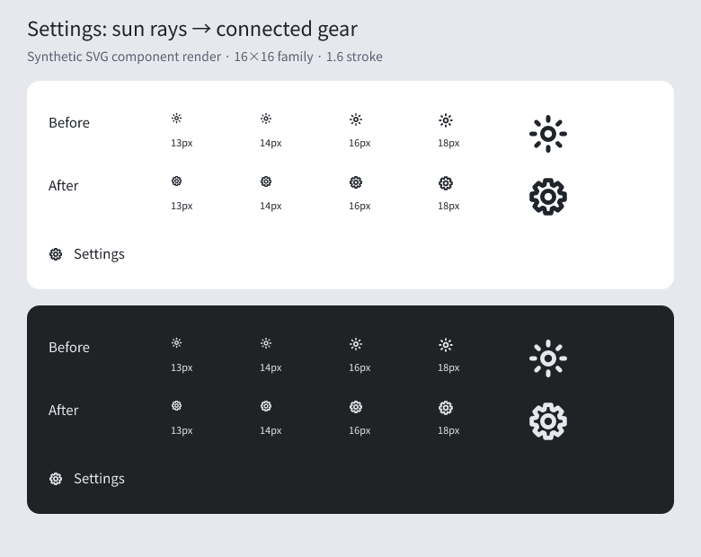

# Settings gear correction

The shared `settings` glyph used a center circle plus eight detached rays. It
looked like a sun at every settings entry point, not a theme-toggle mix-up.
Replace only that artwork with a connected eight-tooth gear outline and retain
the existing center hole, 16×16 viewBox, 1.6 stroke, currentColor and sizing API.
No callers, accessibility labels, theme behavior or dependencies change.

This is an **isolated SVG component rendering**, not a full-app screenshot. The
current SVG was rendered from `Icon` with React server rendering and rasterized
with resvg. The before row uses the prior shared artwork. The two panels compare
light/dark colors at 13, 14, 16 and 18px, plus a 48px close-up. Full-app browser
verification was not performed: browser startup was blocked by the execution
environment's socket restriction and the escalation environment failed to start.

The regression test now checks a single closed outline rather than eight detached
sun rays, preserves the central hole and stroke, and covers the existing sizes.
It failed against the old artwork (eight subpaths rather than one) and passed
with the correction. The focused service-indicator, interface-icon-semantics,
fork-icon and tool-group-icons test suites passed (13 tests).
