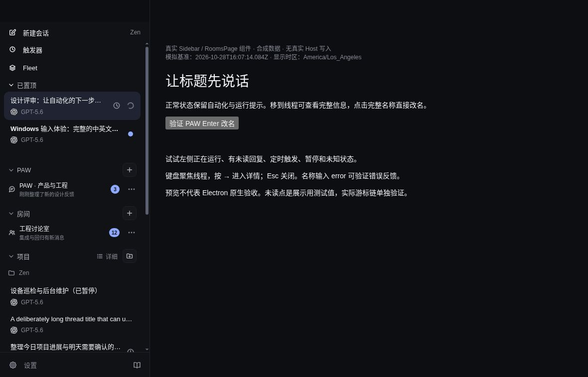
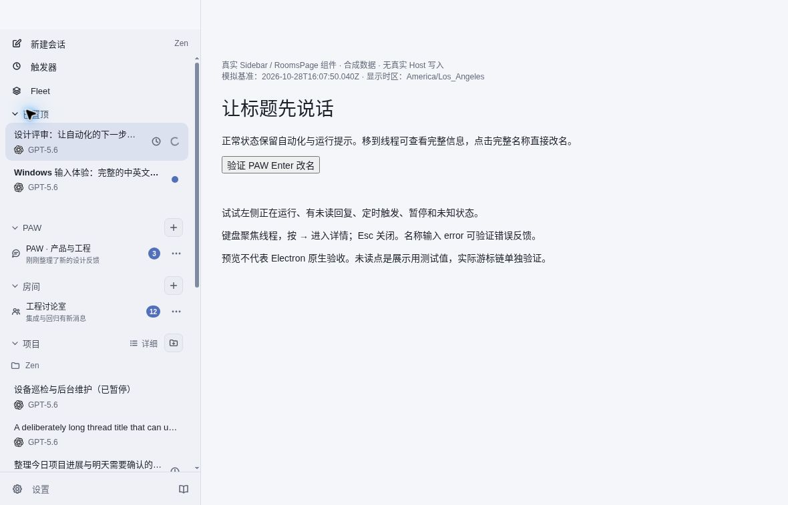

# Sidebar action area correction

Source: local 3cbb20e102cafa5edbe3d04d7dc9c5dbdfd0c09a, matching published source tree 80abb30d7f0b7ad6a6e26cf2c603cad68234fa33. source.json records production component/style and fixture hashes.

The screenshots render the actual Sidebar and PAW/Room navigation with synthetic data in cloud Chromium. They are not native Electron or user-computer acceptance. Host callbacks are stubbed, and no user data or credentials are included.

Verified: New thread → two plugin actions → Pinned → PAW/Rooms → Projects → Recent; all five section headings compute to 13px, font-weight 500, identical secondary color. Pointer collapse and keyboard Enter reopening preserve order. Dark and light themes inspected.

Focused Sidebar regression tests: 68 passed. Node and web typechecks, production build, changed-file formatting passed. Full hosted CI remains a separate merge gate.
