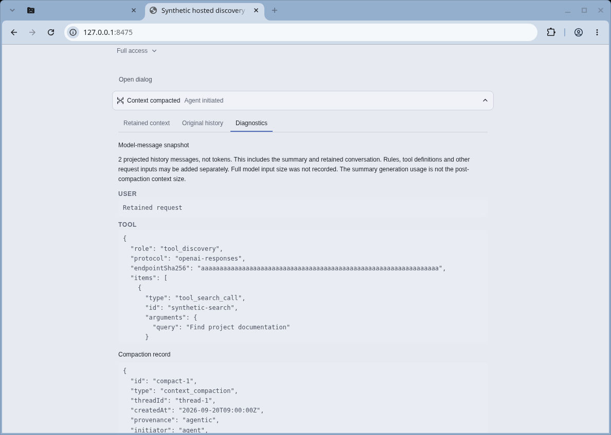
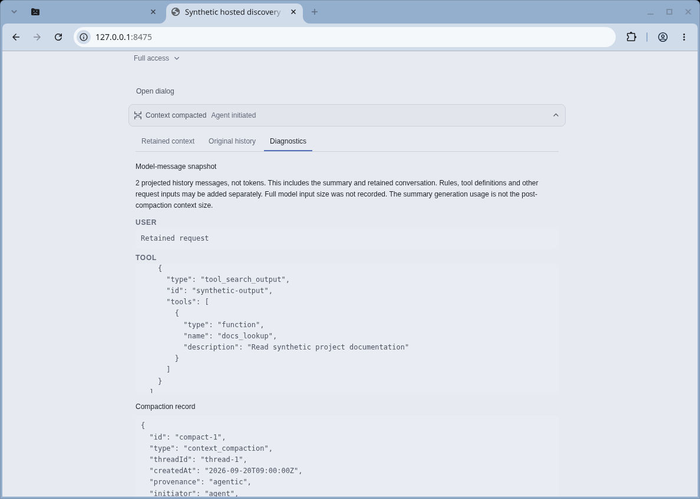

# Tool discovery and raw-file acceptance

## Visual evidence

These are unmodified cloud Chromium screenshots of the real production
`ContextCompactionEvent` component, using only synthetic fixture data. They
show the existing Diagnostics tab retaining hosted discovery calls and outputs
as readable raw content. No user data, live model request, full Electron App,
or native provider execution is represented. All 49 repository inputs match
source commit `6a72b7e096d6d465c1454744fd6a19408eb58fcb` byte for byte.

## Behavioral acceptance

- Full eligible programmatic catalog, selected detailed schemas, and concise stable
  fallback declarations. Documentation reads do not grant execution eligibility.
- Existing enabled/model-callable and actual operation approvals remain enforced.
- Official OpenAI Responses endpoint plus verified model capability gates native
  namespace/search support. DeepSeek/custom/subscription routes retain fallback.
  No new Anthropic adapter is introduced.
- Native tools presentation is committed by context preparation before dispatch;
  real adapter wire requests are compared with durable journal data in a synthetic
  AppServer integration test, including stability across two turns.
- Dedicated model Trace reader removed; raw JSON/text artifacts are readable using
  existing shell tools. Trace itself remains durable. Remote bytes not received
  are not represented as available.
- Complete small in-memory output remains usable when optional spool storage fails;
  larger missing files and upstream truncation remain explicit.

## Validation status at this archive checkpoint

Core aggregate: 1,584 passed, 0 failed, 2 skipped. Changed-file formatting and
Git whitespace checks passed. Sequential ZenX node/web typechecks passed on the
preceding candidate (later changes are spool implementation
and tests; final rerun and hosted CI are recorded in the PR).

Earlier integration failures were not acceptance passes: a 500 ms unawaited-child
test timed out under aggregate load and passed unchanged in isolation; one parallel
typechecker was killed with exit 137 and later passed sequentially. The initial
ZenX aggregate had 11 failures: eight native-environment limitations, a Rooms test
parsing a bounded receipt instead of its complete file (corrected), and two small
output receipts with unavailable spool storage. The latter motivated the tested
in-memory-output fix; the original filesystem failure was not conclusively identified.

Final full ZenX rerun and exact-head hosted CI must finish before merge.
