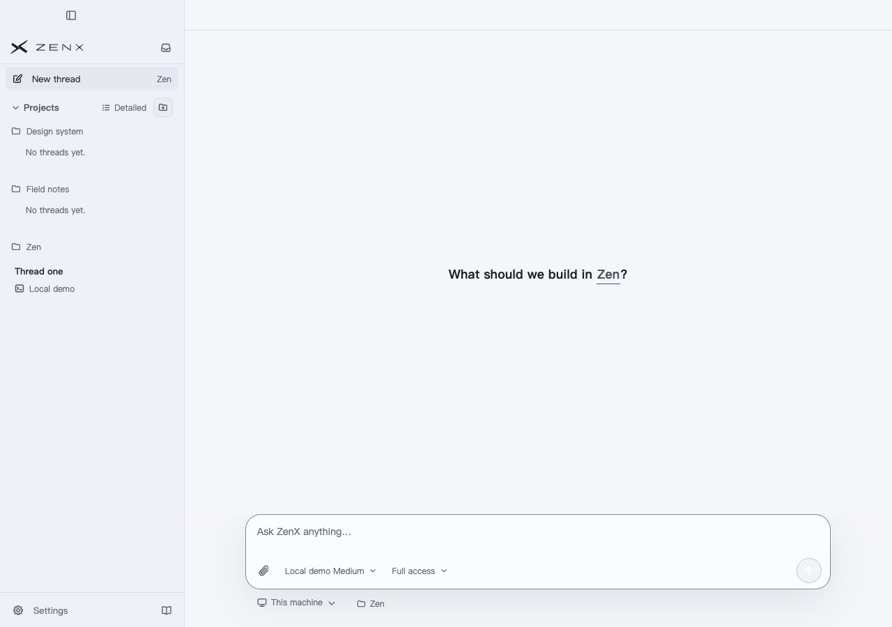
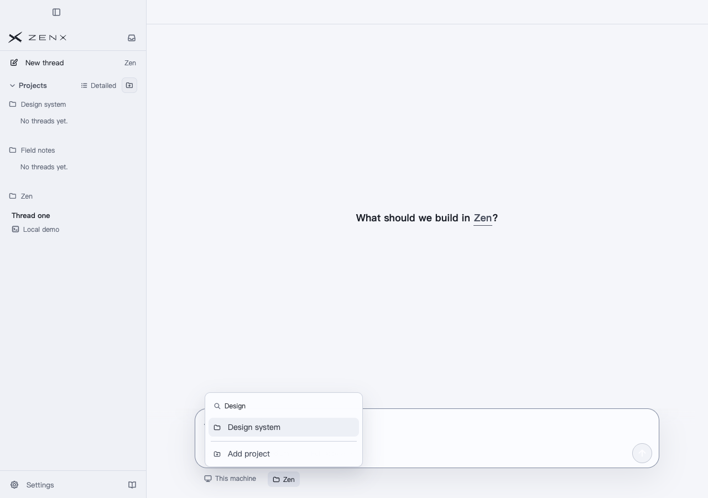
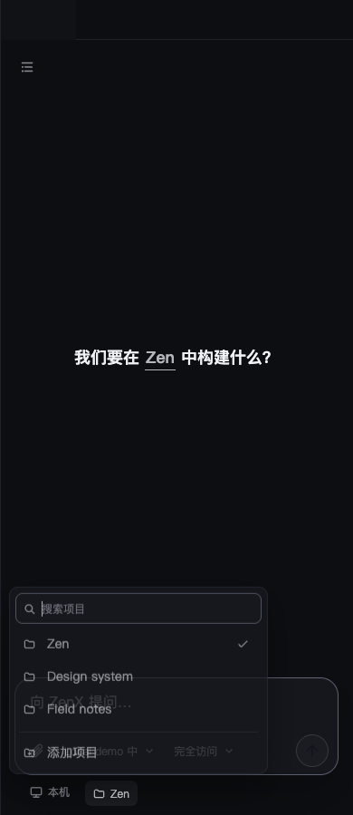
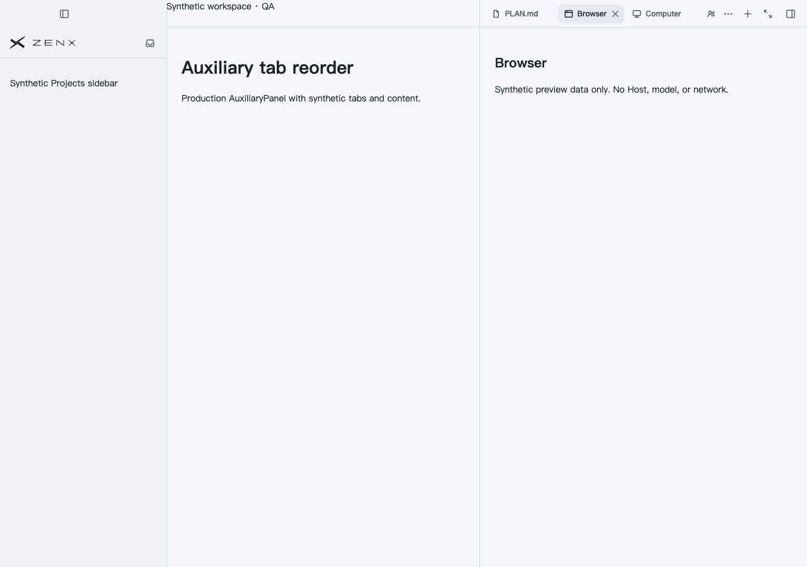
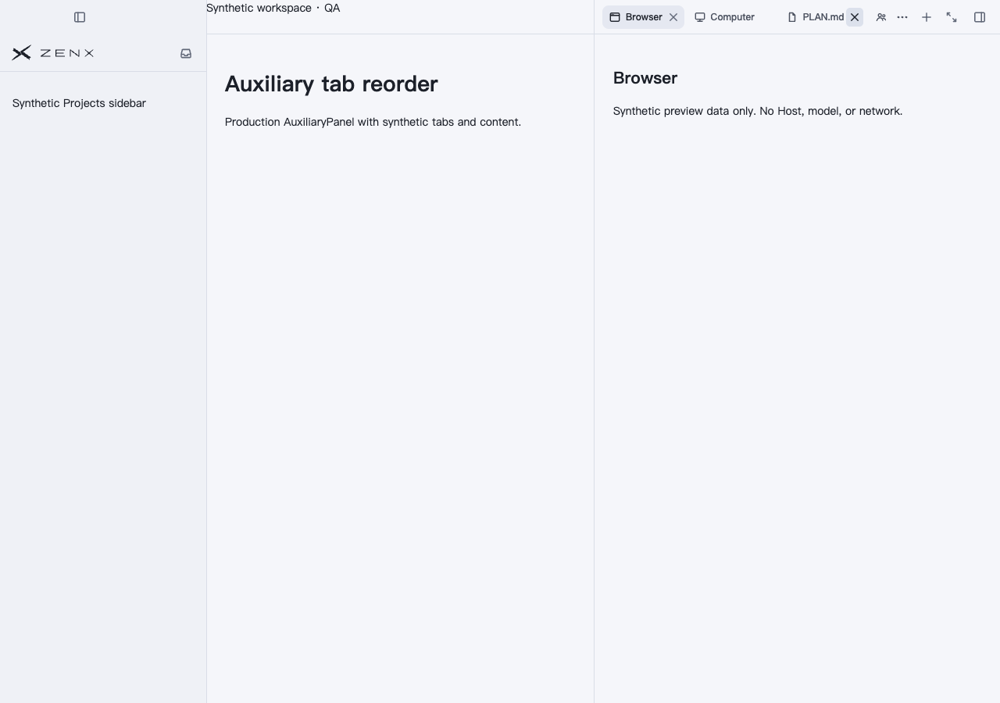
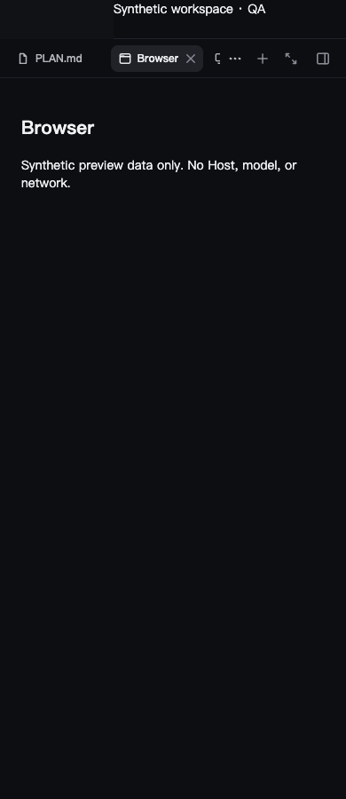
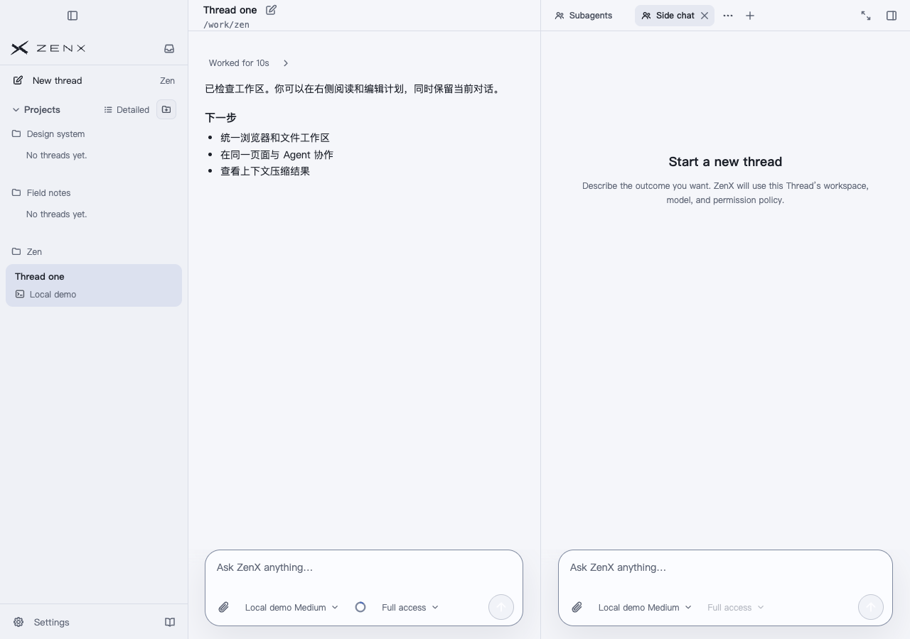

# New Thread, workspace tabs and side-chat acceptance

Production components with synthetic Projects, machines, Threads and file/tab contents. CSP blocks network requests; no real Host, profile, model, user data or native desktop interaction is represented.

The after capture was built from clean source `e64492b838193c611ba77c860b8cc8abe1061448`. `source.json` binds the bundled artifact and component hashes; `ui-polish-capture.json` records the interaction results. This integrates main `7e31a545` after #545 without manual conflicts. The commit refreshing this evidence changes screenshots/documentation only. The before capture uses production `54fc490fb3216ff00c122f46e35985253e457be2` plus the same synthetic test fixture (QA snapshot `b85af87a3cdea701feaaed5bd0ec9148e22dbde0`; its builder only omits the candidate-only reorder stylesheet from the hash list). See `before-source.json`.

- Four welcome states: light/dark at 1280px/390px; machine open/cancel, long machine label bounds, Project keyboard search/selection/Escape, zero Thread creation and zero Project preference writes.
- Four auxiliary states: light/dark at 1280px/390px; real tab icons, drag cancellation retaining order with zero writes, completed reorder moving Files after Computer with one write and unchanged selection.
- Actual App Side chat draft: open and close with zero native/plugin child creation. Settled titlebar and panel edges meet at x=760; the complete users icon hit-tests to the selected Side chat tab.

Drag acceptance starts native Chromium dragstart/dragover with mouse input, then uses CDP Input.dispatchDragEvent for the drop. Cancellation uses Chromium pointer/keyboard input. This covers browser input and renderer behavior, not a physical OS drag gesture or native Browser/Computer interaction. Chrome's isolated profile was removed after capture. The first integrated capture timed out once on the Project Escape-close assertion; the unchanged script/source passed on retry. This is a bounded interaction check, not a stability stress run.

Validation: 198 focused App/renderer/sidebar tests, 46 compiled native child/fork/side-chat tests, Node/Web type checks, Core build and ZenX production build passed. Independent review has no remaining blocking finding. The full local ZenX suite attempt on the initial implementation had 4,396 pass, 26 fail, 20 skip and 1 cancelled out of 4,443 tests. Named macOS path, Ctrl+F and encoded-preview-path failures were reproduced on base; not all packaging/Host/profile failures are classified. Room changes were then covered by the focused App tests, including a blocked promotion receipt followed by a user tab change. This is a draft delivery, not an installation or full-suite green result.

## Selected screenshots

Before and after New Thread:

Before and after dragging Files after Computer; Browser remains selected:

