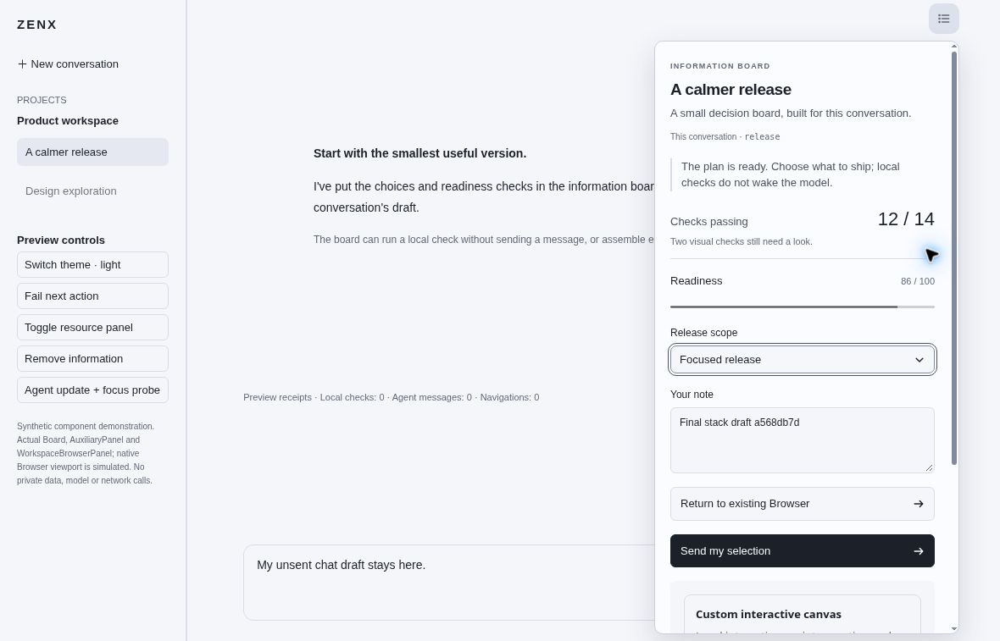
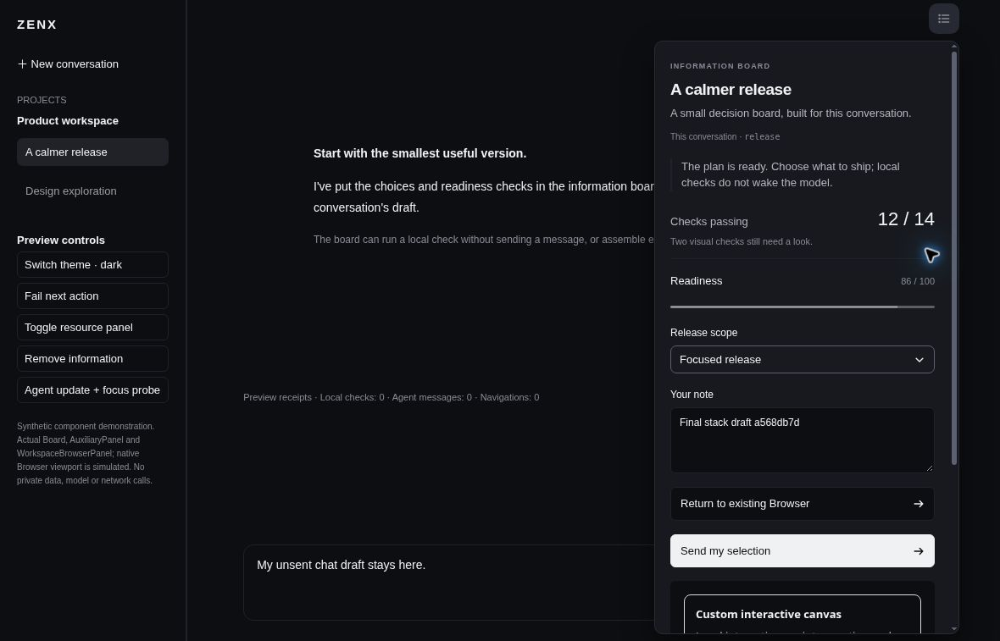
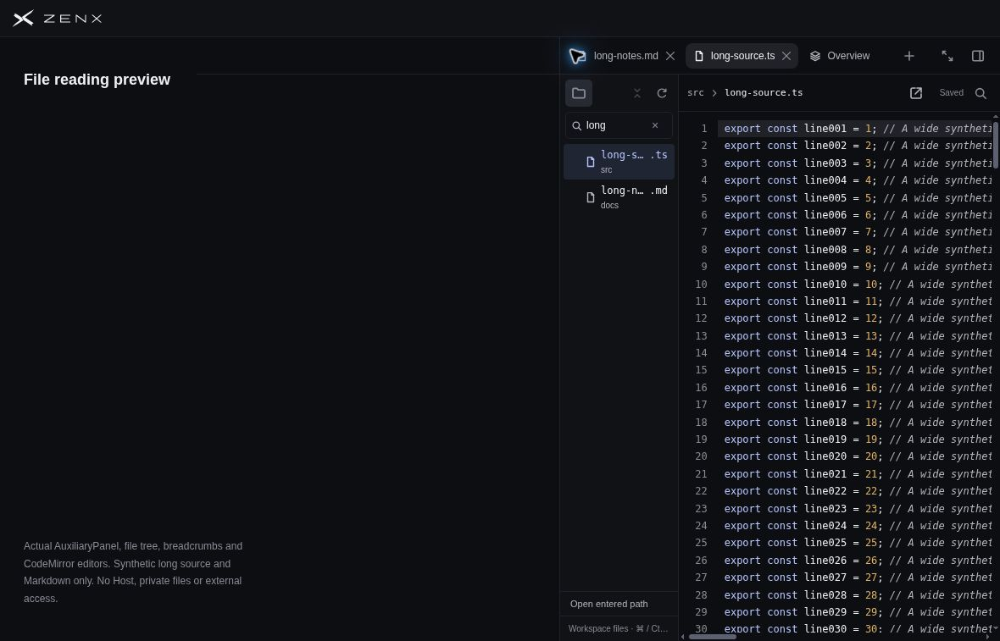
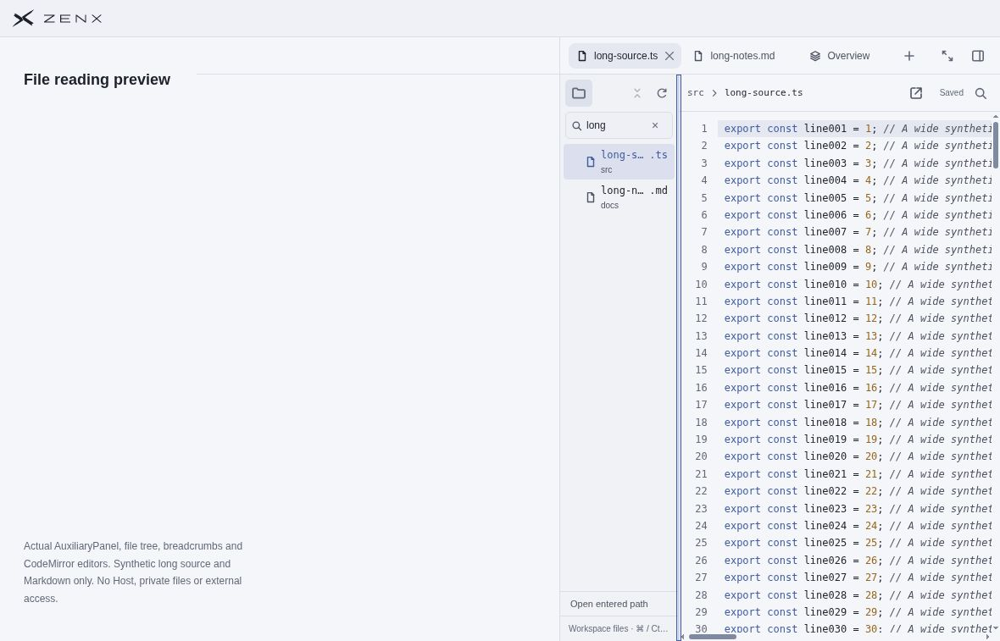

# Workspace controls: synthetic browser review

Review date: **2026-10-29**. Result: **no observed blocker within the bounded
combined-stack checks below**. This archive preserves the evidence for PR #577;
it does not change the product or broaden the acceptance claims.

## Source provenance

The four JPEGs are unmodified browser captures of production components rendered
with synthetic data and fake effect ports. Their format, dimensions (1180 × 757),
byte lengths and SHA-256 hashes are recorded in [`source.json`](source.json).

| Role                           | Commit                                     |
| ------------------------------ | ------------------------------------------ |
| Source used for these captures | `a568db7d13791af5c0dc74fed22a75f2481fe5ca` |
| Published PR #577 head         | `645ef0881681fffa0856badf63023a877942d731` |
| Accepted main merge            | `df003fc5d02173aa9150e53ad883efbf7b1ee3bb` |

All three commits have the identical complete Git tree
`d1285b0f8b6685d3d787f9cb0f2bfa7896ed8bc6`. The screenshots were captured from
`a568db7d`, not recaptured after merge. Every entry in the original
[`board-source.json`](board-source.json) (14 files) and
[`files-source.json`](files-source.json) (33 files) was independently checked
against all three commits. Source paths in those manifests are relative to
`apps/zenx`.

## Bounded checks performed

- **File navigation, 140 px, light and dark:** the query `long` remains readable
  in a 62 px input. Search and clear controls do not overlap the folder controls.
  Refresh stays at the far right of the first toolbar row. The accepted default
  192 px navigation also uses two toolbar rows; this is not a one-row claim.
- **Fixed file-navigation toggle:** the 32 × 32 toggle stays at viewport
  `(667, 94)` when opened and closed. Manual refresh and hide/reopen preserve the
  query and selected source file. Refresh is explicit and user-triggered; **no
  automatic filesystem watcher was added or claimed**.
- **Direct tab drag:** dragging the inactive `long-notes.md` label before
  `long-source.ts` changes the tab order without activating the dragged file.
  The selected tab and displayed editor remain `src/long-source.ts`. There is no
  reorder-only ellipsis. The fixture has one resource owner; this does not prove
  cross-owner Host behavior.
- **Board, light and dark:** the popup has no duplicate host icon/title, pin or
  close header. Its existing top-right trigger has a neutral selected surface
  (light computed background `rgb(220, 225, 236)`). The typed synthetic note
  survives Escape/reopen and outside-dismiss/theme-switch/reopen. Escape returns
  focus to the trigger after its transition. The chat draft remains unchanged;
  action receipts remain zero.

These results combine visible pointer/keyboard interactions, actual pixel
inspection and read-only DOM geometry. The images show resulting states; they
are not recordings of every interaction.

## Captures

### Board — light



### Board — dark



### Files — dark, 140 px navigation, after direct drag



### Files — light, 140 px navigation



## Limits and data boundary

- These are synthetic browser fixtures, **not native Electron, packaged renderer
  or live Host acceptance**. The Browser viewport in the Board fixture is
  simulated. There are no private files, profiles, credentials, real application
  launches, model requests or private reference images in this archive.
- This final spotcheck did not exercise a narrow-window Board, continuous
  edge-held tab dragging, coarse/touch input, mid-drag cancellation or
  workspace/owner switching. Prior tests are separate evidence, not additional
  claims made by these four captures.
- The standalone HTTP production-CSP diagnostic twin lacks the packaged Host's
  injected style nonce. Its preexisting CodeMirror rendering limitation is not
  evidence of a cleanup regression, and that twin is not counted as packaged
  acceptance. No CSP relaxation was performed for this review.
- No automatic watcher, monitoring service or recurring work was introduced.
  The archived interactions were a completed, bounded review.

## Integrity check

From this directory, run:

```sh
sha256sum --check SHA256SUMS
```

`SHA256SUMS` covers the README, provenance, original source manifests and all four
images. This is a documentation-only archive; it contains no implementation or
CI configuration changes.
