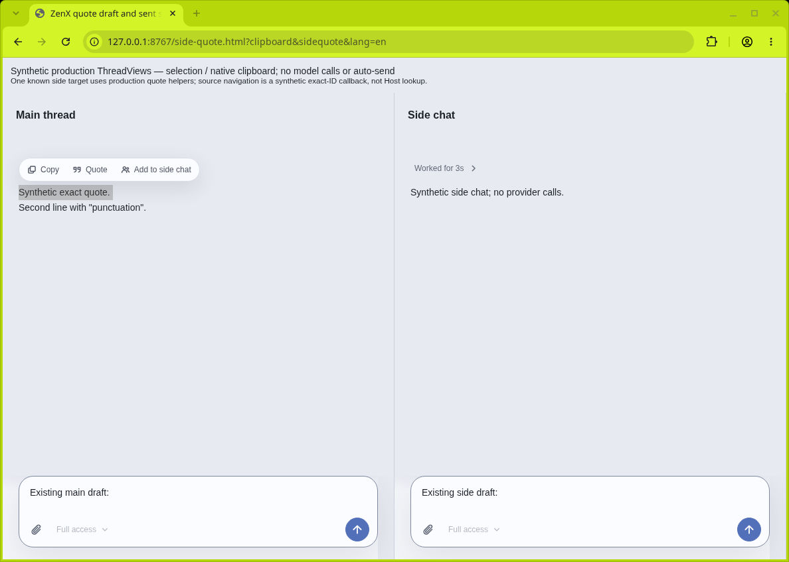
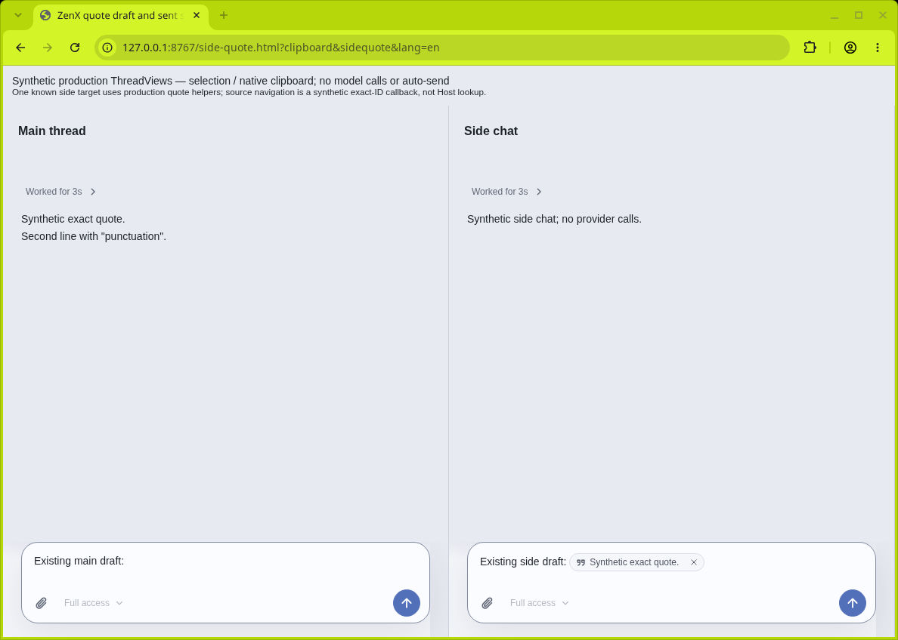
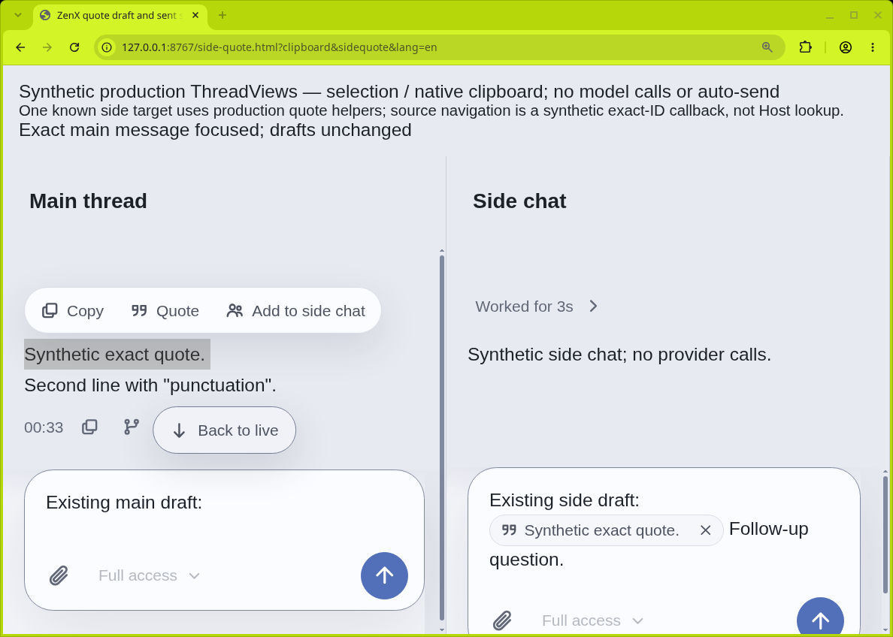
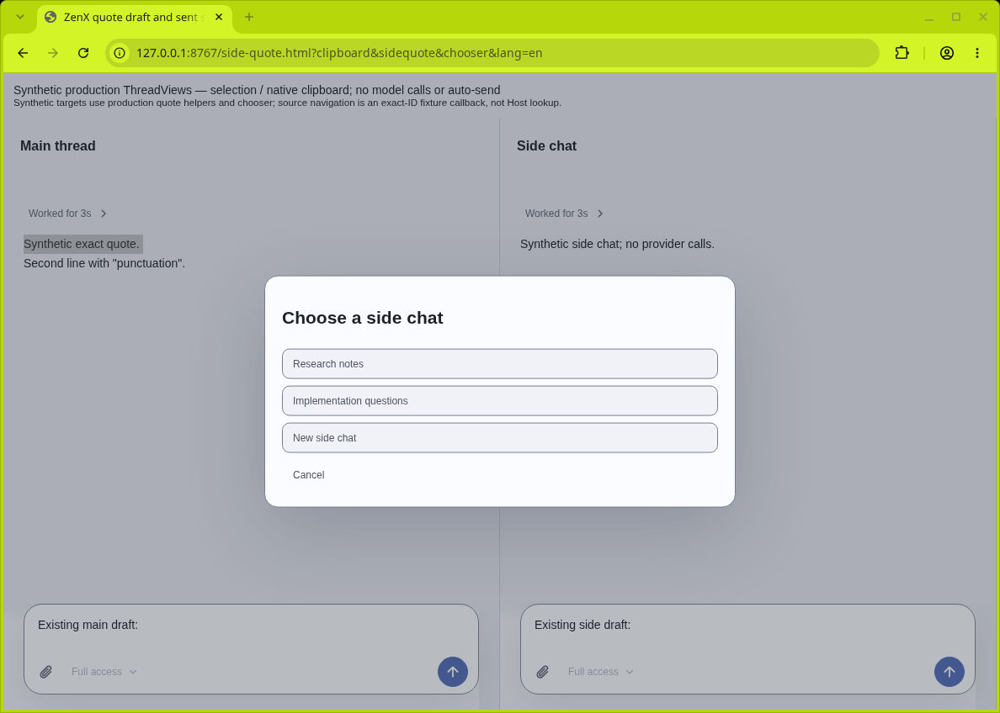
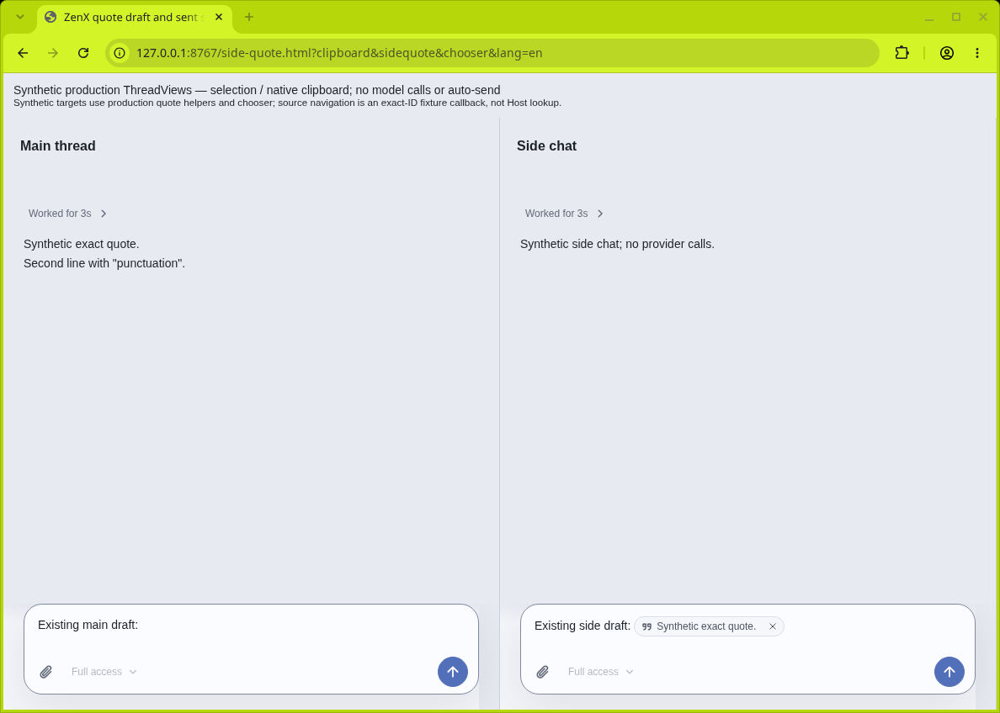

# Add to side chat — synthetic production-component acceptance

All messages, drafts, paths and identities in these screenshots are synthetic.
No user conversation, real Trace, private configuration or user screenshot is included.
The cloud Chromium window was controlled through native CUA input only; no local
headless browser, paid model call or external publication was used.

## Exact artifact

- Production integration source: `28f6ab74deca3606e225102d76117922ca051765`.
- Shared clipboard fixture checkpoint: `0c1e610b7e2cc7b40f191e60a24117abb07a62cc`
  (cherry-picked as `657abe03` in this QA worktree).
- Selection fixture checkpoint: `2b1b4bc8f17908501681a3a8a683b89f2d32da4b`.
- Build: `node apps/zenx/scripts/build-quote-preview.mjs /tmp/side-quote-preview`.
- Inline `quote-frame.html` SHA256:
  `bcd954a88a4d87d12667701512f8263d3ba85e4e01984a3b7efc179ec271b33e`.
  Native terminal independently printed the same hash after synthetic artifact transfer.
- Cloud loopback entry: `side-quote.html?clipboard&sidequote&lang=en`.
- Capture date: 2026-10-30; native window 1188 × 848; normal zoom 100%.

The fixture mounts actual `ThreadView`, `ThreadViewActionsProvider`, selection toolbar,
inline Composer and reference detail components. Both message projections include exact
synthetic canonical provenance. A single known side target is routed using the production
`chooseSideChatQuoteTarget`, `addMessageQuote` and `editComposer` functions. The fixture's
source navigator is explicitly a synthetic exact-ID DOM callback, not App/Host lookup.
The visible header states this boundary. Explicit Send only projects a synthetic native
user-message event; none of the Add acceptance steps pressed Send.

## Observed native steps

1. Select the first main-message line with native triple-click. Copy, Quote and
   Add to side chat appear together; both existing drafts are unchanged.
2. Click Add to side chat. The toolbar dismisses, the side draft retains its prose
   and gains one readable quote capsule; the main draft is unchanged and no sent
   bubble appears.
3. Type ` Follow-up question.` without another click. Text appears in the side
   Composer, demonstrating destination focus, and the capsule remains intact.
4. Open the capsule detail: exact selected excerpt and structured source remain.
   Open source reaches the matching synthetic main message via the real source-link
   callback and leaves both drafts intact. This verifies the callback boundary only,
   not a Host lookup.
5. At 175% native browser zoom (about 339 CSS px per fixture pane), select the same
   source again: all three toolbar labels remain readable and inside the pane. Click
   Add again and return to 100%: exactly one capsule and all existing text remain.

## Separate actual App evidence and limitations

`app-project-picker-interaction.test.ts` exercises the actual App stores and shared
Dialog, not the fixture callback: no-target creation remains local, repeated references
reuse a target, selected target wins, multiple unselected targets require explicit choice,
main input is preserved, navigation during a delayed source read cannot steal focus, and
two pending Add actions share one read/draft while retaining both distinct excerpts.
The full App suite passed 108/108 at `d28cd640`; the additional concurrent-read assertion
passed at `b4257472`. Quote/routing unit tests passed 15/15 at the implementation stage.
The published selection captures above use the one-target fixture. The separate production chooser
capture below closes the multi-target UI evidence gap. Physical-touch and OS
clipboard-permission acceptance are not claimed here. Native clipboard screenshots are documented separately
in `../quote-clipboard/README.md`.

Cloud DevTools was organization-disabled; the denial was not bypassed. An early fixture
missing import/provenance was corrected in source and rebuilt before these captures.

## Production chooser follow-up

The inline App chooser was extracted without changing routing/store ownership into
`SideChatQuoteChooser` at `406f374e`. Browser inspection caught unstyled default buttons;
`9712f426` applies existing shared secondary/quiet controls and an explicit localized
Cancel action. The same component is mounted by App and the synthetic fixture.

- Exact follow-up source: `9712f426` on top of `406f374e`.
- Inline HTML SHA256: `2c0579f60839fc557f24f9837493a30b5564e66c74fb18c1f6667de065c70b87`;
  independently matched in the cloud native terminal before capture.
- Entry: `side-quote.html?clipboard&sidequote&chooser&lang=en`, 100% browser zoom.
- Observed: native selection → Add opens the actual chooser with two named targets,
  New side chat and Cancel. Cancel dismisses it and leaves both existing drafts unchanged.
  Repeating the selection and pressing Enter chooses the first focused target, closes
  the chooser and adds one capsule to that existing side draft without sending.
- Fixture boundary: only Research notes is rendered as a destination. The alternate/new
  options explicitly do not create/send in the fixture; full target and creation behavior
  remains covered by actual App integration tests, not simulated visual claims.
- After extraction: targeted actual Add/Side-chat tests passed 5/5 and renderer typecheck
  passed. Full actual App suite is recorded in the final checkpoint handoff.

## Publication boundary

This public archive includes only the individually verified and admitted selection, insertion, compact-layout and chooser images. Additional reference-detail, source-handoff and focus images are withheld pending separate owner publication confirmation. They are not embedded or linked here. Production source and test coverage do not depend on publishing those optional images.
