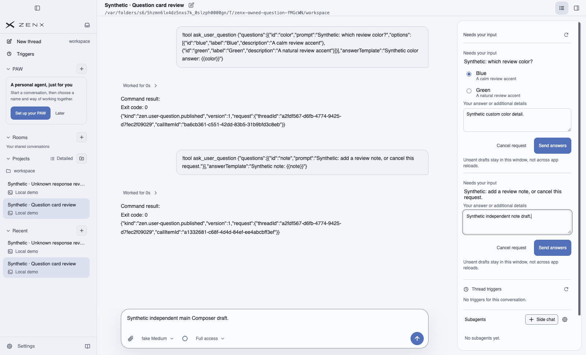
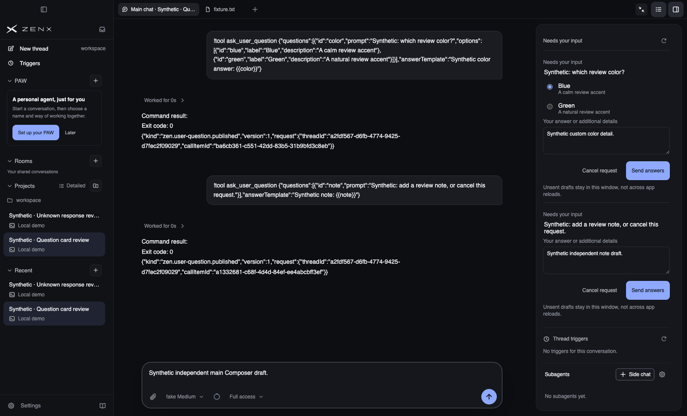
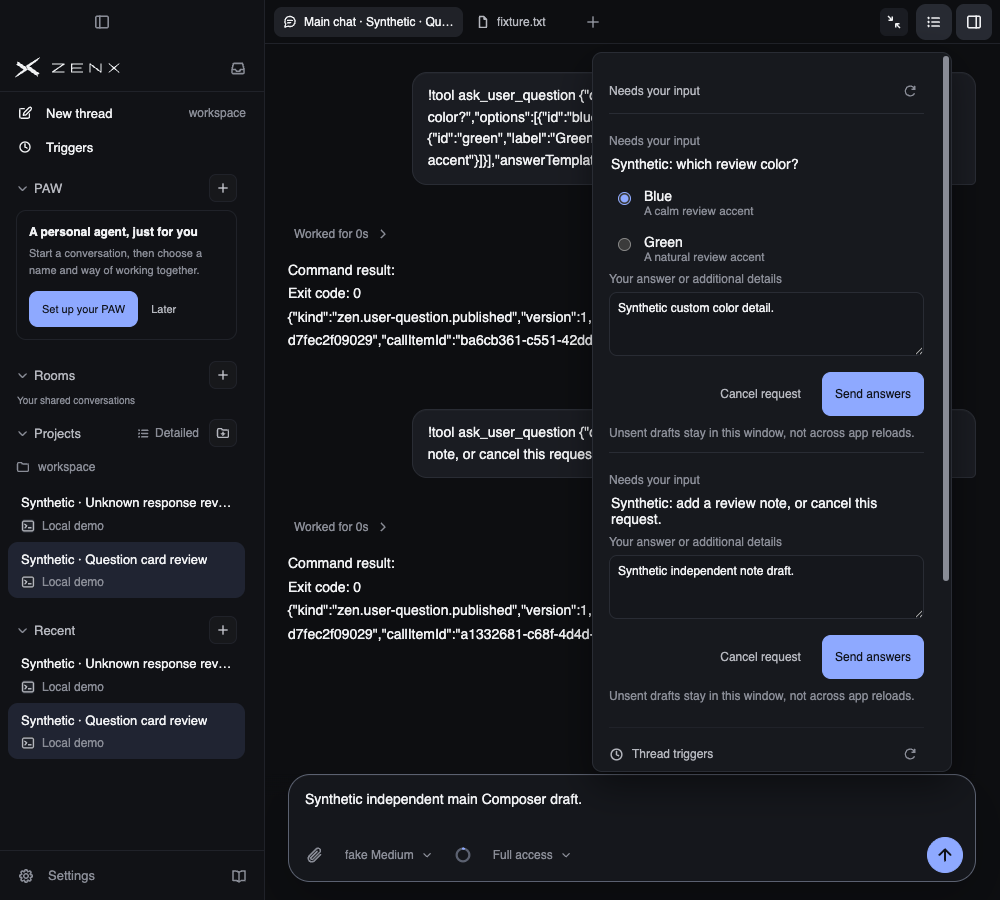
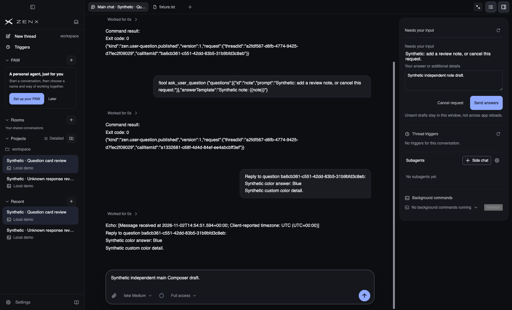
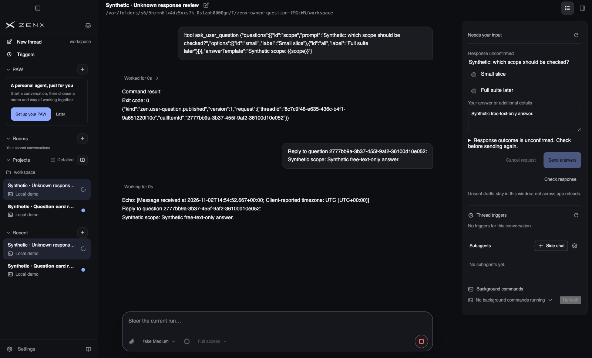

# Synthetic native Question card acceptance — small slice

This is a genuine full production Electron App/preload/child-Host run, not an isolated component render. All question prompts, thread titles, drafts, paths and model messages in the images are synthetic. The visible `!tool` commands, publication JSON and FakeModel echo are fixture mechanics, not proposed real-model product copy or final conversation wording. No user machine, user configuration or real provider credentials were used. The only publication opt-in was the private fixture Host; the normal Desktop and cold verification Host retained the default-off setting.

## Exact version and result

- Production UI: `d773df252e24ed299082b0974dcb4293dbf6b039`, tree `f340e5bb4cf07db37655fae8d20230d4685c188b`.
- Reviewed QA head: `a595c4bea876b7d3e7360e1484dce80523305d44`.
- Actual GitHub PR merge checkout: `8218db88951acf6d65ae120ddef71843c5d5e9f7`, tree `cfaaaec57d87e26520eaa3ba55f4cfa68ef2f374` (exactly the QA head tree).
- [Successful native macOS run](https://github.com/albert-zen/zen/actions/runs/41466272002); [artifact 13150982716](https://github.com/albert-zen/zen/actions/runs/41466272002/artifacts/13150982716). Artifact ZIP SHA256: `17837ea7405f11f7141aa9c6e5b2e3a4c12b1920dca064e1f32149d69548f18b`.
- Runtime: Electron 43.2.0, Chromium 150.0.7871.129, Node 24.18.0; macos-14 CI only.
- `acceptance.ok=true`, all five cases reached, process exit 0, `lifecycle.validated=true`; private fixture removed after confirmed normal Host shutdown.

## Evidence scope

The real enabled fixture Host published three questions through FakeModel/tool dispatch and closed. The production Desktop recovered those native questions without enabling new publication globally. Native mouse/keyboard actions verified authored option plus free text, free-text-only response, separate question/Composer drafts, hide/reopen, Thread switch/return, explicit Send and Cancel, wide light dock, dark internally maximized main-conversation Tab, narrow overlay and Escape focus return. The same Composer DOM was checked only across one owner's internal workspace transition; cross-Thread checks assert preserved drafts, not preserved DOM instances.

A driver-only fault deliberately discarded one real Host reply _after admission_. The UI visibly stayed unconfirmed with Send/Cancel disabled. Clicking the real Check response button reconciled the original client/request to `claimed`; response-mutation count stayed three. After Desktop exit, a default-off cold Host performed one read per synthetic owner (two reads total), confirming exactly one ordinary semantic human input for each of two answers and one cancellation. This is not an exactly-once inference guarantee.

All five original full-page PNGs were viewed, and their SHA256 values were checked. No image editing, injected CSS, DOM value setting, renderer mock or fabricated screenshot was used.

## Images

### Wide light dock: independent card and Composer drafts

SHA256: `d82f0f28ea575a1ea3200dfd72ec45b5fd5e0b0366543568a94f3c8b74f9a2b8`

### Dark internally maximized main-conversation Tab

SHA256: `42b6063877955969984d32675bbebda10c117257fadc6ce1679d3af6db4aef16`

### Narrow overlay: both cards and explicit controls visible

SHA256: `c1e9fd1103e23945e0f86fdff8cf0a6465dc1299b6cae973193edaef7d96e6ba`

### Answered card resolved; other request and Composer drafts retained

SHA256: `ec174c0dff65e6ee5ce47687e1ae0e8dee7667cfdd477adc20671e2fd4f24fd2`

### Fault-injected lost reply: unconfirmed state and read-only Check response

SHA256: `ddd86d03ce9e54b33ff884c1d9552c1c2e7214b0ae94ffe965bf76e7095c5197`

## Production bundle hashes

- `out/main/app-server-host.js`: `e6cfedc2b04f20df826ada5570eeef595b0d7c16f4a3e2e58b0fd4fba6a3b5dc`
- `out/main/index.js`: `ead34057c5b6a1804e6077e723461f80545c47e89688f2894b9f074bec7dc22e`
- `out/preload/index.cjs`: `f8074a5b50f70cfa6b42273bb21dcea1f6172415bbb977e28bc2c47139bf4973`
- `out/renderer/assets/index-CPLJw6G7.js`: `148e9743ba1bd007ccd3d3b52b8ed3d54e1f1c80b94bbf63a13b3d5c2738c6ce`
- `out/renderer/assets/index-tNcA8p3k.css`: `4435ff5da104d122a0d942a5777ce37cfd82dd9c50cd076fabccfc16668942f9`

The run artifact's `source.json` records all generated production chunks, and `acceptance.json` contains the bounded synthetic response/readback receipts. Private profile/journal/raw runtime logs are not included in this evidence branch.

## Prior attempts retained, not counted as passes

[Run 41461335987](https://github.com/albert-zen/zen/actions/runs/41461335987) captured the first full-App case, then exposed a driver race: it checked the old owner's panel-open state before Thread navigation committed. [Run 41465135432](https://github.com/albert-zen/zen/actions/runs/41465135432) progressed through Thread/draft checks and dark maximized layout, then exposed a driver assertion incorrectly requiring the same Composer DOM across different Threads. Those failures were preserved; reviewed test-only synchronization/scope corrections led to the successful run. Actual first-run image review also exposed unstyled secondary buttons, fixed in the product's shared controls before the successful run.

## Not accepted by this slice

Whole-batch recall to original inputs; sidebar asking/recency/hidden-child projection; live new-question publication into selected/background Desktop; Windows/Linux native UI; >32 pagination; concurrent clients; draft persistence across application reload. This evidence does not complete the overall Question feature and does not authorize enabling the production gate or merging unreviewed follow-on work.
