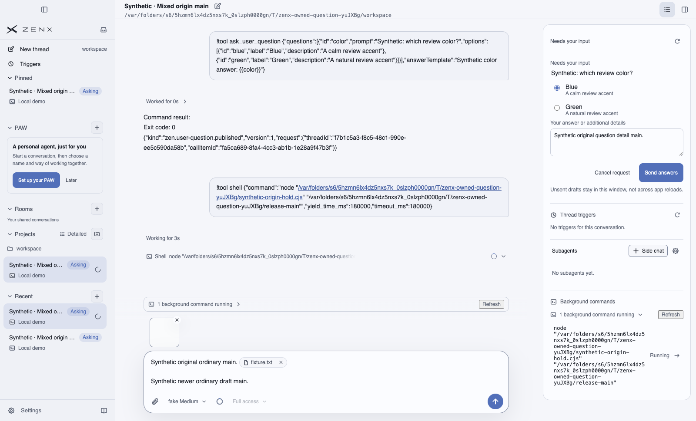
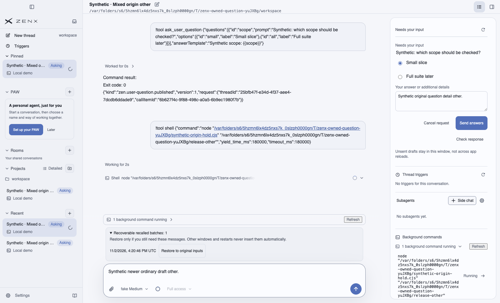
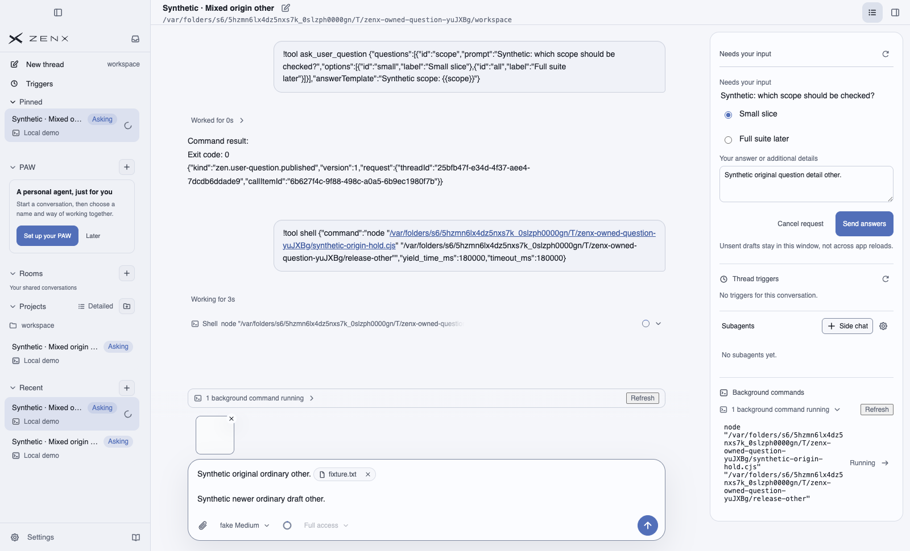

# Synthetic native mixed-origin recall — 2026-11-02

**Passed: two mixed batches in the full production macOS Electron App, with its real child Host and journal.** These three original full-App images supplement—not replace—the [earlier five card-slice images](../user-question-native-20261102/README.md), which retain their earlier exact source scope.

## Fixed source and run

- Product: [#633](https://github.com/albert-zen/zen/pull/633), commit `13b84cf06cd79aa45fbb140b426786b8549b67ca`, tree `6468518d2e72f43b426e230e339e9ae2002d72c2` (origin + native summary + Asking badge).
- Test-only [#631](https://github.com/albert-zen/zen/pull/631) head `06dd959afadd5ebccb472bf2ad97572609334d12`; production blobs unchanged. Actual checkout `fff0617a5d8a3c507c5480cf5ad493cdaad95aee`, tree `adca6d4fb68cc21da3e7bd635eb18a0963626c73`.
- [Successful native run](https://github.com/albert-zen/zen/actions/runs/41480223478), one `macos-14` job; artifact `13158303987`, ZIP SHA256 `40f21aac7d223026cd43eac694bd2141aeafa99d8afb44bb6a438c9943446aab`.
- Electron 43.2.0 / Chromium 150.0.7871.129. Normal App exit 0; cold journal verification passed; disposable profile removed.

This functional acceptance uses the complete production build through an owned Electron bootstrap, not an installed-package performance or packaged startup-latency acceptance.

## What was exercised

A separate explicitly enabled real fixture Host publishes one question per synthetic owner, then closes. Normal Desktop keeps publication **default-off**. Native Send starts the existing production shell tool with a bounded private release-file gate. While it is active, native question option/free-text Send and ordinary text/@file-picker/clipboard-image Send create exactly two pending steer inputs.

1. One native Recall restores ordinary text, file-reference chip and image attachment before the newer Composer draft, and restores the original question input. No recoverable batch remains; nothing is resent.
2. For the other owner, the driver delays one actual Host read reply already confirming `withdrawn`. Native navigation/new draft blocks partial restoration. The receipt remains recoverable; explicit Restore and confirmation then restore all origins once. The delayed reply is a labeled transport fault, not a renderer/Host replacement.
3. Asking changes 1→0 while answer-pending→1 on recall. Original publication timestamp is preserved; recall does not bump human recency. Pinned row/order and manual-order preference remain unchanged. Only five dedicated summary reads are added—no full-history polling while sending.
4. After normal shutdown, a default-off cold Host reads the two owners: one durable two-target receipt each, no pending steer, exact question response `withdrawn`, original ordinary payload preserved, and zero model-visible recalled client inputs.

Question drafts deliberately survive Send. Their continued visibility alone is not the proof: restored ordinary input, exact native receipts, applied/no-recoverable state and cold no-consume checks jointly establish this slice.

## Original full-App screenshots

### 06 — One mixed batch restored once



### 07 — Navigation blocks partial restoration; receipt remains recoverable



### 08 — Explicit receipt recovery restores both destinations once



| PNG | SHA256 |
|---|---|
| `06-origin-mixed-restored-once.png` | `c198b54c24d4563d1b56e4993cd7350007ae7a49cccdd2cba399211959900cb9` |
| `07-origin-navigation-blocked-recoverable.png` | `a99728c710d61ebaac173229b579c0c6aa3c0cfa4cedf34d68d349fc28d95733` |
| `08-origin-explicit-recovery-restored-once.png` | `a3a2a48841c5c2afa84474411450e566b774e1d5e452fdeaedc97445d8415df6` |

## Synthetic and coverage boundaries

All visible data is synthetic. The pasted image is a tiny uniform test bitmap, so its thumbnail is near-white—not a user photo. Visible `!tool`, tool-result JSON and private temporary shell paths are fake-provider fixture mechanics, not final real-model product wording. No user configuration, private profile, raw log or secret is included here. Screenshots are unedited; no injected UI or CSS.

This is **not** live selected/background Desktop publication, automatic panel reveal, hidden-child lineage, a full Recent/Project ordering or language/density/platform matrix, claim-wins race, pagination, or reload-draft durability acceptance. This run is wide/light; earlier dark/maximized/narrow card screenshots apply only to their earlier exact source.

Two earlier attempts remain reported: [41475788787](https://github.com/albert-zen/zen/actions/runs/41475788787) stopped before ordinary Send because a simulated Meta+V did not paste; [41478335852](https://github.com/albert-zen/zen/actions/runs/41478335852) successfully pasted/sent, but the read-only driver mistook CodeMirror placeholder text for draft content. Neither reached Recall. Reviewed fixes changed only native paste invocation and detached-clone inspection; product code and acceptance criteria were unchanged.

Reproduction after building the exact test tree, in its isolated GitHub macOS job:

```sh
node apps/zenx/scripts/launch-user-question-acceptance.mjs "$RUNNER_TEMP/user-question-ui" origin
```
