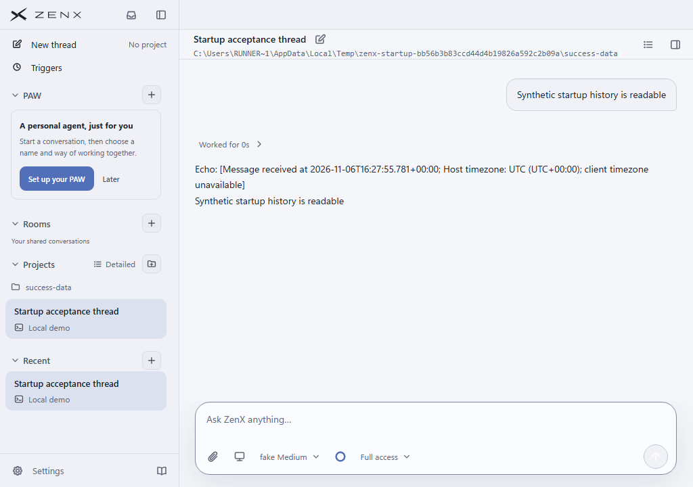
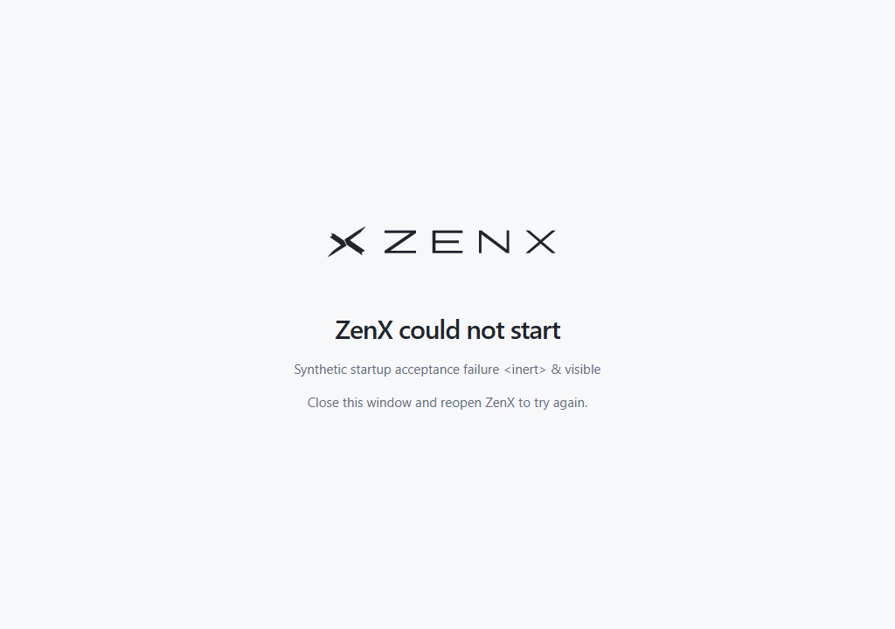

# Joint Windows startup acceptance: #722 and #726

These unmodified native Electron screenshots come from a disposable copy of the real portable package on a GitHub-hosted Windows runner. All conversation content, provider settings, workspace paths and failure text are newly generated synthetic fixture data. No user computer, personal workspace, credentials or remote model service was used.

This candidate includes main `53c99e244965d25673c1b28cf796b19433a586bd`, including App Shot and the independent static/UI CI changes. Earlier screenshots belong to their earlier source tree.

## Exact source

- Head: `5d749d6ff1c3167b9d11543e54e450e3621229a1`
- Tree: `468fe71dfd05ad658a0daa374716dff1b9d672dc`
- CI merge checkout: `d423f92b91b5fb3d32dea29af2aeb5727cfa61af`, no changed files versus head.
- [CI run](https://github.com/albert-zen/zen/actions/runs/42251326001): the Windows packaged job passed; the complete CI result is tracked at this immutable run link. A native result alone does not establish all-lane acceptance.
- [Windows packaged job](https://github.com/albert-zen/zen/actions/runs/42251326001/job/128006890061)
- [Original artifact](https://github.com/albert-zen/zen/actions/runs/42251326001/artifacts/13519913859), ZIP SHA256 `92f37e850a7a19abf696ca0e475a9b8c792a6d3d055cc89521668805f9b83fcb`.
- Conversation PNG SHA256: `957e781e880566931a1c940f8915f72946cf784e7de0b27330d6ba85b19a2a14`.
- Failure PNG SHA256: `014aafc3af0a26abf5b7dba75bf7ef9ac7018f7e0d4459639914448fca7be351`.

## Observed results

Both native startup scenarios passed. Ordinary sidebar-read and Shell-list preload requests returned their expected synthetic owner data. The prior trusted-sidebar and background-command errors are absent from the accepted conversation frame. Actual owned main-frame guard inputs used `RUNNER~1` and expected `RUNNER%7E1` URLs; encoding differed and decoded native paths matched. This directly exercised #726's encoding-equivalence path in Windows Electron.

The Windows environment regression reproduced the old reset as `legacy-null-reset-present=True`, then verified absent, empty and nonempty restoration and inheritance by a child Node process. Explicit removal lets the renderer guard use its actual expected file URL. Production trust checks were not weakened.

First visible window: success **521.6 ms**, synthetic failure **477.7 ms**. Successful milestones from process start: Host **11.555 s**, shell frame **11.894 s**, sidebar **12.038 s**, first conversation **12.339 s**. These include an intentional **3.045 s** bootstrap gate, not uninstrumented startup benchmarks.

The original window was retained and restored. Success observed a different prior foreground HWND; failure's before/after foreground HWND was already the same, so it does not prove a new focus transition. Cleanup and finalization error arrays were empty. The expected synthetic bootstrap failure remained literal text. Earlier failed runs remain failed evidence.

## Limits

One hosted Windows sample, Electron 43.2.0 and a fake provider. This does not establish installed-release acceptance, signing behavior, all-machine performance, large-history percentiles or real provider/network latency. Success stderr still contains a separate `Workspace is not configured` settings error from `markWorkspaceUsed` for the synthetic thread outside configured projects; it is not a trusted-document rejection or a visible application error. Keep #167 open for its remaining installed-release and performance work. No previous unknown-outcome macOS action was replayed.

## Native conversation

## Native failure

