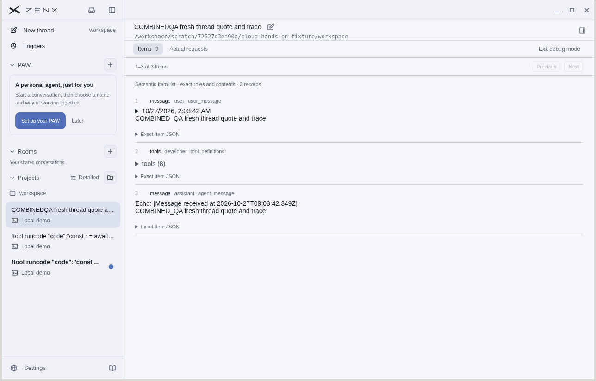

# Combined native pointer and live provenance acceptance

## Exact source

- App/PR 548 head: `45537dd75c7a7b8528225649ac1debf103de2b1e`
- Source tree: `5d445abf6af5bed6d335aeaed03302870cf411ce`
- Includes current main `7e31a54523f4f272e98da55569ef75c1ed1973aa` (545 + 546), final PR 547 `ab0cd8307674620568e257ab9cde50a2103d96a8`, and the narrow New thread native no-drag fix.
- This evidence-only branch is not an app source update. The tested CI head is unchanged.

## Actual GUI acceptance, 2026-10-27

The root operator used the provided cloud Linux/Xfce desktop and ordinary production-compiled Electron app with the real Host, a dedicated synthetic user-data/core profile/workspace, and the built-in Local demo model. No renderer/window API mock was injected. No sandbox/security/GPU flag was changed. The user's computer was not touched.

Manually observed:
- Native pointer click on global New thread from Settings opened the workspace draft.
- A fresh synthetic Echo message could be selected and Alt+Enter inserted its quote bubble.
- Debug mode showed the fresh thread's three real semantic Items (user, tool definitions, assistant).
- Maximize and restore controls worked.
- Native titlebar drag moved the app window.

Screenshot: `combined548-debug.jpg`, SHA-256 `aa3eb8b54f7efbf4467069910b915d0611354127d470ce9a6e3e2e4299b80b83`. It contains only the owned synthetic workspace and conversation. It shows Debug Items, not every earlier action.

## First-launch observation retained

The first combined launch produced an anomalous image showing underlying Chromium/new-tab pixels and white blocks despite ZenX window metadata. A single normal launcher restart, with identical parameters, restored normal rendering. Cause is unknown: no claim is made that 545, GPU, or the capture service caused it. Application logs showed missing system D-Bus socket messages but no renderer-load/404/crash error; compiled app/Host/worker/HTML/CSS hashes matched the completed build. No speculative product patch or security workaround was applied.

## Validation and boundaries

- Independent red/green native-hit-area contract regression; 119 related tests passed.
- Combined titlebar/sidebar/project tests: 123 passed; TypeScript and full production app build passed.
- Final combined local ZenX suite: 4488 total, 4451 passed, 28 skipped, 9 failed. Five packaging failures came from the omitted dedicated npm cache; one snapshot assumes /tmp while this run isolates TMPDIR; three private control-socket listens were denied by this executor (EPERM), and were not retried. The autosave/in-flight/conflict editor case passed locally. These are not represented as a green full suite.
- Final-head remote CI remains the full environment gate; acceptance/CI status is reported on PR 548.
- Local demo is a synthetic model. This screenshot is not live HTTP-provider, Windows/macOS physical-desktop, locked-display, display-off, or multi-display acceptance. OS-encrypted credential storage remained fail-closed in this cloud desktop.
