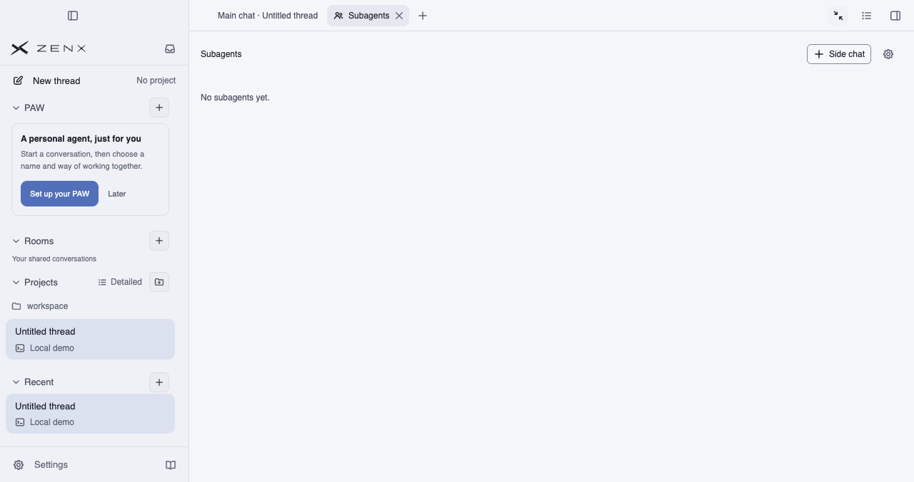
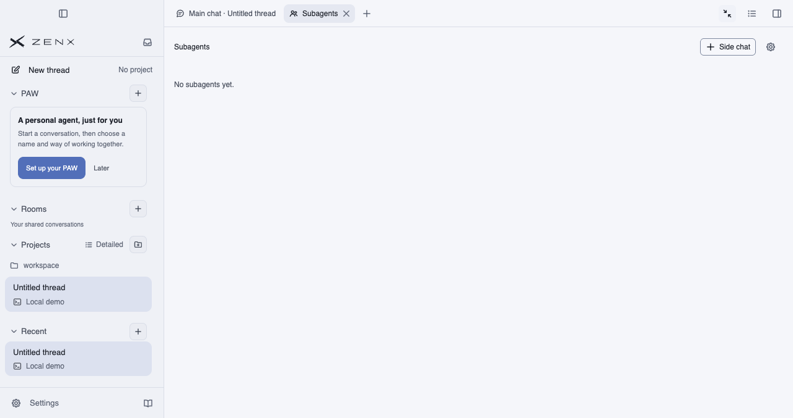
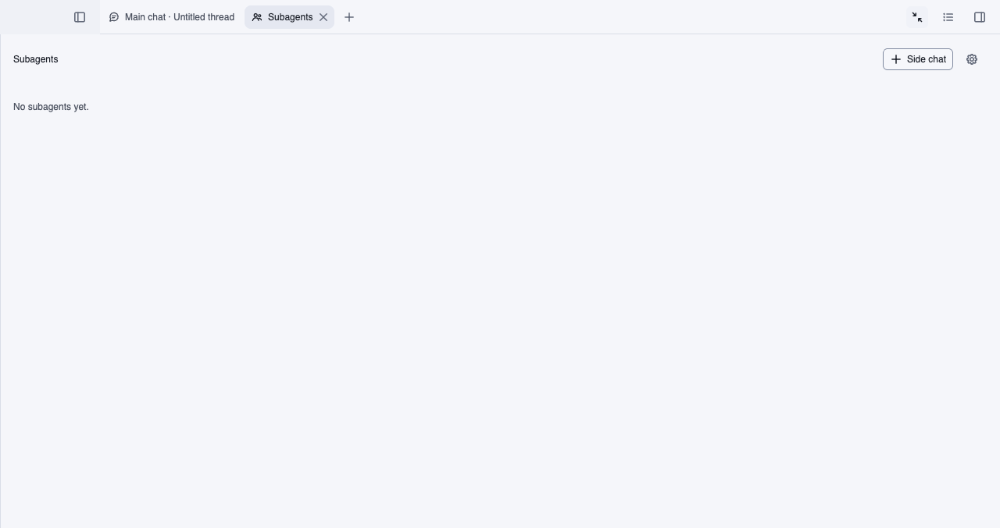

# PR #601 — native macOS pane-maximize evidence

**Status: native macOS fixed-build capture passed independent visual and geometry acceptance.**

## Reproduced before fix

Source `4ed8fb0f2294d234a10cf293b67335f72d2bb332`; [native run 41333129609](https://github.com/albert-zen/zen/actions/runs/41333129609), artifact `13094295572`.

| Left sidebar open | Left sidebar collapsed |
| --- | --- |
|  |  |

The first Tab icon remains inside its rail with `scrollLeft=0`, but `.workspace-header` covers it. Its residual width is 36px (22px left padding + 14px right padding) while the parent session track has zero width. The same mechanism was independently reproduced before the main-conversation Tab feature at `c6f4592e15c6abbc5db890a86ceef0865f70681e` (artifact `13093854792`).

## Fixed build — accepted

Source `dd25fe08cffd4d77421e8349ded2a150e106f74c`; [native run 41334004336](https://github.com/albert-zen/zen/actions/runs/41334004336), artifact `13094302363`.

| Left sidebar open | Left sidebar collapsed |
| --- | --- |
|  |  |

Both states were visually inspected: the main-conversation and Subagents icons are fully visible. Their centers and all four corners hit their own Tab. The zero-width session and its padded header are hidden; the native sidebar toggle stays visible and hittable. A real restore brings the conversation header back (the additional `current-full-app-restored.png` is retained in the source artifact). No frame recorded an obscured Tab icon. The target thread remains at zero Turns and the owned process closes with exit code 0.

## Scope and checks

Native macOS Electron loads production main/preload/renderer and the real bundled Subagents body in an isolated local fake Host. A zero-Turn thread is created via the real protocol, then selected through the UI; Subagents is opened and the right pane's internal maximize button is clicked. Preparing thread selection can require vertical scrolling in the **left sidebar only**; the right Tab rail is never manually scrolled. This is not a capture of the user's installation.

Both left-sidebar states are tested. Acceptance requires the main-conversation and resource icons to be fully inside the rail and unobscured at center/corners; session/header hidden only while expanded; native sidebar toggle visible and hittable; real restore brings the session/header back. Actual default reduced-motion preference is recorded, not altered. This run uses reduced motion, so it is not evidence about animation-lag behavior.

Chromium sandbox and context isolation remain enabled; Node integration remains disabled. The target thread has zero Turns and the owned process closes normally. Images contain only synthetic temporary-workspace paths. No profile, credential, raw log or private user content is included. File hashes and exact source/run identifiers are in `manifest.json`.
