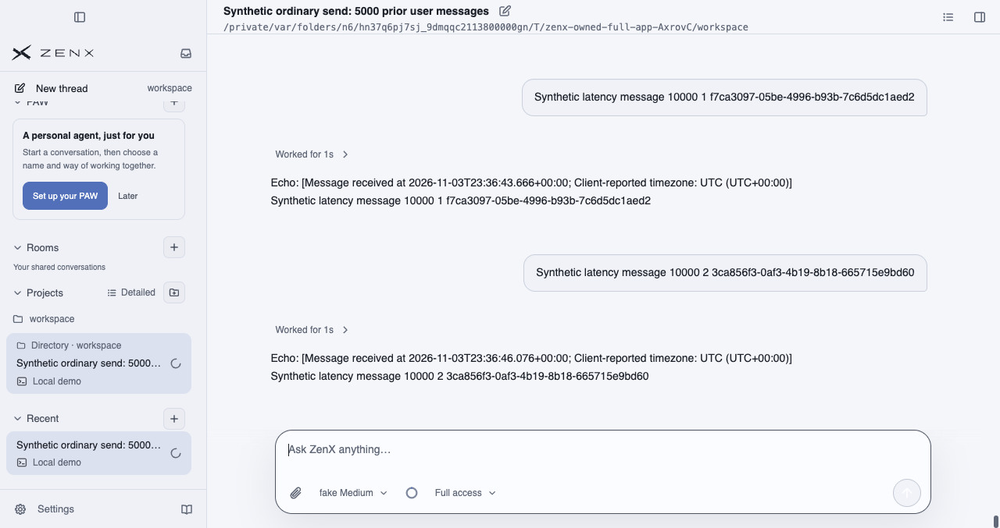
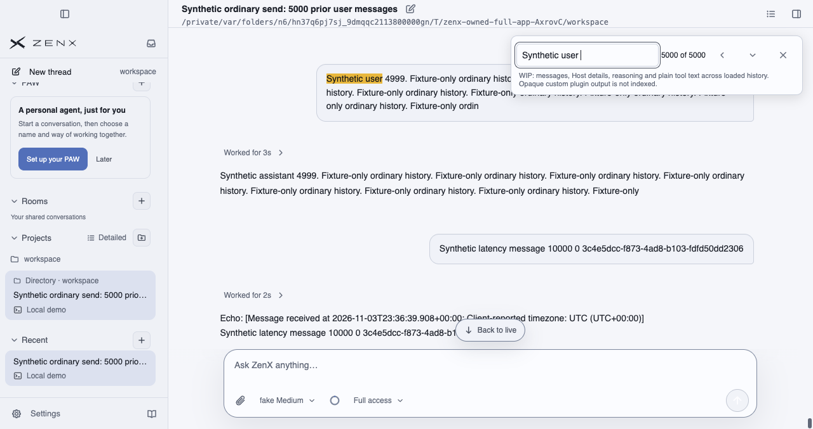
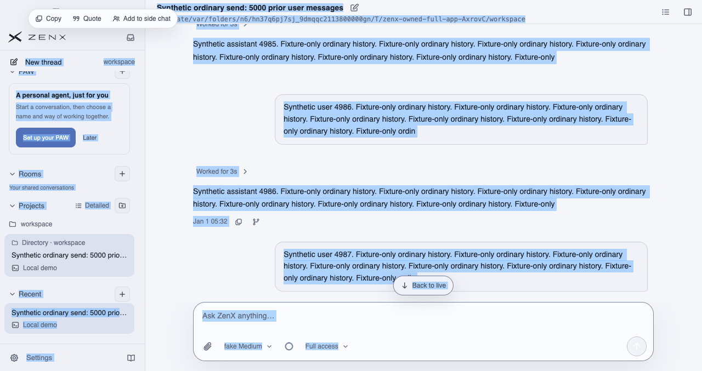
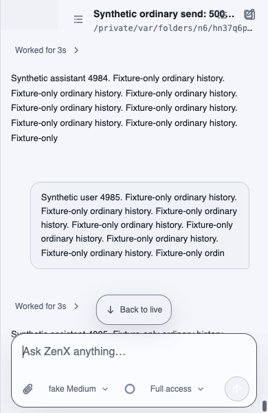

# Legend native UI checkpoint: 3005aa82

**FAILED diagnostic run; partial screenshots, not acceptance or a resolved fix.** The Legend experiment remains default-off and PR #682 draft. This independent evidence branch adds only this README and four unchanged PNGs; it does not change product code, drivers, PR content or state, main, or earlier evidence.

## Exact provenance and synthetic boundary

- Product: [`3005aa82f567fb021ebd0ab1058d16beb04e13e4`](https://github.com/albert-zen/zen/commit/3005aa82f567fb021ebd0ab1058d16beb04e13e4), tree `9663d3a988cd463bbe4b82268f9e36e705f9084e`.
- Packaged native **macOS arm64** run: [41738873184](https://github.com/albert-zen/zen/actions/runs/41738873184); diagnostic driver `76dcbcd7bf7b1483c337f1c621b791faf9a835cb`.
- Renderer bundle `index-Dy-YAhT0.js`, SHA-256 `d7336e69d51c34857ae037054008e5dafd1ff851d2815c8430314b78e621b6c8`.
- Artifact `13281391145`; ZIP SHA-256 `5cdf6968307987beb466c8c8c1d4a3c68f939a31ba29a9c7c136485f16d4ef38`.
- Owned offline fake-provider workspace: **5000 prior synthetic turns (10000 messages) plus three real Enter-key sends**. Visible conversation, timestamps and temporary workspace are test-fixture data, not a real user's conversation. All four PNGs were visually inspected for privacy. No raw logs, Trace or configuration are published here.

## Findings and remaining blockers

The candidate and default full-DOM control each selected and copied all **10006 message bodies** in canonical order. In both, Copy differs from that endpoint's Selection by exactly the current empty Composer's **18-character placeholder plus one LF**, inserted after the canonical messages. This diagnosis does not waive the required raw **Copy = Selection** gate, which still **FAILED**.

Complete message-body coverage does not establish equivalence of the entire historical selection range. Candidate versus default full-DOM Selection still differs by **13 UTF-16 code units and one LF**, not yet attributed.

Candidate Find reached the wrapped tail (5000 matches), clearing selection restored nine virtual rows and the paused reader anchor, and editable-selection boundaries and responsive 390/640/641 checks passed in this run. Select All preparation through complete inspection took **19.798 s** and clear-to-restore **2.706 s**. These observations include diagnostic checks; they are **not pure CPU timings**.

The installed product-menu-to-Cocoa path was exercised; physical OS-menu interaction and hardware Cmd+A were not accepted. Image Notice behavior and an independent durable reopen remain unverified. These images do not establish pending-frame pixel timing or overall UI acceptance. No approval, merge or default enablement is implied.

## Screenshots

### Third ordinary Send after the 10000-message fixture

1280-pixel-wide packaged native window after sample 2, the third real Enter-key send.

### Find wrapped to the history tail

1280-pixel-wide native window showing match 5000 of 5000.

### Native Select All

Candidate selection through the installed product menu to Cocoa, before final raw Copy equality validation.

### Narrow responsive history

390 × 600 native content viewport, paused history and reachable Composer.

