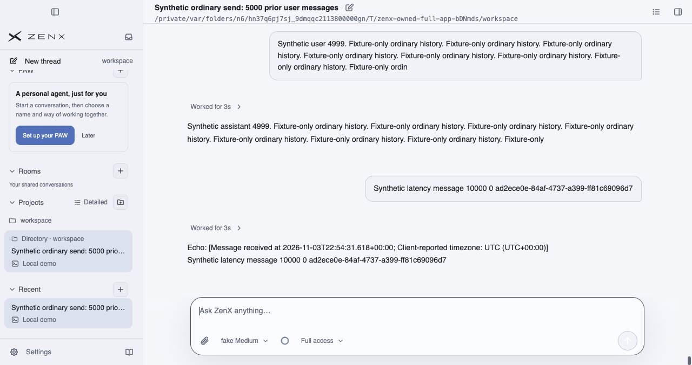
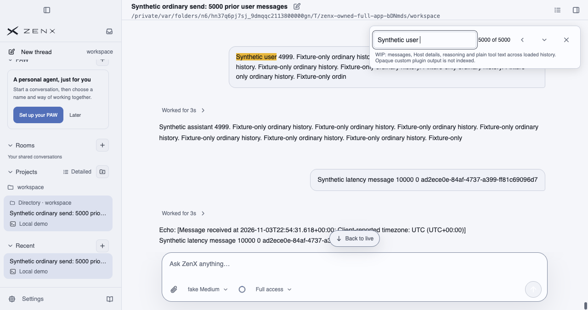
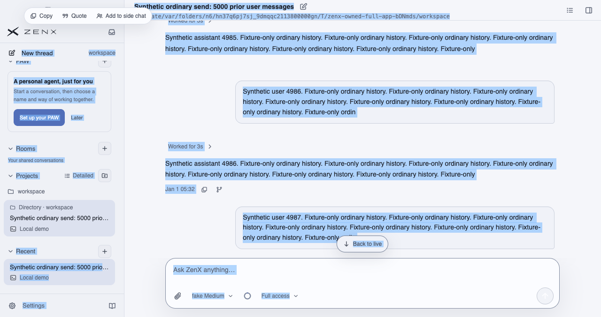
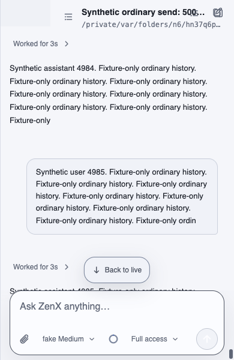

# Legend native UI checkpoint: a6190361

**FAILED diagnostic run; partial screenshot evidence, not acceptance.** The Legend experiment remains default-off and PR #682 remains draft. This independent evidence checkpoint changes no product, driver, PR, or active branch.

## Exact capture provenance

- Product commit: [`a61903616ef741432d2e6d90fc57b44e41122196`](https://github.com/albert-zen/zen/commit/a61903616ef741432d2e6d90fc57b44e41122196).
- Product tree: `ca0a5a03956103d79cec93cad998496367570cbc`.
- Packaged native macOS arm64 run: [41733200075](https://github.com/albert-zen/zen/actions/runs/41733200075), diagnostic driver commit `aa6288366d333798de44ac3361602c32ab4d3e59`.
- Renderer bundle `index-BebB737-.js`, SHA-256 `d7336e69d51c34857ae037054008e5dafd1ff851d2815c8430314b78e621b6c8`.
- Source artifact: `13278770781`; ZIP SHA-256 `642210d3eefdf9b98f6bf90487acd2a90ba74465ecefcb45337f89ea5332a8cf`.
- Owned offline fake-provider workspace: 5000 prior synthetic turns (10000 messages), followed by three real Enter-key sends. Conversation text, timestamps and workspace visible here are test-fixture data, not a real user's conversation.
- The four PNGs below are unchanged capture bytes, visually inspected for privacy. No raw logs, Trace or configuration are published in this checkpoint.

## What was observed, and what remains failed

Find reached the wrapped tail with 5000 matches. Installed product-menu handlers routed to Cocoa for Select All / Copy; all 10006 message bodies were selected and copied in canonical order. Clearing selection restored nine virtual rows and the paused reader anchor; editable-selection boundaries and responsive layout checks at 390, 640 and 641 pixels passed in this run.

The final strict raw clipboard-versus-Selection equality gate **FAILED** and remains a blocker: Copy contained 19 additional UTF-16 code units and one additional LF. The difference is unexplained; complete message coverage does not waive raw equality. No independent durable reopen was verified. These screenshots do not establish overall acceptance, pending-frame pixel timing, physical OS-menu interaction or a hardware keyboard-accelerator path. No approval, merge or default enablement is implied.

## Screenshots

### Ordinary Send, 10000-message history

1280-pixel-wide packaged native window after the first real Enter-key send.

### Find wrapped to the history tail

1280-pixel-wide window, showing match 5000 of 5000.

### Native Select All

Installed product menu to Cocoa selection, before the strict Copy gate failure.

### Narrow responsive history

390 × 600 native content viewport with paused history and reachable Composer.

