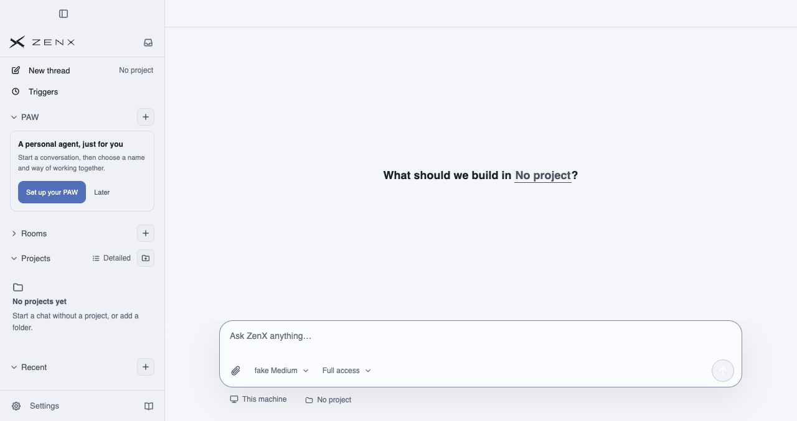
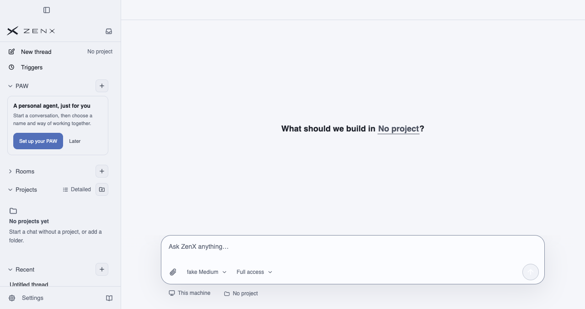
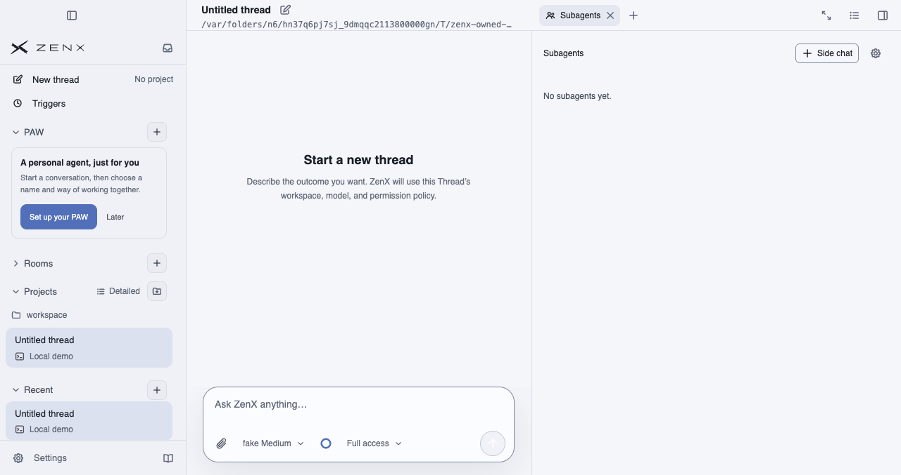
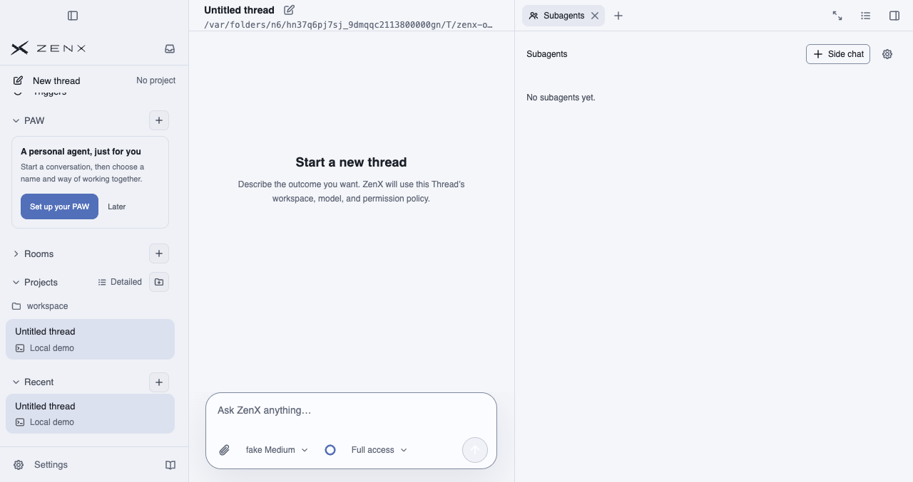

# PR #602 — native macOS layout acceptance

Independent source, screenshot and geometry review passed. Production sources: before `7e017e65e1f2d47ddd9afe6e1d43c7c20312face`; after `e15f8c086d9cd42bbd04dd02fc2b2cfcd6646324`.

[Before run 41335485967](https://github.com/albert-zen/zen/actions/runs/41335485967), artifact `13094649235`; [after run 41337075042](https://github.com/albert-zen/zen/actions/runs/41337075042), artifact `13095702516`.

## First-Thread sidebar width

| Build | Empty | First Thread |
| --- | --- | --- |
| Before |  |  |
| After |  |  |

Both runs cross the real overflow threshold: scroll content height 497→551px in a 497px viewport. Before: outer sidebar stays 264px, but client width 264→253px and scrollbar gutter 0→11px shift the internal action icon 11px left. After: client width stays 253px, gutter stays 11px, and the icon stays at x=136.96875px. Header/footer and measured icon dimensions remain unchanged. Reserving the empty-state gutter is intentional; scrollbar visibility remains automatic.

## Normal right-pane drag

| Before | After |
| --- | --- |
|  |  |

These are real captured drag frames, not illustrations; they are not guaranteed to depict the frame of maximum error. The same native-input harness performs outward and return gestures with the default reduced-motion preference, then an explicit owned-renderer `no-preference` media override. No OS preference is changed; the override is restored and the owned debugger detached.

Before, motion-enabled outward drag recorded up to 35.640625px titlebar/header overlap, with hit-testing reaching the main conversation header instead of the divider; reverse motion lagged by up to 27.4375px. After, **all 220 recorded frames across four gestures have exactly 0px titlebar and header mismatch**, and the top divider hit always reaches the resizer. The strict acceptance tolerance remained 1px. Requested width 640px is CSS-clamped to 558.796875px, and the panel width reported to the titlebar uses that actual value rather than 640px. Pointer release restores normal resize state and the original width.

Full-pane maximize regression also passed with the left sidebar open and collapsed: main/resource icons remain visible and hittable, native sidebar control remains usable, and restoring the pane brings back the conversation header. Those additional screenshots are in the after artifact.

## Scope

Native macOS Electron runs production main/preload/renderer with an isolated local fake Host. A zero-Turn thread is initialized through the real protocol; subsequent selection, opening Subagents, internal maximization and resizing use actual UI input. Preparing thread selection may vertically scroll the left sidebar; the right Tab rail is not manually scrolled. An empty Room section is collapsed through its real UI to exercise the overflow threshold. Chromium sandbox/context isolation remain enabled, Node integration is disabled, and owned processes close normally.

This is not the user's installation. Sampling and intermediate screenshots affect gesture timing, so pixel offsets are bounded diagnostic measurements, not a general performance benchmark. Images contain only synthetic temporary paths. No user profile, credentials or raw logs are published. See `manifest.json` for exact sources, measurements and PNG hashes.
