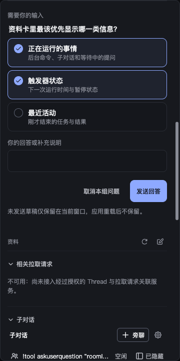
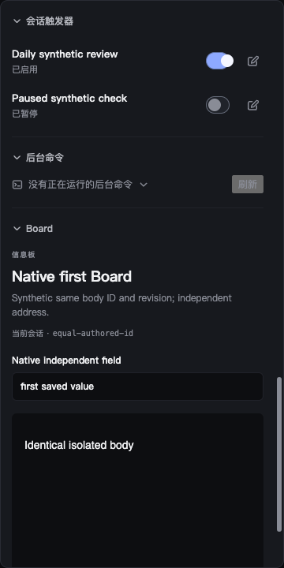
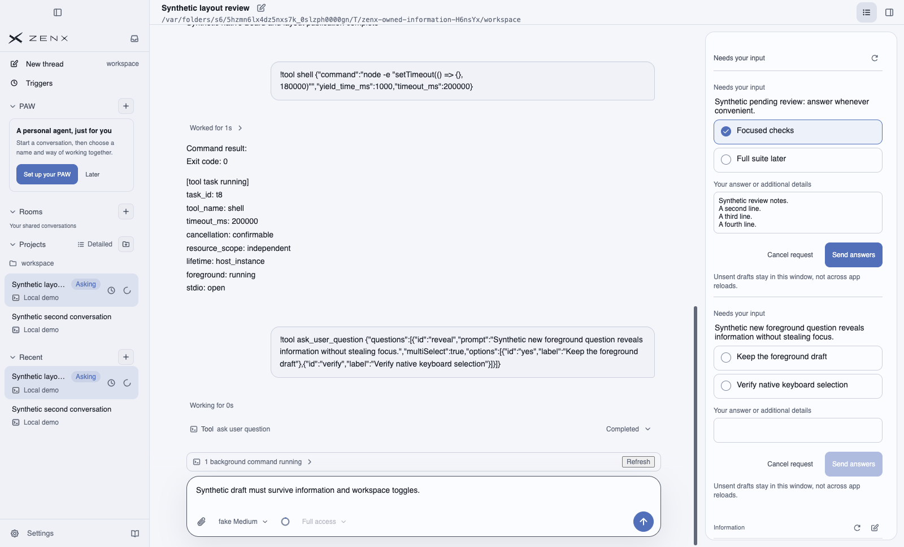
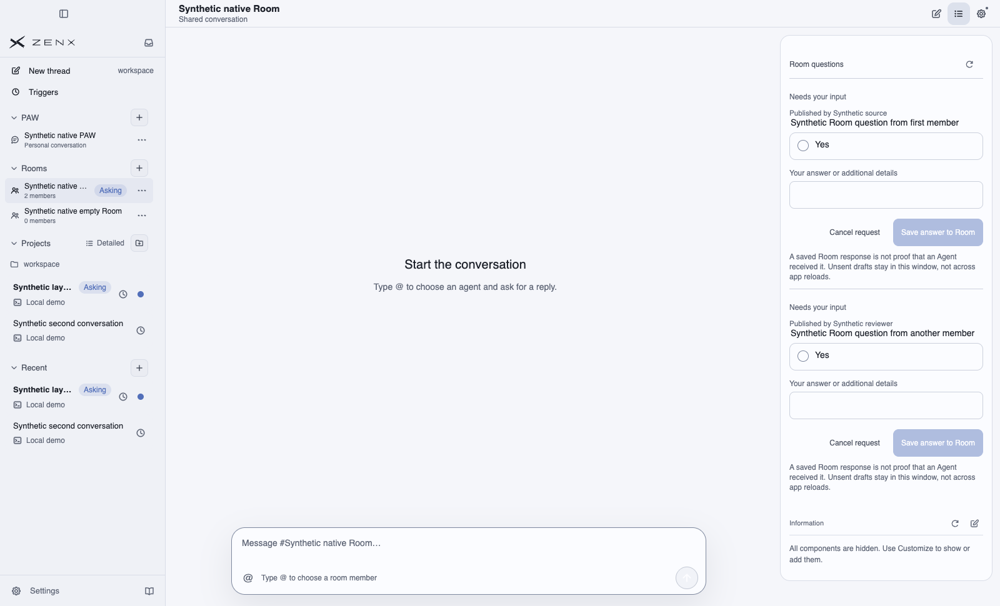
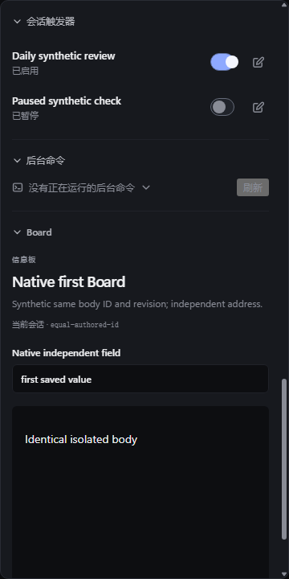
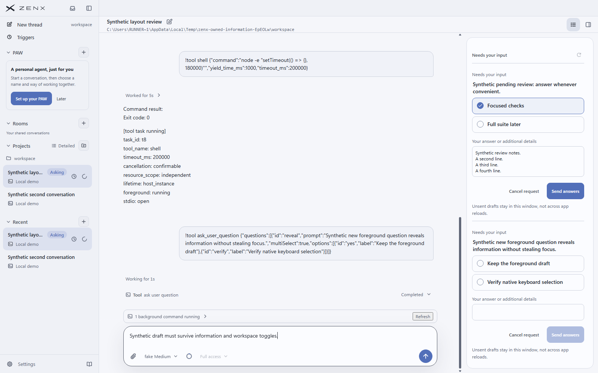
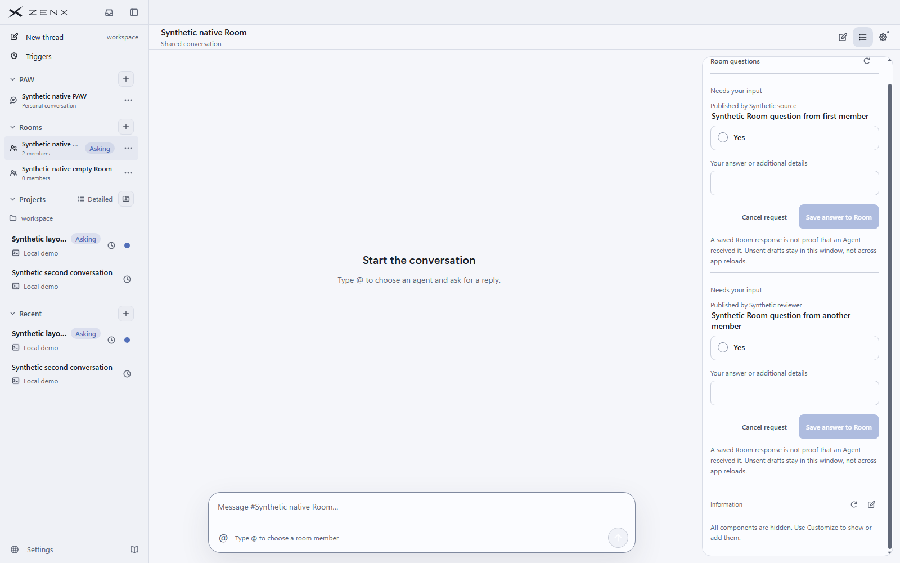

# Information feedback native acceptance

Product head: `174c61abf124f15250caf8b4cb82e44ff33b3e15`.
Tested PR merge commit: `ef2322470c92d0874d9acb72f306925fbeadf07d`.
Both have product tree `6901e71428265f314f8b86ab14c96e3aedb04d28`.

[Native workflow](https://github.com/albert-zen/zen/actions/runs/41663262018): macOS 14 and Windows passed all 26 scenarios and 81 real input steps each. This evidence branch is not a product merge. Full repository CI and independent review remain separate merge gates.

## Scope and provenance

These are captures of the full production Electron App, preload and local Host on GitHub-hosted runners. All conversations, rooms, commands and data are disposable synthetic fixtures. No user data, user profile, credentials or private Trace is included. Question publication uses the real native Host; pointer and keyboard events are native Electron inputs. Language uses the production preference receiver with a synthetic same-origin storage event. The existing native select popup limitation is explicit: select fixtures use controlled DOM input/change, not a claimed native OS-menu interaction.

The two close-ups per platform are Electron `capturePage` captures of the actual information surface. They are not redrawn, generated or image-edited. Full-App images and all other captures remain available in the workflow artifacts. `source.json` preserves the build/source hashes; `manifest.json` identifies the selected PNG bytes. 38 source files matched this product tree on each platform; Windows comparison accounts for Git CRLF checkout conversion in 34 files.

## Reference styles

[Original reference shared by #658, #659, #661 and #662](https://raw.githubusercontent.com/albert-zen/zen/4dbabe0f52a521ed6d2787dc8ed8196043daa6c7/docs/images/information-panel/information-panel.png).

The implementation reuses the original row grid (6px gap, 14px bottom spacing), 10px rounded borders, selected accent surface, selection mark, hover border, and existing trigger switch. Native radio/checkbox inputs are retained under full-row labels rather than replacing them with role-only buttons. The native comparison question uses the original Chinese wording. Current integrated workspace layout is retained; the reference image shows the component area, while these captures also include actual App context.

## Issue evidence

- #647: foreground publication opens information while preserving Composer focus/draft; owner visibility restoration, narrow overlay and dock transitions pass. Navigation and page-shift regressions also have independent App tests.
- #648: only live commands remain; the trigger close-up shows no stale row after the actual command is stopped.
- #649: healthy trigger sections have no refresh control; failure-only Retry is separately covered by focused tests.
- #650: native pause/resume and Tab/Space preserve focus and authoritative state. Revision, duplicate and retired-owner guards have focused tests.
- #651: native radio arrows, checkbox Space, full-row pointer input and textarea growth pass; Room questions use the same styling.
- #652: actual Chinese preference shows 子对话 in the information component and content; all four translation keys are checked.

## macOS 14

### Original-reference Chinese question styling

### Trigger switches, no redundant refresh, ended command absent

### New foreground question with Composer draft preserved

### Room questions using shared native rows

## Windows

### Original-reference Chinese question styling

### Trigger switches, no redundant refresh, ended command absent

### New foreground question with Composer draft preserved

### Room questions using shared native rows

