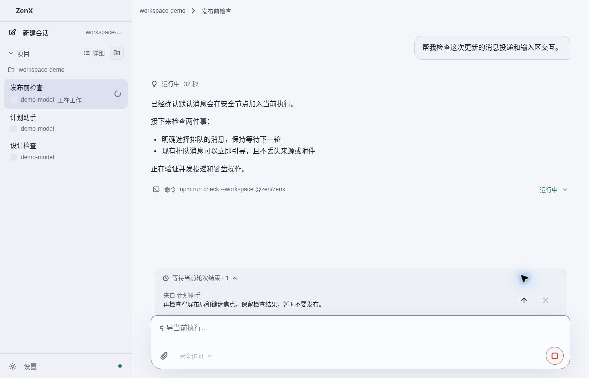
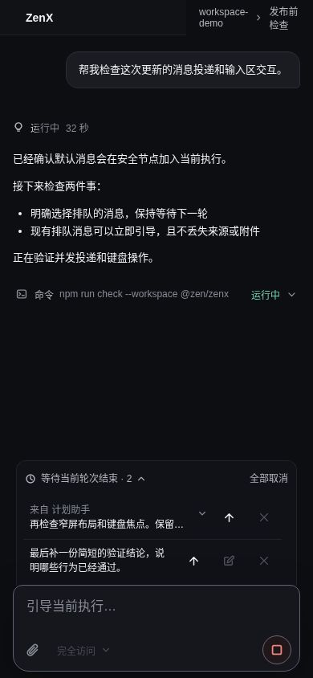
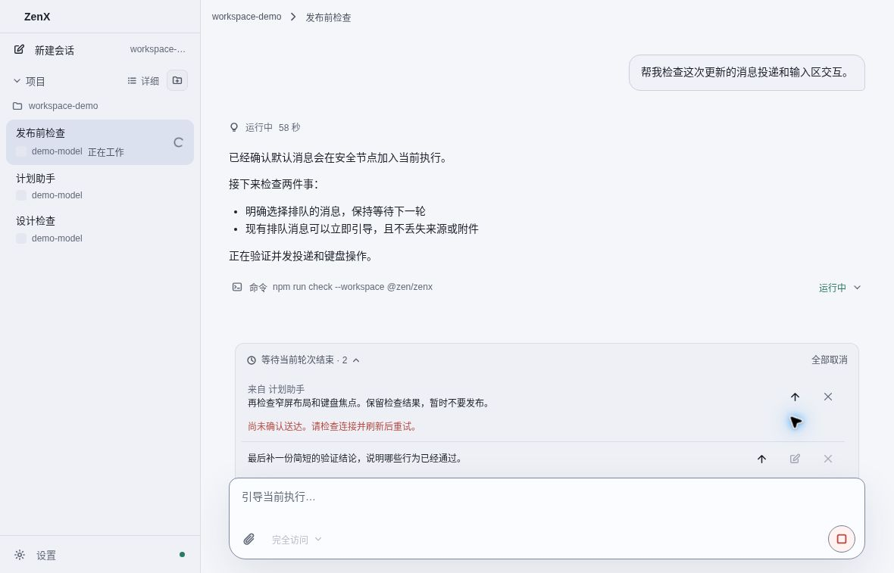

# Send a queued message now

While a Thread is working, the queue strip says **After this turn**. Each row has
an upward-arrow action: **Steer now**, which sends that existing message into the
current execution at the next safe point without interrupting it. If the Thread
is idle, the action says **Send now** and starts that selected message.

Editing supported human-message rows and cancelling pending rows remain available.
Agent-origin and Host-origin queue rows are not editable in the existing native
queue-edit API; this change preserves that boundary rather than disguising an
Agent or Host message as a human edit. All three kinds support Send now.

## Defaults and explicit choices

Normal `zenx_threads_send` communication should omit `messageType`. The receiving
Host defaults to `guidance`, independently of the manual Composer preference.
An explicit `follow_up` means wait for the next Turn; `replacement` interrupts.
The shipped schema, plugin README and agent-facing main document now state the
same behavior. No saved Composer, trigger, IM/Room setting or explicit send intent
is reset by promoting a queued message.

The previous plugin README said omission followed the saved ZenX preference. That
was inconsistent with current native behavior and could mislead an agent. A
queued message alone cannot identify the installed build or prove whether its
caller explicitly requested `follow_up`; inspect the build revision and canonical
sender/tool arguments before attributing an existing queue to a version change.

## Atomic behavior

The native `zen/thread/queue/steer` request takes `threadId`, `queuedItemId`,
`clientId`, and `expectedRevision`. It acts under the same Thread mutation fence as
editing, cancelling and normal queue admission. It never implements promotion by
cancelling and resending text.

- The original queued Item and its timestamp remain unchanged.
- The delivered Item preserves the original client identity, input/images, and
  Agent/Host provenance; its own timestamp records actual admission.
- Duplicate requests, response loss and reload use that canonical receipt.
- A stale edited revision is rejected; a cancelled item is never revived.
- Turn completion and queue-drain races either use the existing delivery or start
  the selected input once. Waiting for initial admission never waits for the whole
  active Turn.
- An uncertain response triggers a read, never an automatic second send. Visible
  errors remain on their owning row; the Composer draft is untouched.

## UX references actually inspected

- [T3 Code queued row](https://github.com/pingdotgg/t3code/blob/5cc99e1c23980d7995a13c47f969b47cb68ed1be/apps/web/src/components/chat/MessagesTimeline.tsx#L1780-L1870):
  persistent Send now arrow, separate queued/sending status, accessible action
  labels. ZenX reuses those cues while keeping delivery in its native server.
- [DeepSeek Harness QueueDock](https://github.com/deepseek-ai/deepseek-harness/blob/639ed015397290b3745d163aafe02ffee4aa3f84/packages/client/ui-conversation/src/client/queue/QueueDock.tsx):
  a compact input-adjacent strip with per-row steer, edit and remove actions.
  Its [attached dock styling](https://github.com/deepseek-ai/deepseek-harness/blob/639ed015397290b3745d163aafe02ffee4aa3f84/packages/client/ui-conversation/src/client/queue/QueueDock.module.css)
  informed the inset rounded-top surface joining the Composer.

## Synthetic visual verification

These screenshots use the production Sidebar and ThreadView with invented fixture
data. They contain no user conversation, attachment or filesystem content.
Backend correctness is tested independently through ZenAppServer/NativeConnection
and authenticated RemoteHost access; screenshots do not simulate proof of backend
execution.

