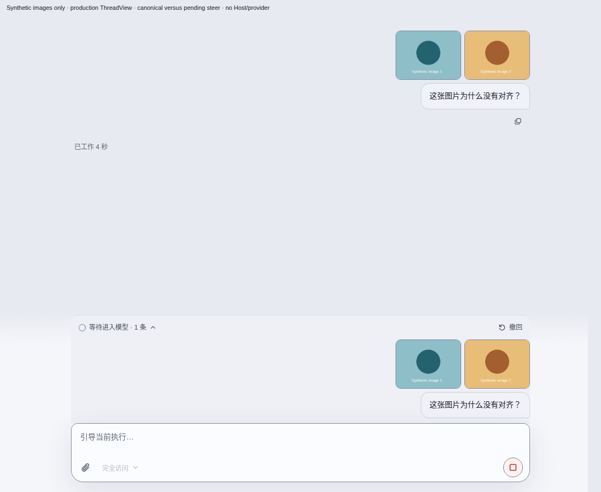
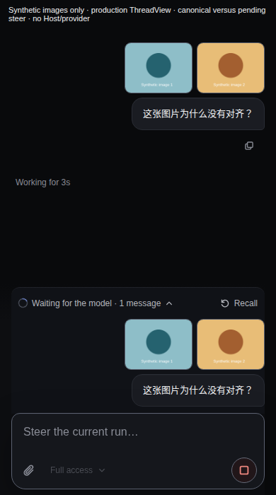

# Pending steer preview evidence

These two unmodified synthetic screenshots show production ThreadView canonical messages (above) and the waiting-for-model shelf (below). No user images or data are included.

Source PR head: `186de4a0f963e76f78a85985f446deb79c708b87`.
Tested merge: `2968d4b8e9b20d5d0c30aaebc9d30680e6044f57`.
Tested tree: `63ee6d209f7a4a1a97fb61500acb79cb605a0e25`.

[CI artifact](https://github.com/albert-zen/zen/actions/runs/42211432220/artifacts/13499552355) passed all 24 scenes with 120 screenshots, 15 acknowledged trusted settled wheel receipts, no browser exceptions, Chromium sandbox enabled, and cleanup complete. All 72 measured images passed the unchanged 90% visible-area threshold (minimum 91.43%). All 24 canonical/pending question bubbles aligned. The selected PNG hashes match the artifact manifest; the 12 source hashes match the reviewed code. See source.json for provenance.

Coverage includes desktop/narrow, one/two images, short/long questions, pending/held/recall failure, actual image/body visibility and canonical alignment. This is production renderer acceptance with synthetic records, not an end-to-end native Host/provider send. The commit retaining this evidence changes documentation only. These screenshots establish the cited source run, not a new full-tree CI pass. That run's aggregate separately failed one Host question answer/cancel timing test; its independent targeted rerun passed. See the PR for the final full CI status.
