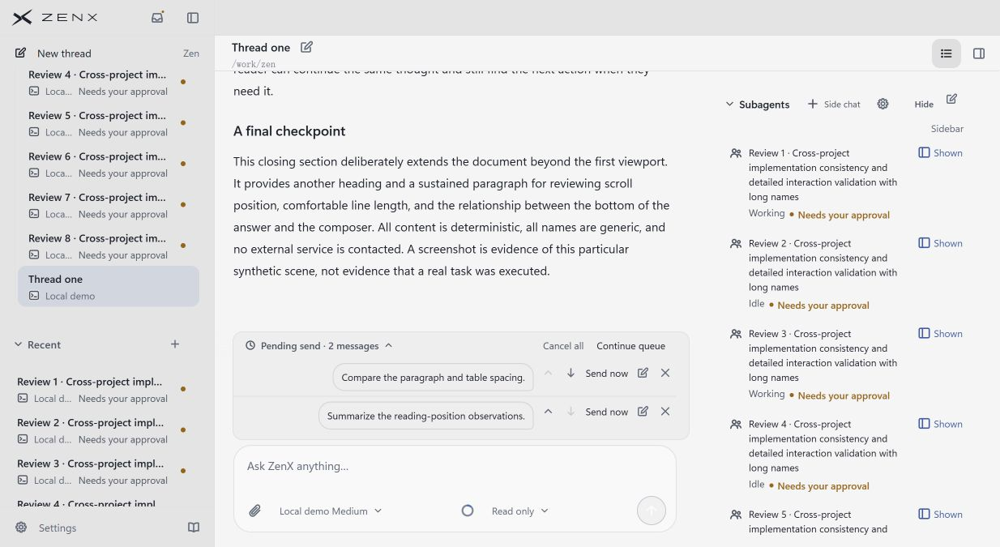
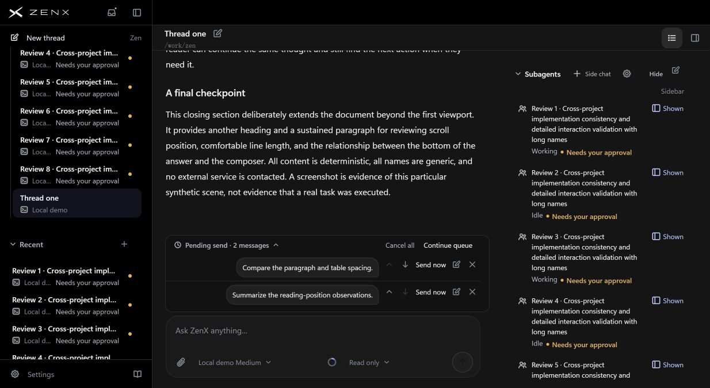

## 后续补充：最终场景独立逐项评审

以下补评晚于上述证据发布；取代“最终场景及参考未重评”的当时状态，历史V2原文仍保留。评审输入不含既有分数或目标，使用本目录浅深产品原图及上述四家相同参考原图；Linear没有对应图。

| 对象 | 信息层级 | 文字/名称可读性 | 任务注意力 | 空间/表面一致性 | 控件可发现性 |
| --- | ---: | ---: | ---: | ---: | ---: |
| Zen 浅色 | 7 | 7 | 6.5 | 7.5 | 7 |
| Zen 深色 | 7 | 6.5 | 6.5 | 7.5 | 6.5 |
| Claude Code | 8 | 7 | 8 | 8 | 7.5 |
| DeepSeek Harness | 8 | 8 | 7.5 | 8 | 8 |
| Codex | 8.5 | 8.5 | 8 | 8.5 | 8.5 |
| T3 Code | 8 | 7.5 | 8 | 7.5 | 7 |
| Linear | N/O | N/O | N/O | N/O | N/O |

10分制主观逐图评审，不是自动测试通过率或产品排名。当前8条仅审批场景没有匹配基线，不能声称涨分；参考任务/主题/视口不同，没有对应多审批场景。主问题：提示存在，但优先处理哪个、从哪里处理不够清楚，长名与多条的扫读成本高。先验证既有导航，再考虑新入口；本次不改变功能。

[完整最终评语及范围](FINAL-REVIEW.md)

# 子对话审批提示：0acf76c5

资料卡现在复用 App 已有的 pendingThreadIds（pending/responding），在 Working/Idle 旁补被动审批提示，与左栏语义一致。Asking 可共存；不新增审批按钮、不改变导航/排序或审批协议。

## 最新实现对应的产品原图
以下为本地真实生产 App/资料卡组件、合成只读数据、Edge 1234×675。8条长名、无 Asking。不是原生 Electron/真实账户验收，也不是当前完整 head 重新捕获：构建基于 b096，三个修改产品文件与最终隔离候选一致；0acf76c5 仅再经 Prettier 格式化（验证通过）。测试文件调整不影响截图。不能据此声称其他页面像素无变化。

仅审批状态的 flex/wrap/gap6 实测成立，避免 Working/Idle 贴住审批标记。浅色普通/hover/focus 对比度此前分别实测4.61/5.80/6.46；不是整体 WCAG 声明。保留9px行padding，拒绝无实质首屏收益的9→6实验。

## 评审与分数
[先前V2独立盲评原文](BLIND-REVIEW.md)仅覆盖当时四张匹配前后图，不是最终 approval-only 多条场景的新盲评。评审未给分，本轮不填造分数；最终版本及参考对象逐项分数均**未重评**。后续局部对比度/仅审批间距是工程实测，不用旧评审冒充整页提升。

## 参考图与来源（复用，未重新评分）
以下复用已公开参考，不冒称本轮重跑。T3是开源未合并设计参考6f13f36f的合成运行图；Codex/Claude是官方演示；DSH是开源生产组件合成图。任务/主题/视口不同，不跨产品排名。Linear无对应图，未评。

.jpg>)

来源：[T3](https://t3.codes/) · [Codex](https://openai.com/blog/run-long-horizon-tasks-with-codex) · [Claude](https://claude.com/product/claude-code) · [DSH](https://github.com/deepseek-ai/deepseek-harness)。此前参考逐项评分保留在各轮原记录，不移植到本轮。

## 验证与限制
0acf76c5 [Fast feedback 43402583034](https://github.com/albert-zen/zen/actions/runs/43402583034)已 success；Main UI、reading、navigation、queue 预览亦 success。Information content、Fullscreen、App Shot 有 failure，完整 CI 核验时仍运行，**不是全部CI通过**。Fullscreen修复未混入本轮。
本地相关34/34通过，发布格式化后3定向测试通过。曾有2长名断言导致OOM：对照b096发现旧断言错误假设status直属row，修正为已有identity容器，原失败记录保留，不抹去失败。
截图包含通用合成文案，不代表真实任务执行。多条密度仍有代价，未验收真实审批操作、读屏、原生应用及所有宽度。
