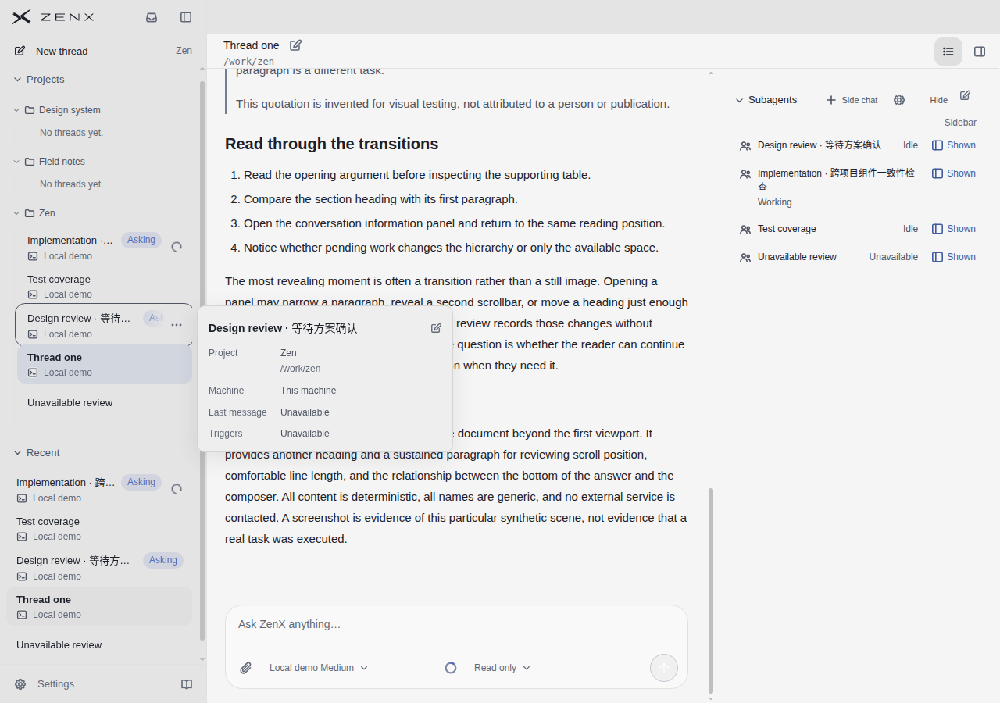
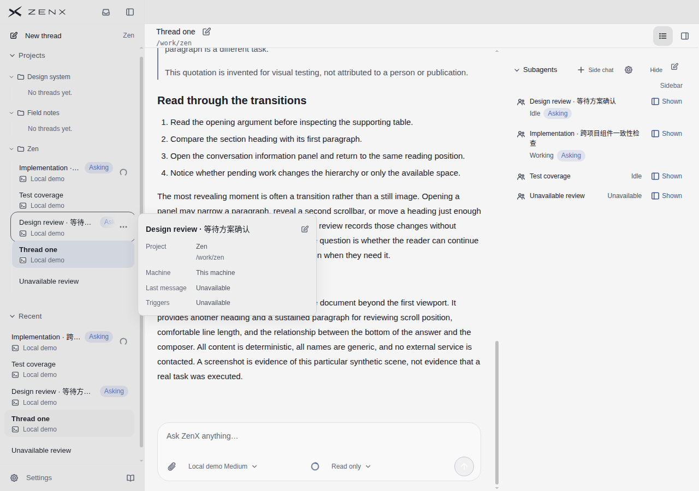
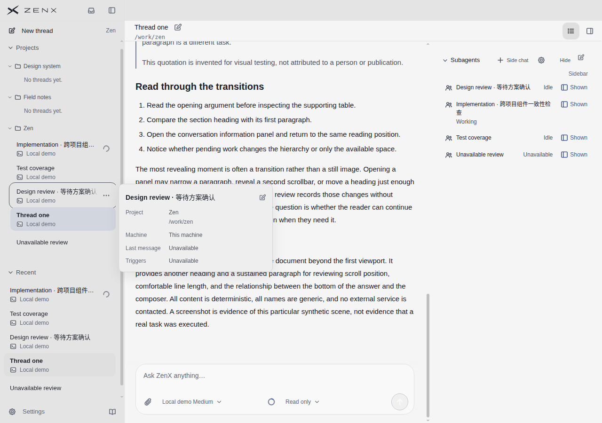
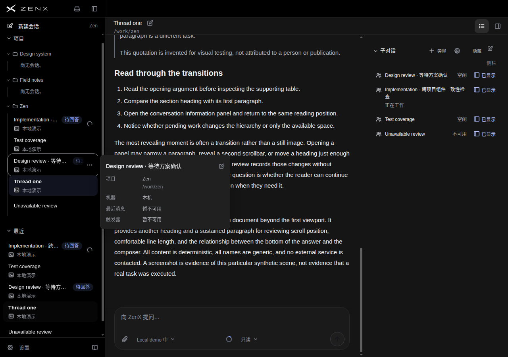
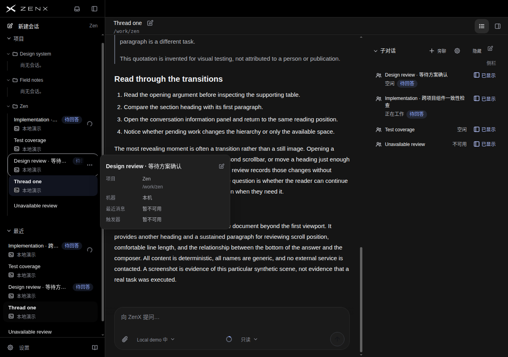
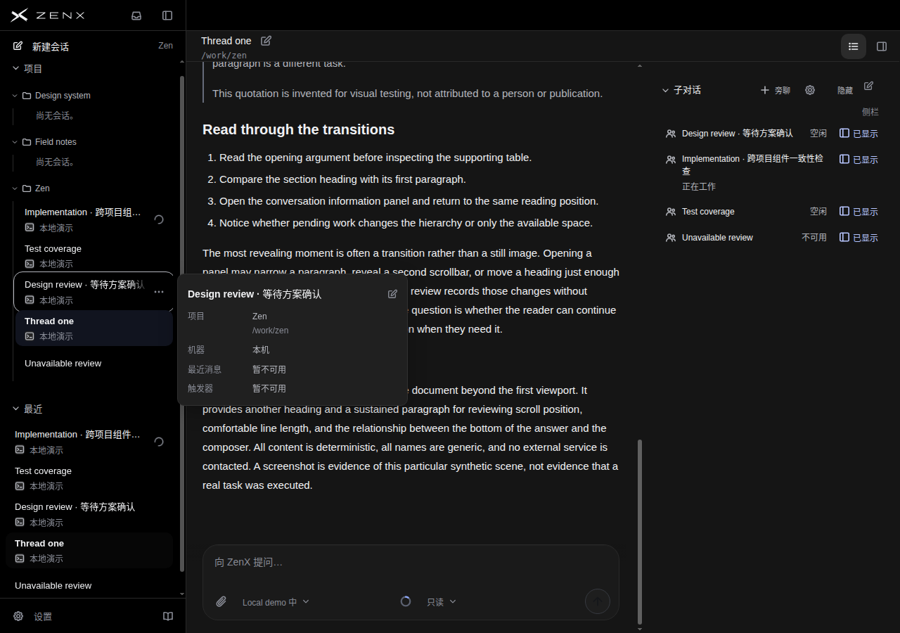
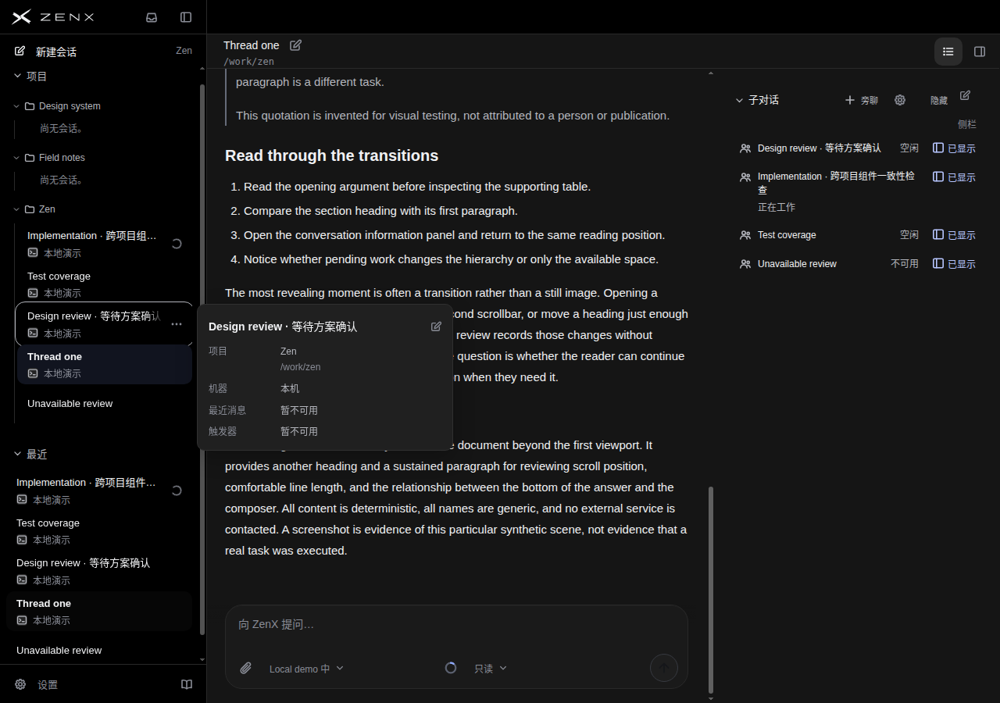

# 子对话待回答提示：与运行状态并列，而非混为一谈

保留 `28b6d9c8` 的局部一致性修复。同一个子对话在左侧栏显示 Asking／待回答，资料卡却只有 Idle／Working；现在资料卡复用同源问题摘要，在原活动状态旁补提示。空闲不等于没有问题需要人回答，工作中也可以有待回答问题。

不新增查询/轮询，不自动显示被隐藏的子对话，不推断审批或失败状态，不改变导航。systemError 抑制过期问题数；零值/缺失不显示。归档仍遵循原显隐规则，显示事实摘要不代表允许回答。

## 决策与代价

独立评审不知道新旧映射和目标分：P=基线，Q=候选。待回答两场景偏好Q，清零两场景持平。发现性6.5→8、状态区分6→8、整体6.5→7；名称持平6.5，空间6.5→6。支持有限保留，不是整体UI升级或胜过参考。

右资料卡待回答时浅色269→298.781px、深色278→303.781px；状态换到名称下方，后续条目下移。清零后尺寸、Idle/Working及测量对象恢复基线。没有声称逐像素一致、二十条目容量或无遮挡全景改善。

## 实证与范围

- 基线 `76e65c11`：[reading43273378660](https://github.com/albert-zen/zen/actions/runs/43273378660)，artifact13969033184，71.825秒84图。
- 候选 `28b6d9c8`：[reading43279469324](https://github.com/albert-zen/zen/actions/runs/43279469324)，artifact13971868078，76.727秒84图。
- 两轮精确源码、干净工作树、无renderer errors/external requests；真实生产组件，合成Host数据，不是原生应用或实际任务。
- 左右通过真实threadId与唯一名称对应，idle+1、active+2、idle+0、systemError。清零沿现有合成Host通知刷新，不实际回答；原生Tab焦点、四个可见ID、Composer几何保持，无页面横溢出。
- 候选43项短测及新增英语/中文真实React DOM目标测试2/2通过。基线目标测试0匹配不算验收。目标测试位于截图后，单测10秒、进程30秒截止，失败仍报失败且已有截图上传，避免无关旧suite绑住视觉循环。
- 候选[快速静态43279468725](https://github.com/albert-zen/zen/actions/runs/43279468725)类型及Prettier通过，不代表全CI。
- 前置验证过程中曾修正SDK构建缺失、TS7016声明缺失；整份旧DOM suite存在陈旧结构断言，运行器中止根因未证。本轮只运行新目标测试，不把旧失败掩成通过。
- 英语浅色、中文深色，不是完整语言×主题交叉验收。键盘焦点打开既有资料popover，遮住部分主对话，不能称无遮挡全景。暗色正文截图切片略不同，不能据此声称滚动保持已视觉证明。无原生/辅助技术/触摸或独立面板视觉验收。

## 产品原图

### light / pending

基线

候选

### light / cleared

基线

候选

### dark / pending

基线

候选

### dark / cleared

基线

候选

## 全部逐项10分制

| 场景               | ①发现性 | ②状态区分 | ③名称 | ④三栏层级 | ⑤空间 | ⑥整体 |
| ------------------ | ------: | --------: | ----: | --------: | ----: | ----: |
| P light/en pending |     6.5 |       6.0 |   6.5 |       6.5 |   6.5 |   6.5 |
| Q light/en pending |     8.0 |       8.0 |   6.5 |       7.0 |   6.0 |   7.0 |
| P light/en cleared |     7.5 |       7.5 |   7.0 |       7.0 |   6.5 |   7.0 |
| Q light/en cleared |     7.5 |       7.5 |   7.0 |       7.0 |   6.5 |   7.0 |
| P dark/zh pending  |     6.5 |       6.0 |   6.5 |       6.5 |   6.5 |   6.5 |
| Q dark/zh pending  |     8.0 |       8.0 |   6.5 |       7.0 |   6.0 |   7.0 |
| P dark/zh cleared  |     7.5 |       7.5 |   7.0 |       7.0 |   6.5 |   7.0 |
| Q dark/zh cleared  |     7.5 |       7.5 |   7.0 |       7.0 |   6.5 |   7.0 |

## 每参考对象逐项评分

没有匹配任务或三栏证据的项为N/O，不编造分数，不跨产品平均排名。

| 参考截图                               | ①发现性 | ②状态区分 | ③名称 | ④三栏层级 | ⑤空间 | ⑥整体 |
| -------------------------------------- | ------: | --------: | ----: | --------: | ----: | ----: |
| T3 / main-conversation-dark.jpg        |     N/O |       N/O |   8.0 |       N/O |   8.0 |   8.0 |
| Codex / proactive-20s.png              |     N/O |       N/O |   8.0 |       N/O |   8.0 |   8.5 |
| Claude / product-demo-conversation.jpg |     N/O |       N/O |   6.5 |       N/O |   7.5 |   7.5 |
| DSH / subagents-dark.jpg               |     N/O |       N/O |   7.5 |       N/O |   8.0 |   8.0 |
| Linear / 无图                          |     N/O |       N/O |   N/O |       N/O |   N/O |   N/O |

[完整独立评审](BLIND-REVIEW.md) · [原始测量、完整截图manifest及发布图SHA256](receipt.json)

## 实看参考原图

### T3

.jpg>)

### Codex

### Claude

### DeepSeek Harness

Linear没有本轮可核验原图，全部N/O。四参考均无同等待回答条件，不宣称其采用同一方案。
