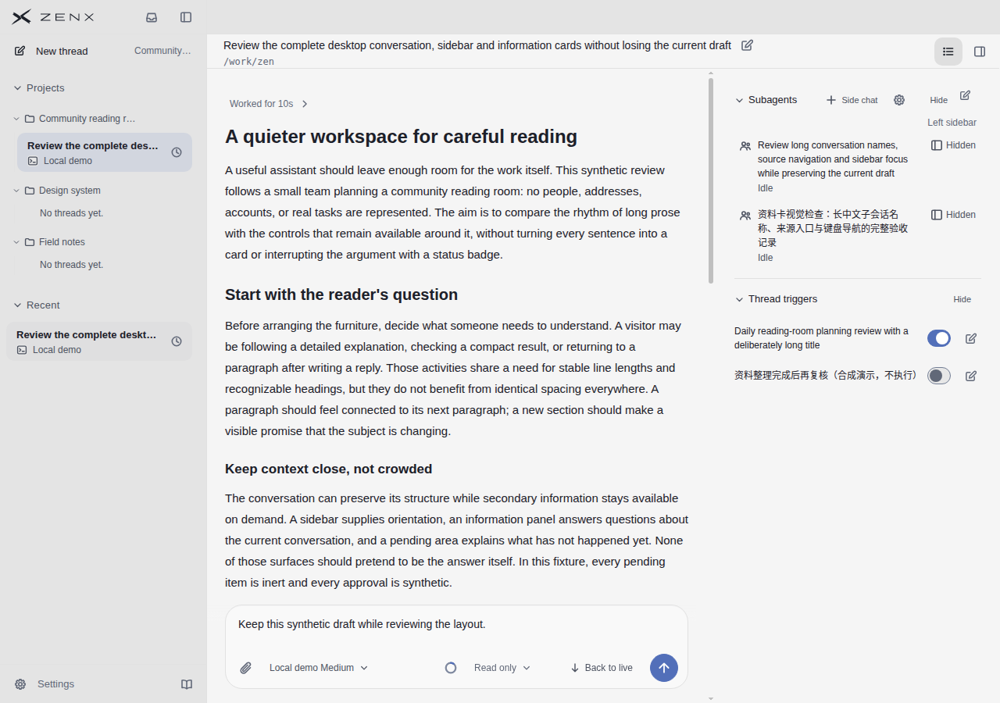
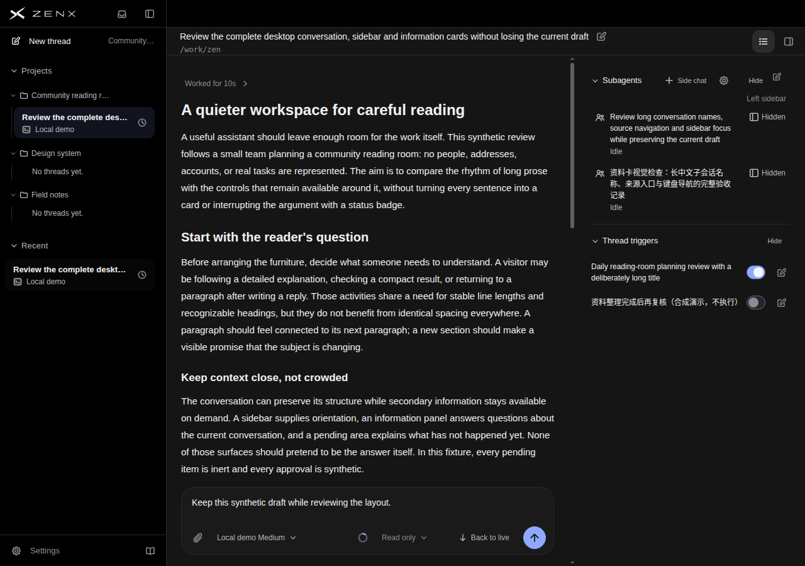
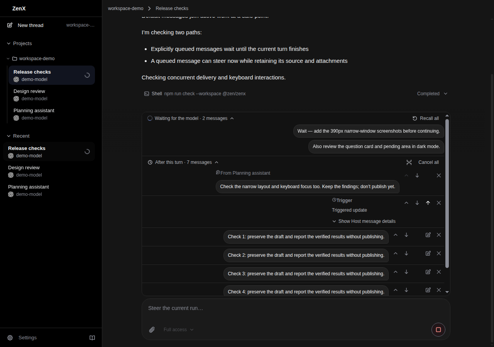
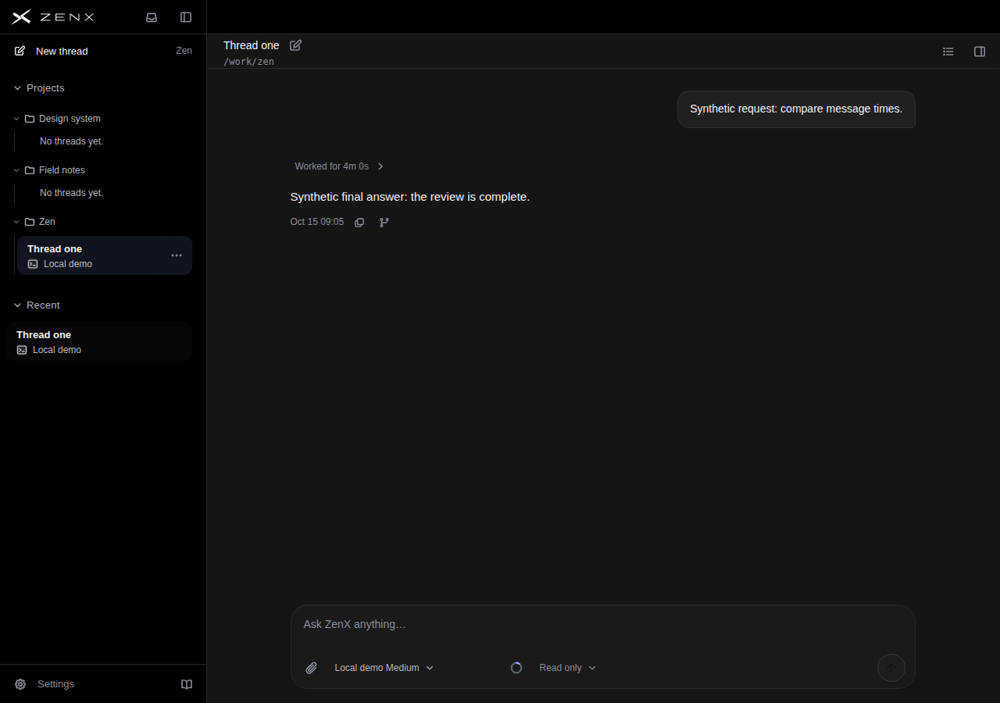
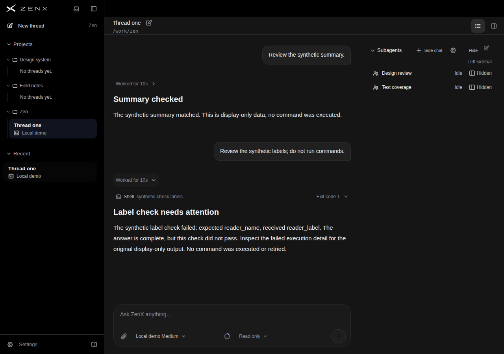

# ZenX desktop screenshots for draft #755

Source: `e1e55ec6fbf8562bc061cff0fb9995b9b2ac1726`. Original unedited PNGs from the production-component desktop preview, Chrome 157.0.8103.50, 1280 × 900, fine pointer. All visible conversations, commands and timings are synthetic fixtures. These are desktop browser captures, not native Electron acceptance or live execution evidence.

[Desktop reading capture](https://github.com/albert-zen/zen/actions/runs/44094298173/artifacts/14332034680) · [Desktop queue capture](https://github.com/albert-zen/zen/actions/runs/44094298394/artifacts/14333366639)

## Conversation and information dock

The main conversation, sidebar and information dock are shown together. In the dock, only the first header reserves space for the floating Customize button; the later Hide aligns with the right-side control rail.

| Light                                                                                                  | Dark                                                                                                 |
| ------------------------------------------------------------------------------------------------------ | ---------------------------------------------------------------------------------------------------- |
|  |  |

## Queue layout, source and Steer

The queue and Composer share the same 800 px outside edges in these desktop captures. Source labels sit with their content, not against the full queue's left edge. The queue has no separate “Less space” line. Hovering the trigger row reveals the Steer arrow without adding a text button or moving the row.

| Pointer away                                                                                     | Trigger row hovered                                                                                              |
| ------------------------------------------------------------------------------------------------ | ---------------------------------------------------------------------------------------------------------------- |
|  |  |

## Reply time and shell outcome

The synthetic request was sent at 09:00, its turn started at 09:01 and finished at 09:05 UTC. Hovering the final reply shows 09:05. This fixture exercises recovered history, not live arrival. A failed Shell record with a known nonzero exit also shows its exit code in the collapsed row; the underlying invocation lifecycle is unchanged.

| Reply hover                                                                          | Collapsed Shell record                                                                              |
| ------------------------------------------------------------------------------------ | --------------------------------------------------------------------------------------------------- |
|  |  |
