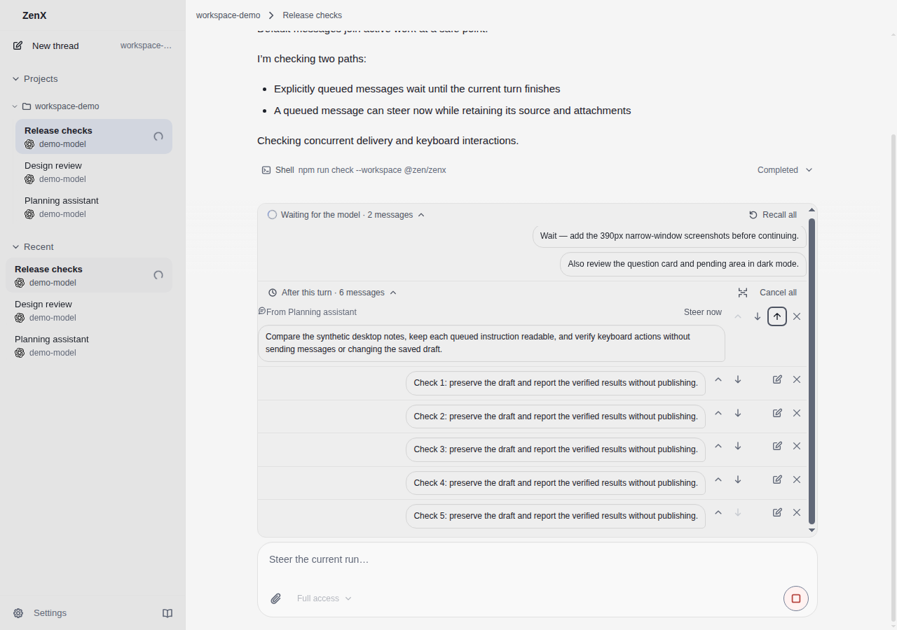
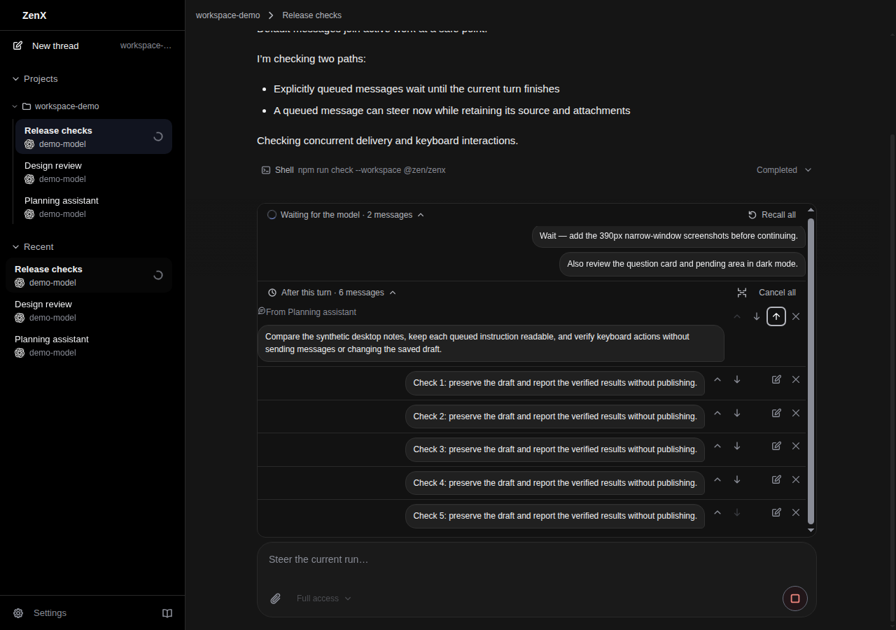

# Desktop queued-message Steer: keyboard focus

A sighted keyboard user could Tab to the actionable arrow in an expanded queue, but the arrow and focus ring did not say what the action does. The T3 Code [captured Replay example](../../references/t3-runtime-6f13f36f/queue-expanded-tab-focus-dark.jpg) shows the function name when the keyboard focus is on Steer for an expanded long queued message. That older development replay (commit `6f13f36fab31131917f178a904985f638913b26c`) was paused for a question. Zen was actively running, so the comparison is about identifying the action, not when a message is delivered.

Zen now shows the localized “Steer now” cue on the existing source line, just to the left of the action cluster, while the Steer icon is keyboard-focused in this desktop agent-origin row. The cue does not create another focus stop or reserve a new row. The existing motion, sending behavior and accessible name are unchanged.

| Synthetic desktop scene                               | Before                                                 | After                                                     |
| ----------------------------------------------------- | ------------------------------------------------------ | --------------------------------------------------------- |
| Light, long agent-origin message, native Tab to Steer |  |  |
| Dark, same state                                      |   |   |

Both pairs are original 1280 × 900 Chrome production-renderer captures with the same synthetic queue fixture. [Before run](https://github.com/albert-zen/zen/actions/runs/44234900834), source `d2a18bcd8a772d97f5eef100bb614d8af2fa0572`. [After run](https://github.com/albert-zen/zen/actions/runs/44241353049), source `f379d4e2bd3e5f9dd943350c9194a471560a8724`.

The after probe waited for the transcript to settle, then held native Tab focus on the target in both themes. The queue actually scrolled 3px during traversal; row geometry was unchanged after accounting for that scroll, and the transcript and composer stayed fixed. The cue was visible without clipping or overlap and disappeared on the next Tab. No Steer activation, message send or live model call was exercised. The before snapshot shows no painted in-page hint; it says nothing about browser chrome's native hover title.
