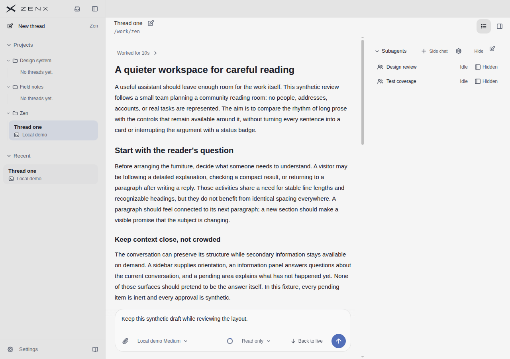
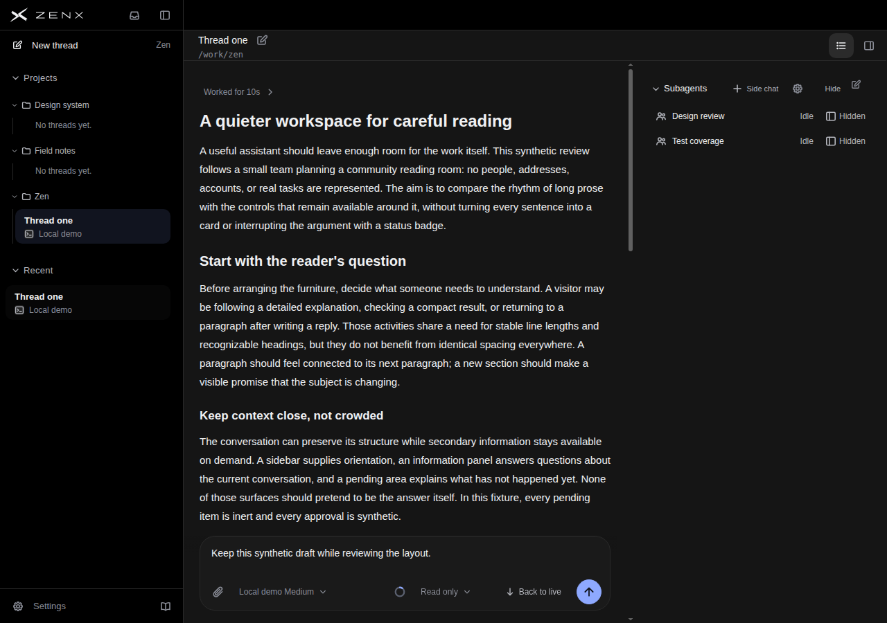

# Desktop whole-UI review: bf6acf41 → c2eb7473

## Scope and provenance

Reviewed product source: `c2eb7473d41c821f9190052aa79a798f761a2c54`.
This is real production UI components rendered with synthetic read-only conversation data, not native Electron/OS acceptance or real customer data. Comparison uses matching desktop light/dark Information-reading scenes. The reviewer did not receive a target score.

## Independent visual scores (10-point scale)

| Dimension             | bf6acf41 baseline | c2eb7473 |
| --------------------- | ----------------: | -------: |
| Information hierarchy |               7.7 |      8.0 |
| Readability           |               8.0 |      8.0 |
| Attention control     |               7.5 |      8.0 |
| Consistency           |               7.8 |      8.0 |
| Discoverability       |               7.6 |      7.5 |

These are modest visual improvements, not a claim that the complete application is finished. Discoverability declines slightly.

## Observed differences

- In matching Information-reading screenshots, the resting composer has a quieter outline/shadow while text and blue send control remain visible. The light-theme input boundary is less obvious: this is a discoverability cost, not an unqualified improvement.
- Detailed desktop sidebar selected rows shrink from approximately 59 px to 50 px. The Recent heading moves upward approximately 40 px (y430 to y390). Short fixture names do not overlap.
- Duplicate current-thread entries across Projects and Recent remain. The pending state's secondary line still truncates to `Loc…`.
- The prose-top scene still shows a bright outline in both versions. DOM focus was not verified, so these screenshots do not establish correct focus behavior or a quieter composer in every resting state.

## Reference comparison

This round inspected the existing T3 Code dark runtime screenshot and Codex proactive screenshot. T3's composer also has a low-emphasis outline; its navigation remains flatter and better grouped. Codex uses a quiet selected row and compact single-line title/time presentation. Zen should preserve useful provider/status metadata rather than copy away information.

The existing per-dimension scores, source notes and original screenshots for all five reference products remain in the PR history/body. They are not newly rescored in this round. Different themes, data and image resolutions prevent treating this inspection as a controlled cross-product pixel comparison.

## Not verified

Keyboard/mouse interactions, hover targets, focus semantics, accessibility contrast measurements, long names, multiple projects and complex status combinations were not validated in this review. No native application acceptance is claimed.

## Product screenshots

Baseline images remain at commit `16c2e98b64d86d03a42f9686048a246332a1c867`, directory `docs/ui-quality/evidence/desktop-reading-bf6acf41`.

The adjacent source receipt records the exact input commit, clean source tree and build provenance.
