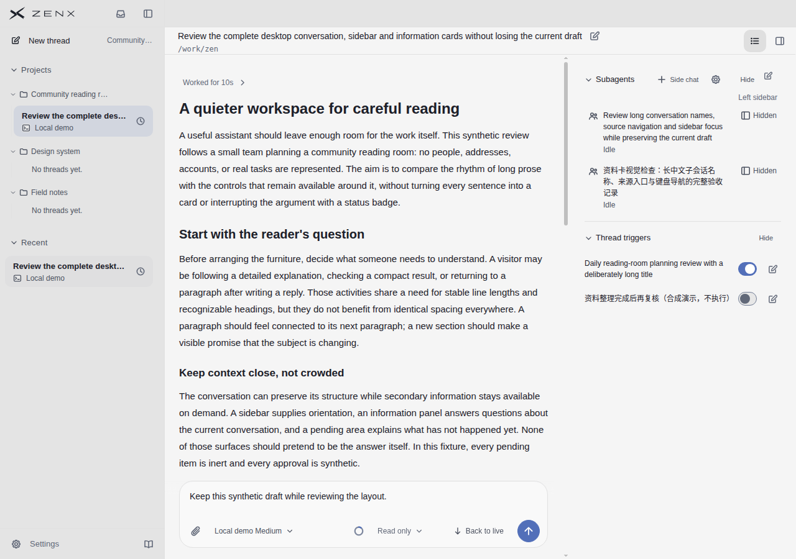
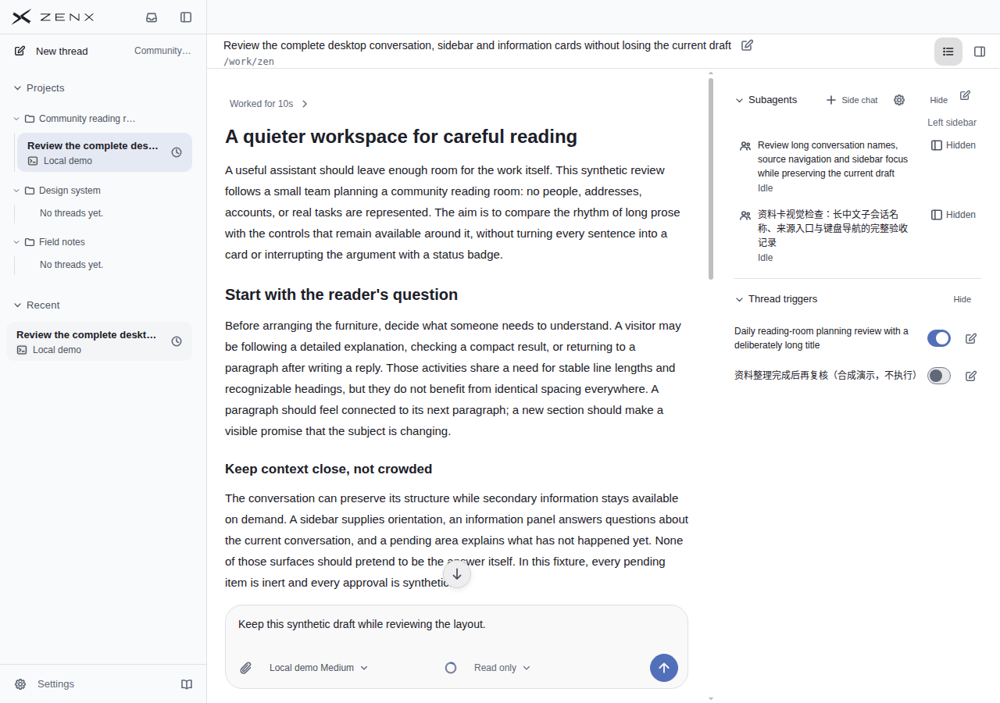
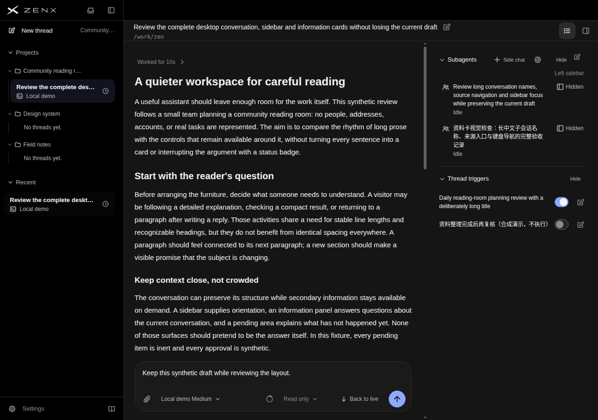
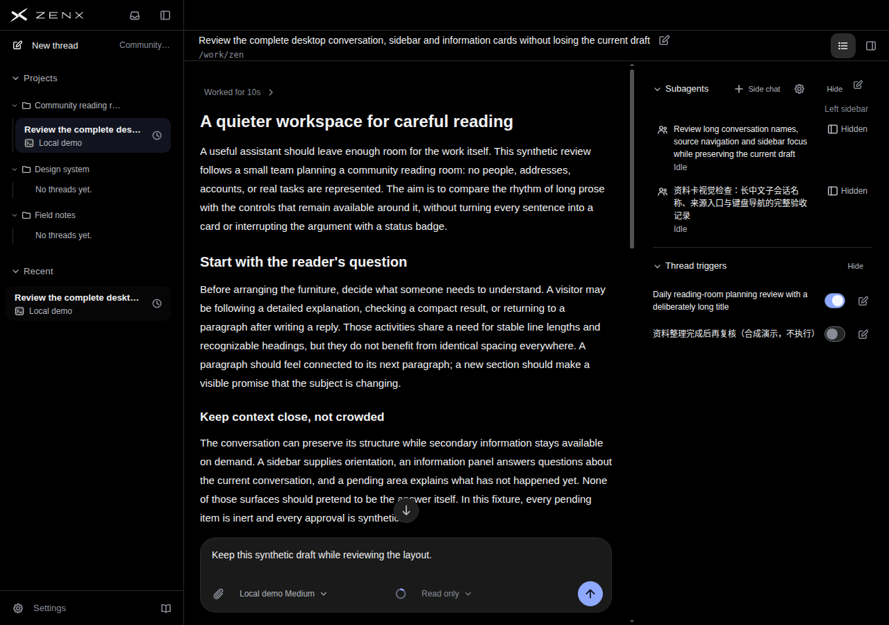
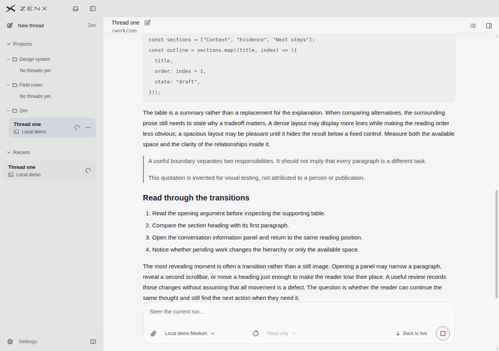
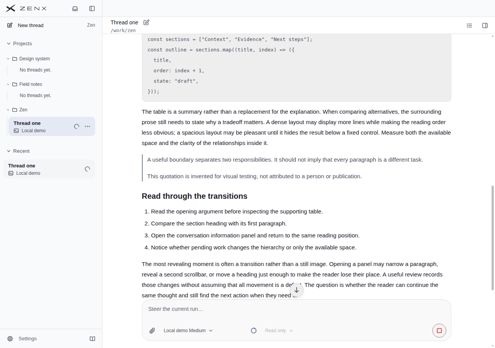

# Desktop reference comparison for #755

Three changes to the default desktop conversation. Each row identifies the equivalent reference state and the pattern used in Zen, not a requirement to copy the entire product.

| Scene                                                        | Reference in that state                                                                                                                                                                                                                                                                                                                                                                                                                                                                                                                                                                                                                       | Zen before                                                                                                                                                                        | Zen change                                                                                                                                       |
| ------------------------------------------------------------ | --------------------------------------------------------------------------------------------------------------------------------------------------------------------------------------------------------------------------------------------------------------------------------------------------------------------------------------------------------------------------------------------------------------------------------------------------------------------------------------------------------------------------------------------------------------------------------------------------------------------------------------------- | --------------------------------------------------------------------------------------------------------------------------------------------------------------------------------- | ------------------------------------------------------------------------------------------------------------------------------------------------ |
| Light conversation with navigation visible                   | DeepSeek Harness: [conversation/sidebar surfaces](https://github.com/deepseek-ai/deepseek-harness/blob/ca33fd6843b205e279c7ccb6cb73a472c78f5760/packages/client/ui-theme/src/styles/design-platform.css#L176-L329) and [sidebar layout](https://github.com/deepseek-ai/deepseek-harness/blob/ca33fd6843b205e279c7ccb6cb73a472c78f5760/packages/client/ui-layout/src/client/AppFrame.module.css#L58-L65). Released T3 Code also keeps [light navigation and canvas close in tone](https://github.com/pingdotgg/t3code/blob/7d32075e3757ded707914e2450c3e392a9665765/apps/web/src/index.css#L1049-L1114).                                       | [Light desktop screenshot](../desktop-20261117-e1e55ec/reading-desktop-light-supporting-rails-long.png): `#e4e4e4` sidebar against `#f5f5f5` reading canvas.                      | Near-white `#f9fafb` sidebar and white reading canvas; retain borders and selection.                                                             |
| Dark conversation with navigation visible                    | T3 Code v0.1.10: [black conversation canvas](https://github.com/pingdotgg/t3code/blob/7d32075e3757ded707914e2450c3e392a9665765/apps/web/src/index.css#L1121-L1147) and [black navigation](https://github.com/pingdotgg/t3code/blob/7d32075e3757ded707914e2450c3e392a9665765/apps/web/src/index.css#L1164-L1209).                                                                                                                                                                                                                                                                                                                              | [Dark desktop screenshot](../desktop-20261117-e1e55ec/reading-desktop-dark-supporting-rails-long.png): black sidebar against `#151515` conversation.                              | One black base canvas; existing borders, bubbles and Composer still separate functions.                                                          |
| Scrolled up in a long conversation with the Composer present | [ZCode's independent circular down-arrow above the Composer](https://github.com/zai-org/ZCode/blob/fec975905a2abd4c07e35c40d51fa097a2258ec9/packages/ui/src/v4/ConversationTimeline.tsx#L2236-L2251); [DeepSeek Harness conversation-owned control and bottom-zone clearance](https://github.com/deepseek-ai/deepseek-harness/blob/ca33fd6843b205e279c7ccb6cb73a472c78f5760/packages/client/ui-chat/src/client/chat/ChatView.module.css#L383-L409); [T3 separates timeline navigation from the Composer](https://github.com/pingdotgg/t3code/blob/7d32075e3757ded707914e2450c3e392a9665765/apps/web/src/components/ChatView.tsx#L3488-L3517). | [Baseline capture, `reading-reentry-parked-cue.png`](https://github.com/albert-zen/zen/actions/runs/44094298173/artifacts/14334025434): the labeled return link sat next to Send. | Centered circular arrow above the writing dock, visible only while away from the latest message. No extra toolbar item or permanent reading row. |

The [T3 official dark desktop image](https://t3.codes/_astro/app-desktop.BHuzLVLF.webp) shows the sidebar and transcript sharing a black plane while the Composer and dock remain distinguishable. It illustrates that surface relationship, not the scroll control. For light DSH and the ZCode arrow above, the exact matching references are the linked source implementations; no new competitor screenshot is represented as runtime evidence.

## Zen before / after

Original 1280 × 900 desktop Chrome captures of production renderer components with synthetic fixtures, not private chats or native Electron. Before: `e1e55ec6fbf8562bc061cff0fb9995b9b2ac1726`. After: `f81ed95bcb7ead27dd6b3023ef5dbba45c134604`. [Exact after run](https://github.com/albert-zen/zen/actions/runs/44229236827).

| Scene                                               | Before                                                                                                                    | After                                                                   |
| --------------------------------------------------- | ------------------------------------------------------------------------------------------------------------------------- | ----------------------------------------------------------------------- |
| Light: sidebar, conversation and dock               |  |  |
| Dark: sidebar, conversation and dock                |  |    |
| Reading older messages in the same synthetic thread |                                                                             |          |

[After click and later synthetic output: return button gone at the live end](jump-returned.png).

The after capture checked computed backgrounds for both themes and the saved pixels match: light sidebar `#f9fafb`, light conversation and dock `#ffffff`, dark all three `#000000`. The re-entry probe used native wheel and click at this desktop size: one 36px control, center aligned with the Composer and 6px clear of the writing dock, shown when reading back, then absent at the latest message. Two later content additions and the final update stayed followed. A separate component check covers keeping a nonempty draft; the streaming re-entry fixture's editor is empty. The small button can overlay a local slice of older text; it does not add or resize a toolbar.
