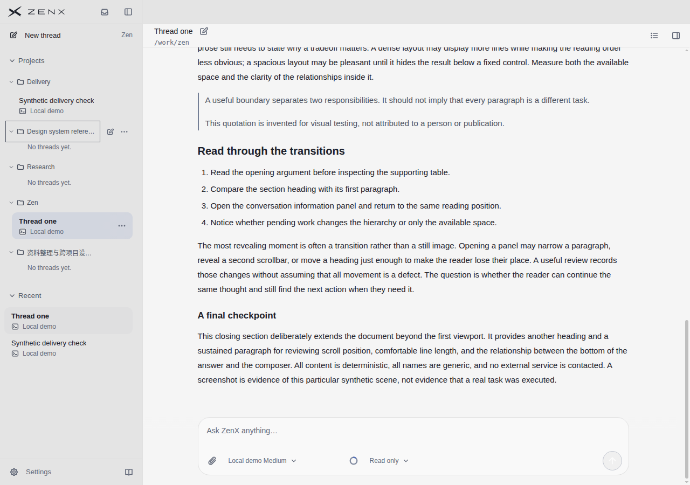
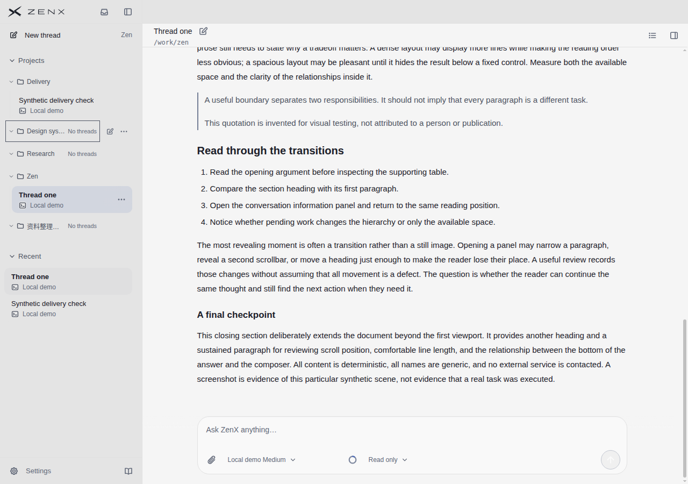
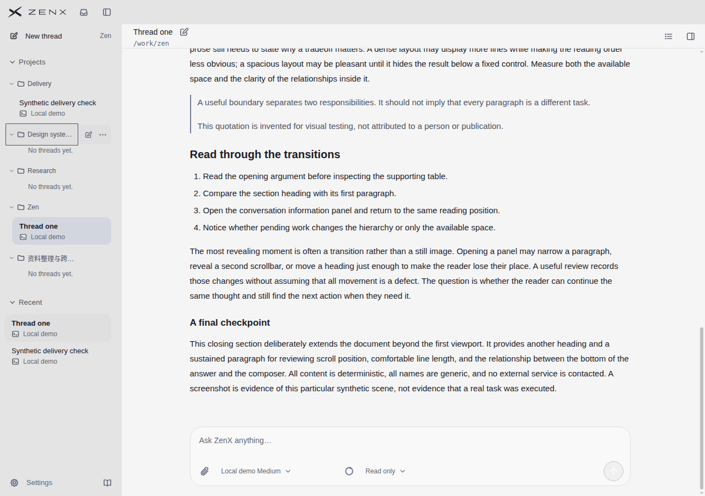
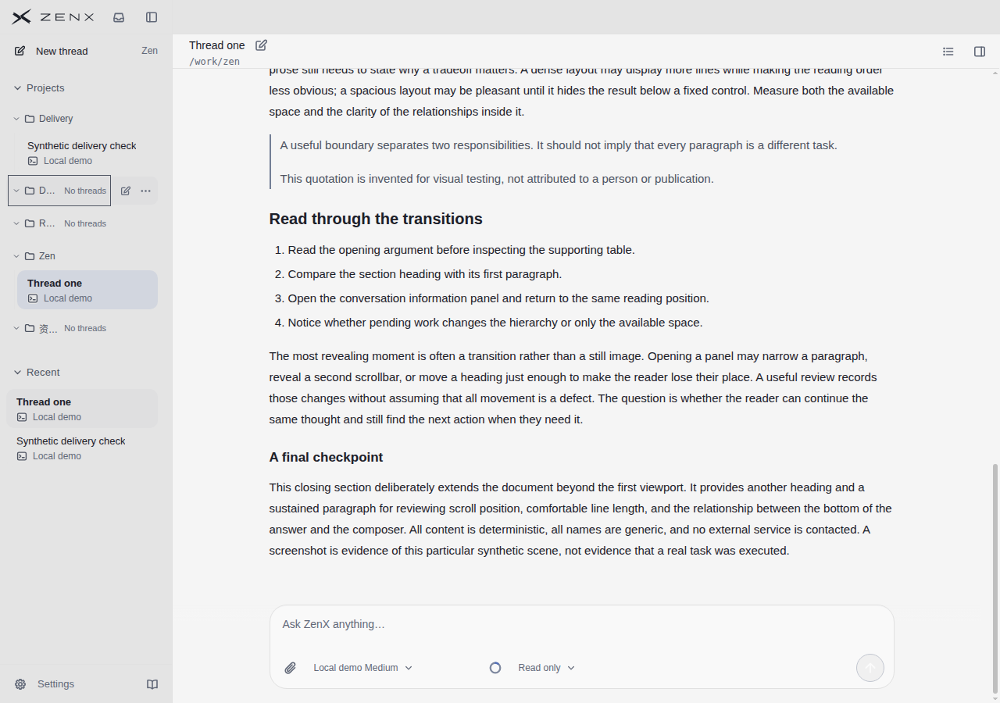
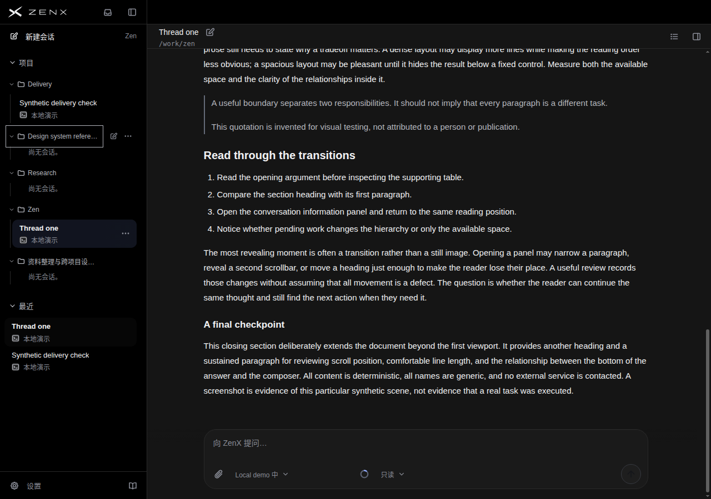
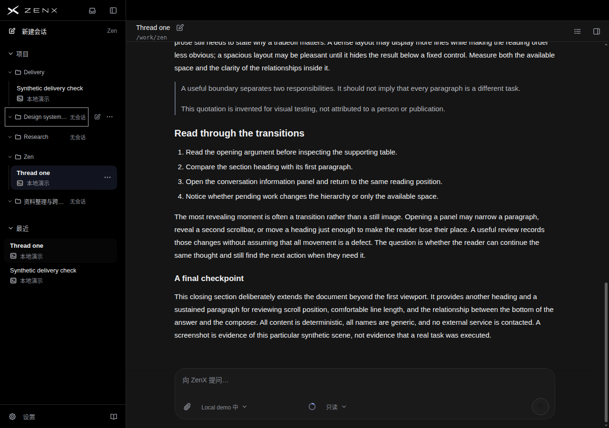
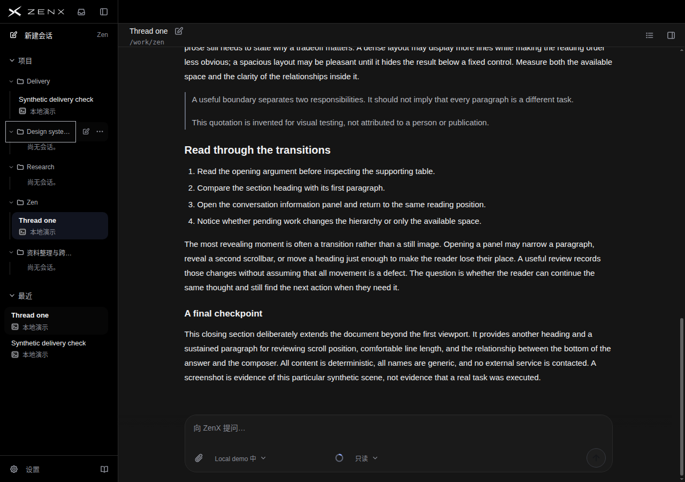
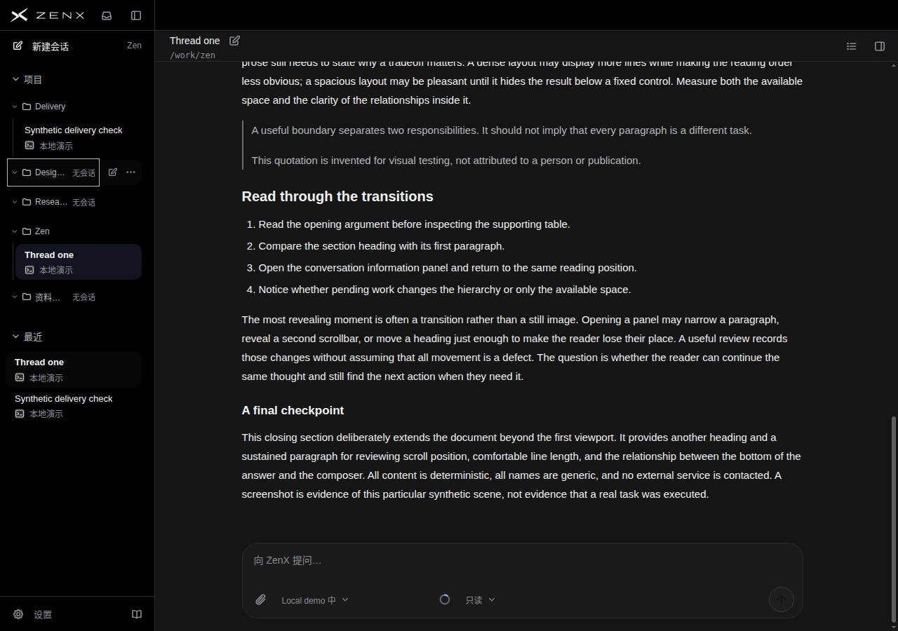

# 空项目侧栏实验：拒绝并回退

候选 `291327fb` 已在 `242007bd` 非强制回退，完整树恢复到 `21beb4cd`；保留新增比较场景，不保留产品布局改动。不是 UI 提升发布。

## 为什么不保留

把展开空项目的说明移入组头，3组共节省72px；但英文项目名称宽度默认130→71px，侧栏最小宽度220px时86→27px，Design / Research变成D… / R…。中文名称130→92、86→48px。静态盲评8个成对场景全部偏好原版，当前画面没有纵向溢出来证明省高值得牺牲名称识别。没有压缩正文、改变资料卡、删除项目、排序或Recent入口。

独立评审员不知道新旧映射或目标分：P=候选，Q=基线。分数仅本轮主观10分制，不与不同评审者往轮分数作趋势。[完整评审](BLIND-REVIEW.md)保留全部逐项理由及参考限度。

## 真实渲染与操作证据

- 基线：`21beb4cd`，[run 43261440130](https://github.com/albert-zen/zen/actions/runs/43261440130)，artifact13964515872，75.406秒，80图。
- 候选：`291327fb`，[run 43262047080](https://github.com/albert-zen/zen/actions/runs/43262047080)，artifact13963933991，74.457秒，80图。
- 两轮源码精确且工作树干净，无renderer errors、无external requests。并未等待整套CI。
- 原生Tab、Enter折叠、Space展开、侧栏分隔柄Home至最小宽度，再原生pointer拖回；保留DOM身份与实际可见状态分别检查。非空组、Composer几何及页面无横向溢出均保持。完整测量见[receipt](receipt.json)。
- 三空、两非空项目，长中英名称，英文浅色/中文深色；不是完整语言×主题交叉验收。数据及bridge为合成，真实组件浏览器渲染，不是原生应用/真实任务或辅助技术验收。
- fixture意图置顶未在截图出现pin，不能声称覆盖置顶标记。资料卡未在盲评新增场景打开；另旧information-reading/supporting-rails-long两主题右侧区域像素一致，不据此宣称整体提升。
- 候选另有ui-ux、shell、Sidebar格式检查失败；被拒候选已完整回退，不单独修补或宣称整套CI通过。

## 产品截图

以下8图展示默认与最小侧栏宽度；折叠/非空组折展完整图保留在上述artifact，全部16张原图均被独立评审。

### light / expanded

基线

已拒绝候选

### light / minimum-width

基线

已拒绝候选

### dark / expanded

基线

已拒绝候选

### dark / minimum-width

基线

已拒绝候选

## 全部逐项评分

| 主题/语言 | 状态             | 组  | 项目名称识别 | 空/折叠状态清晰 | 导航扫描层级 | 整体空间利用 | 整体偏好 |
| --------- | ---------------- | --- | -----------: | --------------: | -----------: | -----------: | -------: |
| light/en  | expanded         | P   |          5.5 |             7.5 |          7.0 |          7.0 |      6.5 |
| light/en  | expanded         | Q   |          8.0 |             8.5 |          8.0 |          7.5 |      8.0 |
| light/en  | empty-collapsed  | P   |          6.5 |             7.0 |          7.0 |          7.0 |      7.0 |
| light/en  | empty-collapsed  | Q   |          8.0 |             8.0 |          8.0 |          7.5 |      8.0 |
| light/en  | filled-collapsed | P   |          5.5 |             7.5 |          7.0 |          7.0 |      6.5 |
| light/en  | filled-collapsed | Q   |          8.0 |             8.5 |          8.0 |          7.5 |      8.0 |
| light/en  | minimum-width    | P   |          3.0 |             7.0 |          5.5 |          5.5 |      4.5 |
| light/en  | minimum-width    | Q   |          7.0 |             8.5 |          7.5 |          7.0 |      7.5 |
| dark/zh   | expanded         | P   |          6.5 |             7.5 |          7.5 |          7.5 |      7.0 |
| dark/zh   | expanded         | Q   |          8.0 |             8.5 |          8.5 |          7.5 |      8.0 |
| dark/zh   | empty-collapsed  | P   |          7.0 |             7.0 |          7.5 |          7.5 |      7.0 |
| dark/zh   | empty-collapsed  | Q   |          8.0 |             8.0 |          8.5 |          7.5 |      8.0 |
| dark/zh   | filled-collapsed | P   |          6.5 |             7.5 |          7.5 |          7.5 |      7.0 |
| dark/zh   | filled-collapsed | Q   |          8.0 |             8.5 |          8.5 |          7.5 |      8.0 |
| dark/zh   | minimum-width    | P   |          4.5 |             7.0 |          6.0 |          6.0 |      5.5 |
| dark/zh   | minimum-width    | Q   |          7.0 |             8.5 |          8.0 |          7.0 |      7.5 |

## 每个参考对象逐项评分

参考任务、视口和内容不同，不进行产品总排名；无同类空项目截图的项为N/O。

| 参考图                                 | 项目名称识别 | 空/折叠状态清晰 | 导航扫描层级 | 整体空间利用 | 整体偏好 |
| -------------------------------------- | -----------: | --------------: | -----------: | -----------: | -------: |
| T3 / main-conversation-dark.jpg        |          8.0 |             N/O |          7.5 |          7.5 |      7.5 |
| Codex / proactive-20s.png              |          N/O |             N/O |          9.0 |          8.5 |      8.5 |
| Claude / product-demo-conversation.jpg |          8.0 |             N/O |          8.0 |          7.5 |      8.0 |
| DSH / subagents-dark.jpg               |          8.0 |             N/O |          8.0 |          8.0 |      8.0 |
| Linear / 未提供原图                    |          N/O |             N/O |          N/O |          N/O |      N/O |

## 实看参考截图

### T3

.jpg>)

### Codex

### Claude

### DeepSeek Harness

Linear无可核验原图，全部N/O。T3本轮未提供同类空项目行为证据，只作整体层级参考，不能声称方案复制其行为。
