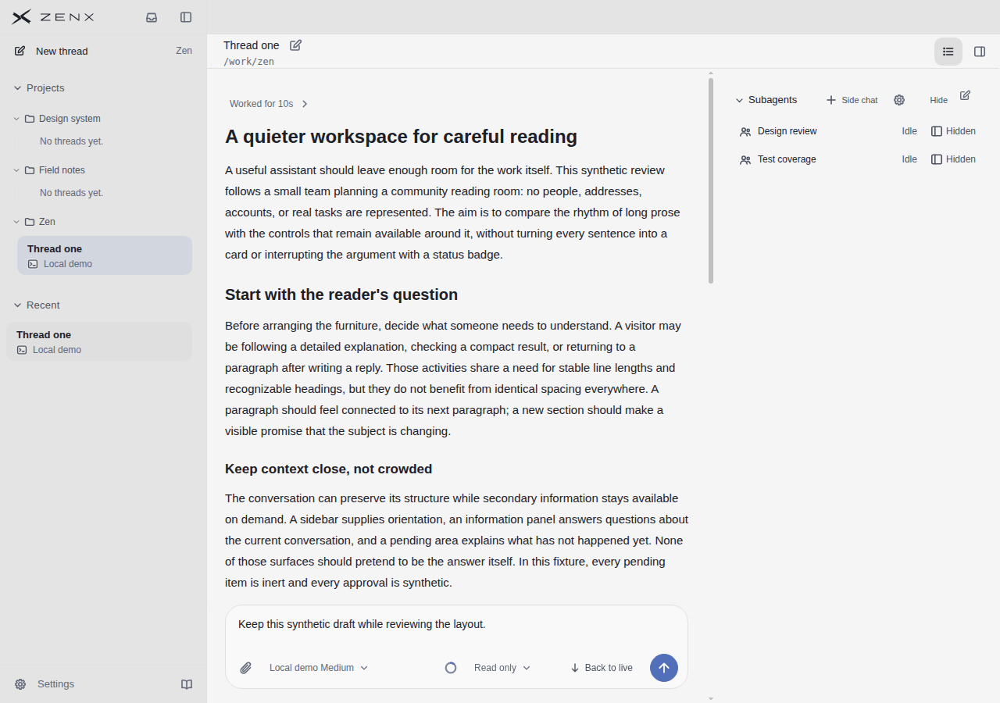
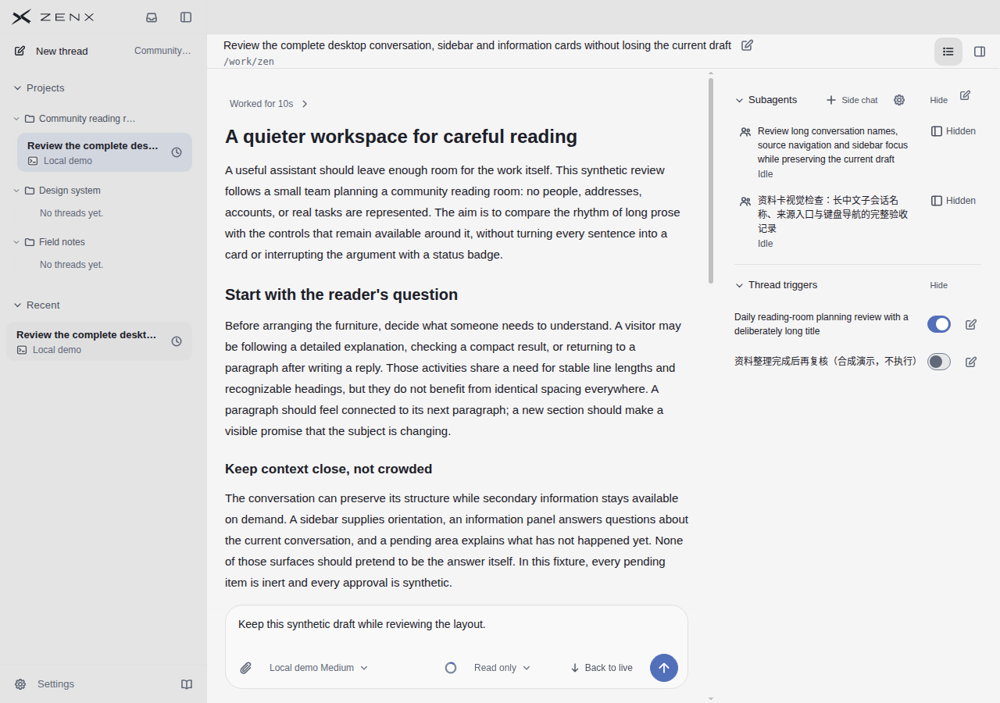
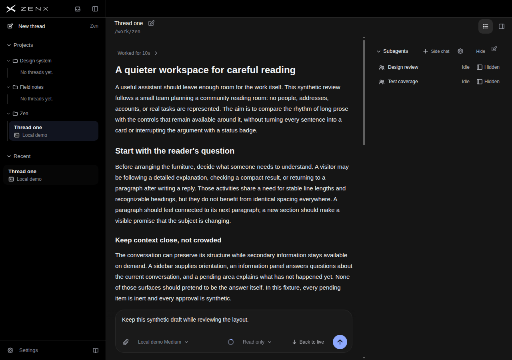
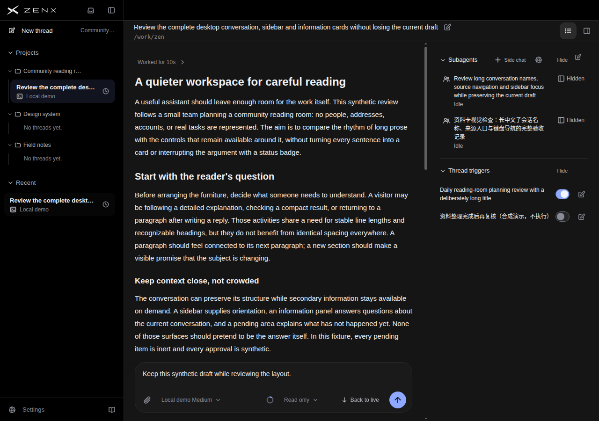

# Desktop information density: keep long names readable without a second row for every short name

Source **7f951c2a**, previous **761e27bd**, intermediate **c2b15cbb**. Production-component Chrome rendering with synthetic data, 1280×900; not native Electron or real Host acceptance.

The first inline candidate was not accepted uncritically. Anonymous review found its Idle text too close to the name. The revised candidate puts short-name status in a trailing aligned column with a minimum gap; a long name still receives the full column and its status wraps below. No status, title or visibility action is removed.

## Actual result and tradeoff

Short English rows recover approximately 54→36px baseline spacing. The second short row moves up approximately 18px. **Both light and dark long-name images are pixel-identical to 761e27bd**; the old long-name card's roughly 35px displacement relative to ea3 is not a new gain or new regression. Main conversation and left sidebar layout are unchanged. See [pixel bounds](pixel-comparison.json).

The reviewer, given anonymous A/B/C image sets without version order, code or target scores, preferred C for density-first use. Short-name hierarchy/readability recover the preceding two-line version's score; consistency remains 0.5 lower because status changes position with name length. No overall score increase or broad UI success is claimed.

Mapping: A=c2b15cbb (initial inline), B=761e27bd (always second status line), C=7f951c2a (revised trailing status). [Full initial blind report](BLIND-REVIEW-AB.md), [C follow-up report](BLIND-REVIEW-C.md), [mapping](blind-mapping.json), [source, timing, image hashes](receipt.json). The follow-up reviewer retained the original judgments; this is not a second independent reviewer.

| Scene, B→C                 | Hierarchy | Readability | Attention | Consistency | Discoverability |
| -------------------------- | --------: | ----------: | --------: | ----------: | --------------: |
| Light short English        |   8.5→8.5 |     8.5→8.5 |   8.5→8.5 |       8→7.5 |             7→7 |
| Dark short English         |   8.5→8.5 |         8→8 |   8.5→8.5 |       8→7.5 |         6.5→6.5 |
| Light long English/Chinese |       8→8 |     7.5→7.5 |       8→8 |         8→8 |             7→7 |
| Dark long English/Chinese  |       8→8 |         7→7 |       8→8 |         8→8 |         6.5→6.5 |

Subjective 0–10 scene scores, not an application-wide total, objective measurement, or conversion of earlier reviewers' scales.

## Current product originals

## References actually viewed in this review

| Reference                               | Hierarchy | Readability | Attention | Consistency | Discoverability |
| --------------------------------------- | --------: | ----------: | --------: | ----------: | --------------: |
| Codex official 20s frame                |       8.5 |         8.5 |       8.5 |         8.5 |               8 |
| Claude Code official demo               |         8 |           7 |       7.5 |           8 |               7 |
| T3 Code 6f13f36f                        |         8 |         7.5 |         8 |           8 |             6.5 |
| DeepSeek Harness fcc0ad4                |         8 |         7.5 |       7.5 |           8 |             7.5 |
| Linear, no original supplied this round |       N/O |         N/O |       N/O |         N/O |             N/O |

Unlike content, themes and viewports: not a product ranking or equivalent interaction test. Original sources and capture boundaries remain in adjacent reference directories. This round used the following existing originals, not unseen substitutes:

## Limits

Only short English and long English/Chinese names, all Idle, are pictured. **Short Chinese, mixed-length lists, other/long status labels, zoom, dense lists and native/Host behavior are not verified.** Right-aligned Idle and Hidden are now close to each other; they mean different things, and this requires attention in broader validation. No click, keyboard, screen-reader or contrast conformance claim is made. Three targeted CSS/markup tests and TSX syntax/format checks pass, but these are not browser interaction acceptance. Build 7.55 seconds, capture 50.05 seconds, no renderer errors or external requests recorded.
