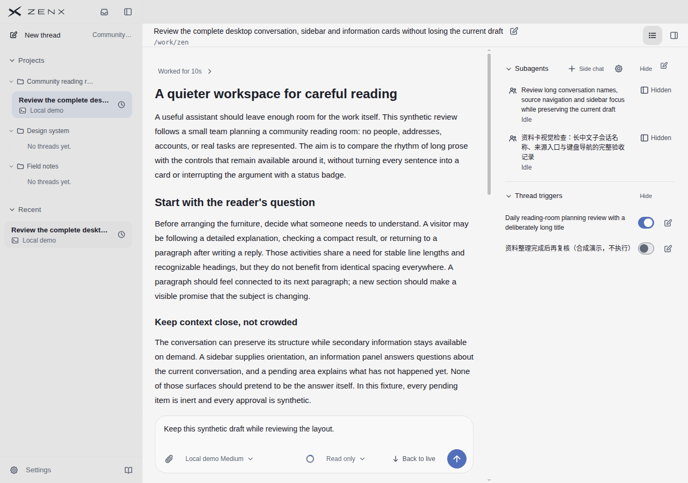
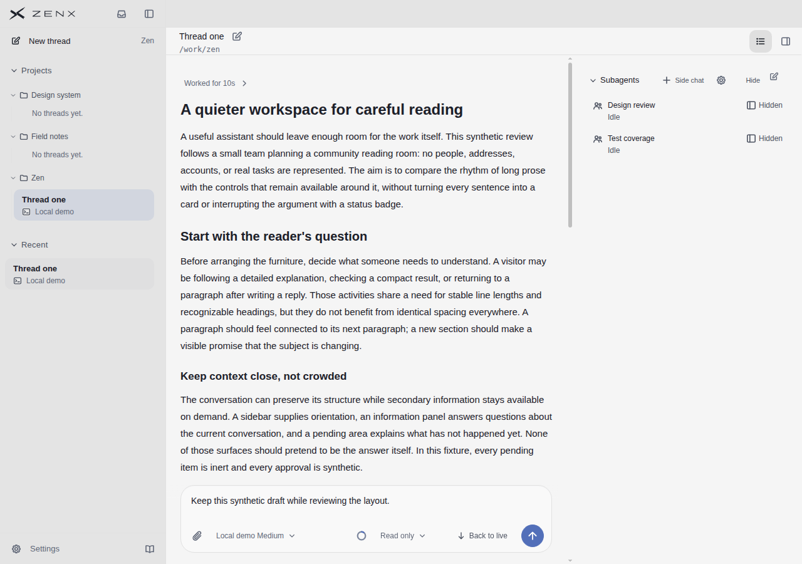
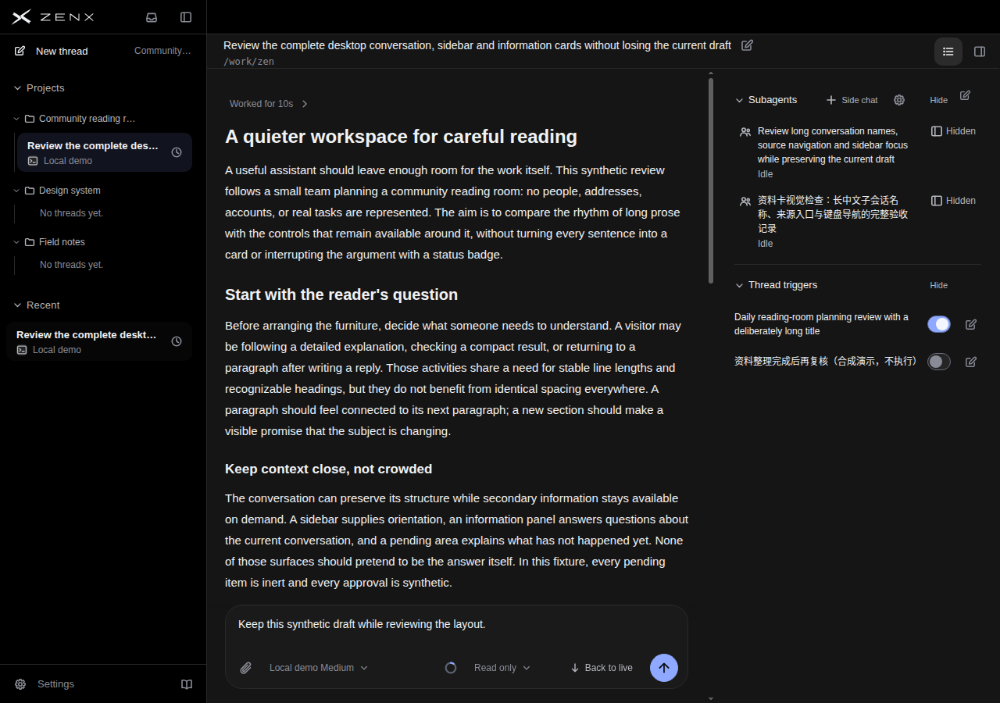
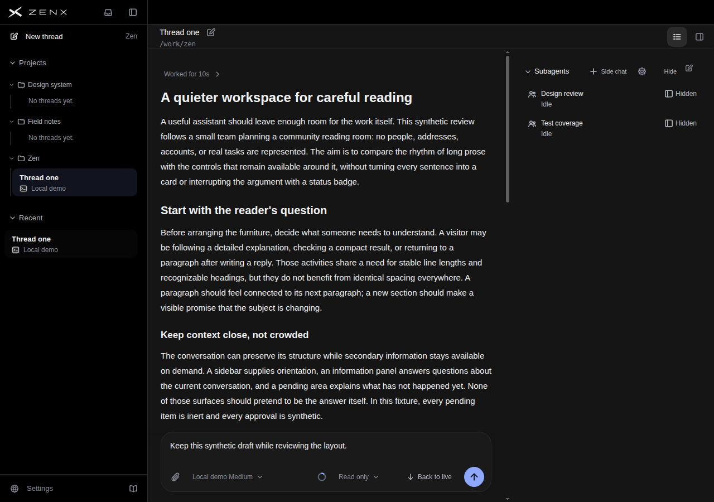

# Docked subagent identity layout: independent visual review

Reviewed the eight original 1280×900 product PNGs: `reading-desktop-{light,dark}-{supporting-rails-long,information-reading}.png`, before `ea3fcca6` and after `761e27bd`. This is a production-component Chromium render with synthetic data, not native Electron or real Host acceptance. The reviewer received no target score. This reviewer also inspected the candidate's code earlier, so this is an independent visual judgment, not a blinded experiment.

## Conclusion

The new title/status hierarchy is clearer in both themes, with a real density tradeoff. Keep it as a bounded improvement to the information card, not an improvement to the whole application or a claim of higher overall scores.

- **Long English title:** the visible title changes from four tight lines to three more comfortably spaced lines. The icon now aligns with the first line rather than the middle of the multiline block. `Idle` sits directly below the title and no longer takes a narrow competing column beside it.
- **Long Chinese title:** remains three lines in the pictured case, with more breathing room. The name remains complete. This is improved rhythm and hierarchy, not fewer lines for every language.
- **Short names:** both remain one title line, but now each has a second status line. `Idle` is easier to associate with its own name, while rows become visibly taller: roughly 36px to 54px between title baselines in this screenshot pair. Short lists lose density.
- **Overall card height:** the long-name Subagents section becomes taller; the separator and Thread triggers heading move down about 35px. Both trigger rows and their toggles/edit controls remain fully visible at this viewport. Do not claim that the change saves vertical space or increases visible card capacity.
- **Controls and canvas:** `Hidden` remains visible and top-aligned beside each title. No visible overlap or clipping occurs in these eight frames. The main conversation, composer and left sidebar show no apparent layout change. The information region still shares the main conversation canvas in both themes.

## Reference actually viewed

T3 Code `6f13f36f`, `main-conversation-dark(1).jpg`: its navigation separates primary identity from quieter metadata, while the conversation remains the visual focus. The new Zen grouping follows that hierarchy principle. This T3 image has no equivalent docked subagent list, different content and styling; it is not a controlled comparison, proof of matching behavior, or a basis for ranking the products. The initial qualitative pass assigned no scores; the subsequent scene-by-scene scoring pass is recorded below. No application-wide total is assigned.

## Remaining limits

Only these two paired scenarios and two themes were visually assessed. Many subagents, deeper nesting, archived/error/working labels, unusually long localized statuses, zoom, keyboard focus, hover/activation and visibility-switch behavior were not visually verified. Existing tests do not close those gaps. The extra row height may matter in denser information panels and should be checked before claiming general density success.

## Requested scene-by-scene scores (subsequent assessment)

The following scoring pass supplements the initial qualitative conclusion above. Scores are subjective 0–10 judgments of the **visible whole scene**, in 0.5-point steps, not measured quality, functional acceptance, or an application-wide total. Each row is a separate pictured state. Readability includes visible text and local density. No averaging or cross-product ranking is appropriate; untested behavior remains outside the discoverability score (visible cues only).

| Product scene                          | Hierarchy before → after | Readability before → after | Attention control before → after | Consistency before → after | Discoverability before → after |
| -------------------------------------- | -----------------------: | -------------------------: | -------------------------------: | -------------------------: | -----------------------------: |
| Zen light, long identities + two cards |                  7.5 → 8 |                    7.5 → 8 |                            8 → 8 |                      8 → 8 |                      7.5 → 7.5 |
| Zen dark, long identities + two cards  |                  7.5 → 8 |                    7.5 → 8 |                            8 → 8 |                      8 → 8 |                      7.5 → 7.5 |
| Zen light, short identities            |                    8 → 8 |                      8 → 8 |                            8 → 8 |                      8 → 8 |                      7.5 → 7.5 |
| Zen dark, short identities             |                    8 → 8 |                      8 → 8 |                            8 → 8 |                      8 → 8 |                      7.5 → 7.5 |

Before is `ea3fcca6`; after is `761e27bd`. The limited long-name gains reflect the formerly cramped title/status relationship, not a new benefit in the central transcript. Short names do not gain a score: their hierarchy is already clear before, and the new status grouping is offset by taller rows. Long-name cards also become taller despite fewer English title lines. No attention, consistency or discoverability increase is claimed. These are newly assessed scene scores, not a conversion or correction of other reviewers' historical scores.

### Every reference and every criterion

The four available original reference images were opened and visually inspected in this review. T3 was inspected with the original eight product images; Codex, Claude and DSH were then inspected for this scoring pass. Images are stored under `docs/ui-quality/references/` unless stated otherwise. Scores apply only to the listed image's visible application UI, excluding webpage chrome and presentation background.

| Reference / actual image                                                   | Hierarchy | Readability | Attention control | Consistency | Discoverability |
| -------------------------------------------------------------------------- | --------: | ----------: | ----------------: | ----------: | --------------: |
| Codex: `official-desktop-demos-20261111/proactive-20s.png`                 |         9 |           9 |                 9 |           9 |               8 |
| Claude Code: `claude-official-demo-20261111/product-demo-conversation.jpg` |         8 |           7 |               8.5 |         8.5 |               7 |
| T3 Code: `t3-runtime-6f13f36f/main-conversation-dark(1).jpg`               |         8 |         7.5 |                 8 |           8 |             7.5 |
| DeepSeek Harness: `deepseek-harness-production-fcc0ad4/subagents-dark.jpg` |         8 |           8 |                 8 |         8.5 |               8 |
| Linear: no inspectable original available in this checkout                 |       N/O |         N/O |               N/O |         N/O |             N/O |

- **Codex:** the clean selected-row fill, separated sidebar headings, readable prose and sparse tool controls guide attention well. Composer placeholders and secondary controls are faint; some icon meanings require familiarity. Official edited video frame at 20 seconds, not an interaction test. Source: https://learn.chatgpt.com/docs/app (provenance in the adjacent `sources.json`).
- **Claude Code:** calm section grouping and compact result/status surfaces give the conversation precedence. The supplied official demo is lower-resolution, with small pale labels, truncated sidebar titles and a prominent horizontal code scrollbar. These reduce readability and visible-cue confidence. Source: https://claude.com/product/claude-code; marketing demo, not an authenticated application capture. This score reflects the image as seen, not an assertion that the actual application's text is equally blurred.
- **T3 Code:** title-first sidebar grouping and subdued input chrome support reading; secondary text is small/dim and the patterned sidebar adds visual texture. The tiny icon actions are not self-explanatory. Runtime synthetic scene at `6f13f36f`; no matching docked subagent list is shown.
- **DeepSeek Harness:** the actual synthetic subagent popover presents readable primary names with subordinate identifiers, and the transcript remains distinct from tasks and composer. Several top-level menus/tabs, chips and muted text compete mildly with the main content; actions mostly have useful visible cues. Runtime screenshot at `fcc0ad4`; popover, not Zen's persistent information dock.
- **Linear:** searched available local originals for Linear images and reference records; no corresponding original was available to open in this checkout. Historical scores or reported observations are not substituted for a fresh inspection. N/O means not observed, not zero or inferior quality.

The sources differ in content, viewport, theme, rendering and capture quality. The rows **must not be sorted into a product league table** or used to infer equivalent interaction performance. None verifies native platform behavior, keyboard routes or accessibility conformance. For this task the useful shared principle is identity first and secondary metadata subordinate, not a mechanical goal of copying another product's numeric score.

## Inspectable original images

Before-state originals are available in the [ea3fcca6 quick-preview artifact](https://github.com/albert-zen/zen/actions/runs/43183615712). The after-state originals below are from run [43187869952](https://github.com/albert-zen/zen/actions/runs/43187869952), artifact 13928938079, and match receipt.json. Build 5.96 seconds; capture 46.2 seconds. No renderer errors or external requests were recorded.

